# Heads-Up Preflop Strategy (100bb, Button vs Big Blind)

A data-science look at heads-up no-limit hold'em preflop strategy. Stage 1 asks:
**if only all-in equity mattered, which hands should the Button raise, what size
should it open to, and what should the Big Blind 3-bet?**

## Quick start

```bash
python3 -m venv .venv && .venv/bin/pip install -r requirements.txt
.venv/bin/python -m pytest -q                 # equity engine vs known reference numbers
.venv/bin/python scripts/build_equity.py      # ~2 min -> data/ (already included)
.venv/bin/python scripts/solve.py             # ~10 s  -> output/ charts + CSVs
.venv/bin/python scripts/solve.py --open 3 --threebet 10   # try other sizes
```

## Layout

| Path | What it does |
|---|---|
| `preflop/cards.py` | 169 hand classes, 1,326 combos, 13x13 grid order |
| `preflop/equity.py` | eval7 Monte Carlo equity, equity vs random, 169x169 matrix with card removal |
| `preflop/solver.py` | BTN vs BB preflop game tree solved with CFR+ (with equity realization), EV, exploitability |
| `preflop/sizing.py` | Parallel open-size / 3-bet-size searches |
| `preflop/realization.py` | Per-hand playability bonuses (experiment 5) |
| `preflop/postflop.py` | Rule-based postflop simulator: pot-odds calling, balanced bluffing |
| `preflop/flopgame.py` | Learned flop c-bet / check-raise game (CFR+ per board texture x hand bucket) |
| `preflop/turngame.py` | Learned turn game after a c-bet is called (shared check/bet/raise tree + CFR+ loop) |
| `preflop/rivergame.py` | Learned river game after the BB check-calls the turn |
| `preflop/sizedgame.py` | Flop / turn / river with several bet sizes per street (experiment 13) |
| `scripts/solver_compare.py` | Runs TexasSolver on 12 flops and compares it with the model (experiment 14) |
| `preflop/fullgame.py` | Flop + turn + river learned together with Monte Carlo CFR, 12 hand buckets, configurable sizes (experiments 15–16) |
| `preflop/plots.py` | Range grids, heatmaps, bar and line charts |
| `bot/` | The match bot: `engine.py` (one decision for any 100bb spot), `selfplay.py` (heads-up dealer, duplicate matches), `ask.py` (command line) (experiment 29); `pokernow/` (game-log parser, local server, overlay) (experiment 31) |
| `scripts/` | One script per experiment (named in each section below) |
| `tests/` | Equity reference numbers, combo counts, postflop hand-strength rules, the bot engine and dealer |

## The model

```
BTN (SB, 0.5bb):  fold | raise to s          (never limp)
BB  (1bb):        fold | call | 3-bet to t    (t = 4s by default, 9bb vs 2.25)
BTN:              fold | call | all-in 100bb
BB:               fold | call
```

Any call goes straight to showdown and each player wins `pot x equity`.
That's the key simplification: no postflop betting, and position is worth nothing.
CFR+ finds the Nash equilibrium of this game. Exploitability is under 0.1 milli-bb
per hand, so the strategies are effectively exact *for this model*.

## Stage 1 results

| Open | BTN EV (bb/hand) | BTN raises | BB folds | BB calls | BB 3-bets |
|---|---|---|---|---|---|
| 2.0 | -0.119 | 68% | 0% | 79% | 21% |
| **2.25** | **-0.108** | **65%** | **0%** | **81%** | **19%** |
| 2.5 | -0.097 | 63% | 0% | 82% | 18% |
| 3.0 | -0.078 | 60% | 14% | 69% | 17% |
| 3.5 | -0.074 | 58% | 29% | 55% | 16% |
| 4.0 | -0.079 | 57% | 41% | 45% | 14% |

* **BTN at 2.25bb raises 65%** and folds weak offsuit hands and low unconnected
  suited hands (T2s, 9xs-and-below gappers, 87o, 76o...).
* **BB 3-bets ~19%**: pairs 22+, Ax down to A7o / A2s, KQ/KJ/KTs, plus suited
  connectors T9s/98s/87s. **BB never folds** to a 2.25bb open, because even 32o has
  about 32% equity and only needs 28% to call.
* **The equity-only model picks ~3.5bb as the best open, not 2.25bb.** Small opens
  give the BB a great price to see every flop, and nothing here punishes the BB
  for being out of position. Solvers that model postflop play favour 2–2.5bb, so
  the gap is a measure of how much postflop play and position matter. That is
  stage 2.

## Experiment 2: Big Blind defense vs a 2.25–2.50bb open

`scripts/bb_defense.py` (~6 min) solves every BTN open from 2.25 to 2.50bb in
0.05bb steps and tries every BB 3-bet size from 6 to 14bb (0.25bb steps), keeping
the one that earns the BB the most. It runs two models:

* **equity**: raw all-in equity, position is worth nothing.
* **position**: in pots that see a flop, the BTN realizes 110% of its equity and
  the BB 85% (`r_ip`, `r_oop` in `solve()`). These two numbers are illustrative
  assumptions, not measured.

| BTN open | Best 3-bet (equity) | Best 3-bet (position) | BB fold / call / 3-bet (position) |
|---|---|---|---|
| 2.25 | 8.0bb (3.6x) | 10.0bb (4.4x) | 5% / 77% / 18% |
| 2.30 | 8.0bb | 10.5bb | 6% / 76% / 18% |
| 2.35 | 8.25bb | 10.75bb | 9% / 73% / 18% |
| 2.40 | 8.5bb | 11.25bb | 10% / 73% / 17% |
| 2.45 | 8.5bb | 11.5bb | 10% / 73% / 17% |
| 2.50 | 8.75bb (3.5x) | 11.5bb (4.6x) | 13% / 70% / 17% |

* **The best 3-bet scales with the open: about 3.5x in the equity model and about 4.5x
  once the BB is penalized for being out of position.** Playing a bloated pot out of
  position is costly, so the BB 3-bets bigger to make the BTN fold more often
  (the BTN folds ~45% to the 3-bet at every size).
* **The EV curves are flat near the top.** Anything within about ±0.75bb of the
  best size costs under 1 milli-bb per hand (see `good_3bet_range_bb` in `summary.csv`).
* **The 3-bet range barely moves across 2.25–2.50.** It's a linear "value" range:
  pairs 55+, Ax suited down to A4s, offsuit aces down to A7o, broadway hands.
  What changes is the **fold** range. With the position penalty, the BB folds 5%
  vs 2.25bb and 13% vs 2.50bb: every 0.05bb on the open pushes the weakest
  offsuit hands (83o, 74o, 64o, 53o, 43o...) from call to fold.

Outputs in `output/bb_defense/`: `summary.csv`, `bb_ranges.csv` (every hand,
every size, both models), `ev_by_3bet_size.csv`, and range / EV charts.

## Experiment 3: Sweeping the BB's out-of-position penalty

Only the ratio `r_ip / r_oop` changes the results, so `scripts/realization_sweep.py`
fixes the BTN at 1.0 and sweeps the BB's `r_oop` from 0.75 to 1.0. Experiment 2's
1.10 / 0.85 "position model" is r_oop ≈ 0.77 on this scale.

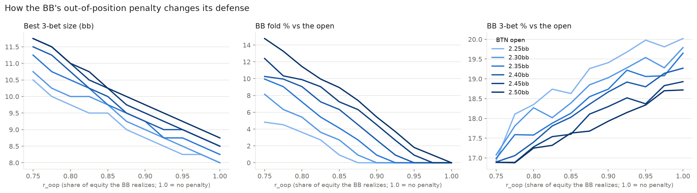

| r_oop | Best 3-bet vs 2.25 | BB fold vs 2.25 | Best 3-bet vs 2.50 | BB fold vs 2.50 |
|---|---|---|---|---|
| 1.00 | 8.0bb (3.6x) | 0% | 8.75bb (3.5x) | 0% |
| 0.90 | 8.75bb (3.9x) | 0% | 9.75bb (3.9x) | 5% |
| 0.80 | 9.75bb (4.3x) | 4% | 11.0bb (4.4x) | 11% |
| 0.75 | 10.5bb (4.7x) | 5% | 11.75bb (4.7x) | 15% |

* **The best 3-bet size grows almost linearly as the penalty grows**, from about 3.5x
  the open with no penalty to about 4.7x at r_oop 0.75.
* **Folding starts only once the penalty is real.** Against 2.25bb the BB keeps
  defending everything until r_oop drops below ~0.86. Against 2.50bb, folds start
  at ~0.97.
* **The 3-bet frequency falls slightly** (20% → 17%): a bigger size means a tighter range.
  The jagged lines come from the 0.25bb size grid.

## Experiment 4: The Button chooses its open size too

`scripts/sizing_game.py` lets the Button choose an open from 2.0 to 4.0bb, knowing the
BB will answer with its best 3-bet size (2.5x–6x the open). Each player uses one size
for every hand.

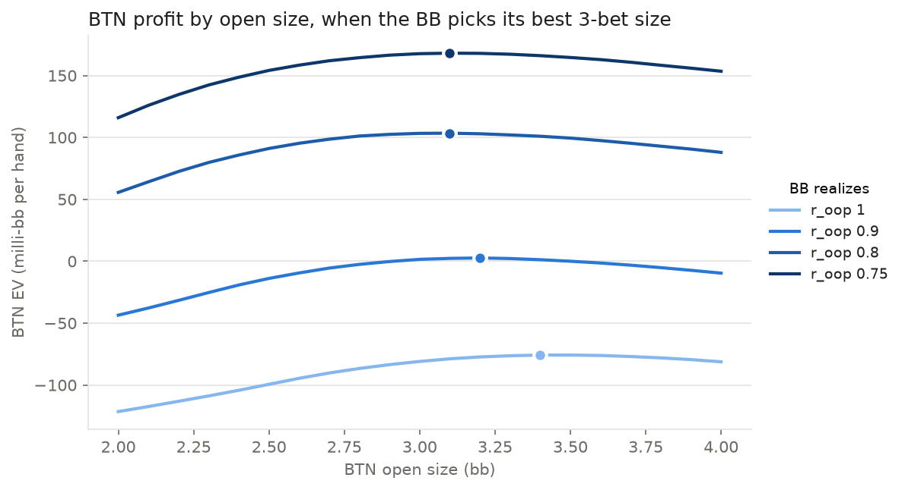

| r_oop | BTN best open | BB 3-bets to | BTN raises | BB fold / call / 3-bet | Cost of opening 2.2bb |
|---|---|---|---|---|---|
| 1.00 | 3.4bb | 11.9bb (3.5x) | 58% | 25% / 59% / 17% | 3.7bb/100 |
| 0.90 | 3.2bb | 12.4bb (3.9x) | 67% | 28% / 56% / 17% | 3.4bb/100 |
| 0.80 | 3.1bb | 14.3bb (4.6x) | 79% | 29% / 55% / 17% | 3.1bb/100 |
| 0.75 | 3.1bb | 15.5bb (5.0x) | 86% | 29% / 55% / 16% | 3.3bb/100 |

* **The Button's best open stays at 3.1–3.4bb whatever the penalty.** Penalizing the BB
  makes the Button profitable and lets it open far more hands (58% → 86%), but the best
  size only drops from 3.4 to 3.1bb.
* **So this model still can't produce 2.25bb opens.** Small opens are what solvers that
  play the full game recommend. The model is missing whatever makes small opens work:
  postflop betting, hand-by-hand realization (suited/connected hands realize more), and
  mixing sizes by hand.
* **The BB's answer to a bigger open is a bigger 3-bet**, reaching 5x the open at r_oop 0.75.

## Experiment 5: Hand-by-hand realization — where 2.25bb appears

`scripts/hand_realization.py` adds two kinds of per-hand realization on top of the
BB's position penalty (r_oop = 0.85), then reruns the open-size game (opens
1.75–3.5bb every 0.05bb, BB best-responds with its 3-bet size):

* **Playability (k):** suited, connected and broadway hands realize more
  (`preflop/realization.py`, hand-picked bonuses).
* **Strength (alpha):** the BTN's pot share becomes `E^a / (E^a + 0.85 (1-E)^a)`.
  With a > 1, strong hands realize more than their equity and weak hands less,
  because after the flop strong hands win bigger pots and weak hands fold. At a = 1.5,
  a 30%-equity hand realizes about 73% of its equity and a 60% hand about 108%.

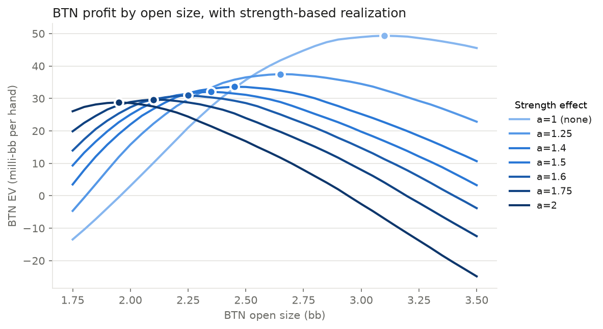

| Model | BTN best open | Opens within 1 mbb of best | Cost of 2.25 (bb/100) | BB 3-bet vs 2.25 |
|---|---|---|---|---|
| position only | 3.10bb | 2.95–3.25 | 2.84 | 9.6bb |
| playability k=2 | 3.25bb | 3.05–3.40 | 2.79 | 9.0bb |
| strength a=1.25 | 2.65bb | 2.50–2.80 | 0.78 | 7.9bb |
| strength a=1.4 | 2.45bb | 2.35–2.60 | 0.20 | 7.3bb |
| **strength a=1.5** | **2.35bb** | **2.25–2.50** | **0.06** | **7.3bb** |
| **strength a=1.6** | **2.25bb** | **2.15–2.35** | **0.00** | **6.75bb** |
| strength a=1.75 | 2.10bb | 2.00–2.25 | 0.09 | 6.75bb |
| strength a=2.0 | 1.95bb | 1.85–2.05 | 0.44 | 6.2bb |
| both a=1.5 k=2 | 2.40bb | 2.25–2.50 | 0.09 | 7.3bb |

* **Playability bonuses don't explain small opens.** They help both players' good
  hands, so they mostly cancel out, and the best open stays above 3bb.
* **The strength effect does.** At a ≈ 1.5–1.6, a 2.25bb open is the best size (or
  within 0.06bb/100 of it). The more postflop play rewards strong hands and punishes
  weak ones, the smaller the best open: a smoothly falling curve from 3.1bb to 1.95bb.
* **Why:** a small open gets called by many weak BB hands that will underperform
  after the flop. The BTN *wants* those calls, so it keeps the price low.
* At a = 1.5 vs a 2.25bb open, the BTN raises 71%. The BB folds 26%, calls 53%,
  and 3-bets 21% to ~7.3bb (about 3.25x), a smaller 3-bet than in the equity-only models.

Caveat: alpha is a single knob chosen to match a known answer, not fitted to
data. Calibrating it against real solver EVs is the next step.

## Experiment 6: Calibrating realization, then measuring it by simulation

### 6a. Calibration to published solver numbers (`scripts/calibrate.py`)

Targets for the BB vs a ~2.5bb open at 100bb, from the
[Preflop Wizard heads-up guide](https://www.preflopwizard.app/blog/poker-heads-up-strategy):
fold 30–35%, 3-bet 15–20%, 3-bet size 9–10bb. This is a weak source: an aggregate of
unnamed solver runs that include limping, which this model doesn't allow.

A grid search over α (1.0–2.0) and r_oop (0.70–1.00) finds **α = 1.4, r_oop = 0.75**
fits every target (fold 31%, 3-bet 21% to 9bb). α is well pinned down (1.3–1.5);
r_oop less so (0.70–0.80 all fit).

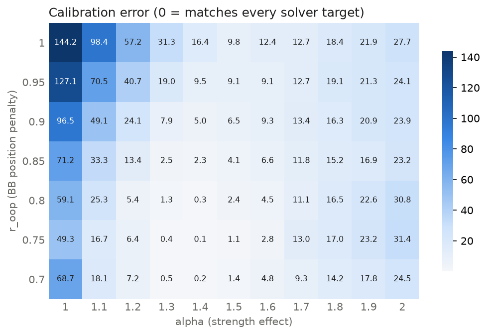

**Out-of-sample check:** the open size was not a target, yet the calibrated model's
best BTN open is **2.45bb** (2.35–2.6 within 1 milli-bb), inside the 2–2.5bb that
solvers use. Opening 2.25bb instead costs only 0.19bb/100.

### 6b. Measuring realization with simple postflop rules (`scripts/simulate_realization.py`)

`preflop/postflop.py` plays hands out from the flop. Both players follow the same rules:

| Strength (from the cards each player sees) | First to act / checked to | Facing a bet |
|---|---|---|
| **Strong**: two pair+ that improves the board, overpair, top pair with T+ kicker | bet 2/3 pot | call |
| **Medium**: any other pair using a hole card, or a flush draw / open-ended straight draw (not on the river) | check | call |
| **Weak**: everything else | bluff 1/3 of the time, else check | fold |

The BB acts first every street; one bet per street at most and no raises. Hands are dealt
from the model's BTN opening range vs BB calling range at a 2.25bb open, 1.4M hands
per round. Then α and r_oop are fitted to the results, the preflop game is re-solved
with them, and the loop repeats until they stop moving (2 rounds).

| | α | r_oop | BTN best open |
|---|---|---|---|
| Calibrated to solver numbers (6a) | 1.40 | 0.75 | 2.45bb |
| **Simulated from simple rules (6b)** | **1.36** | **0.80** | **2.45bb** (2.35–2.65) |

On average the BTN wins 63% of the flop pot with 55% equity.

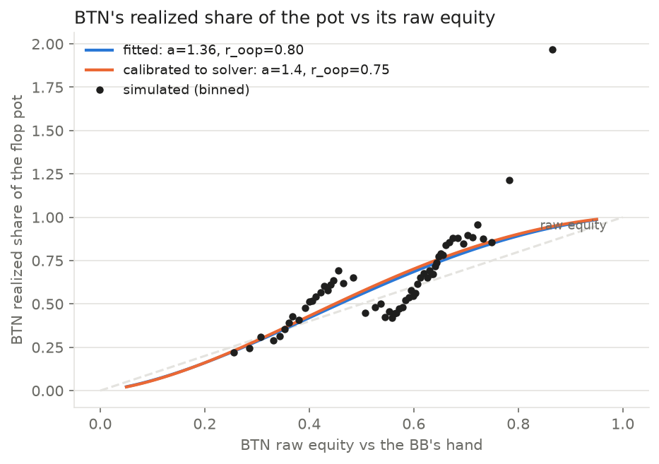

Per-hand realization (realized share ÷ raw equity):

* **BTN (in position):** big pairs realize the most (AA 2.7x, KK 2.3x, small pairs ~1.4x,
  because the rules pay them off with any pair). Suited connectors 1.3–1.4x.
  Offsuit weak aces and kings only 0.8–0.9x.
* **BB (out of position):** offsuit trash (A2o–A5o, K2o–K6o, Q2o–Q6o) realizes only
  ~0.6–0.7 of its equity; suited connectors and broadway offsuit ~1.0–1.2.

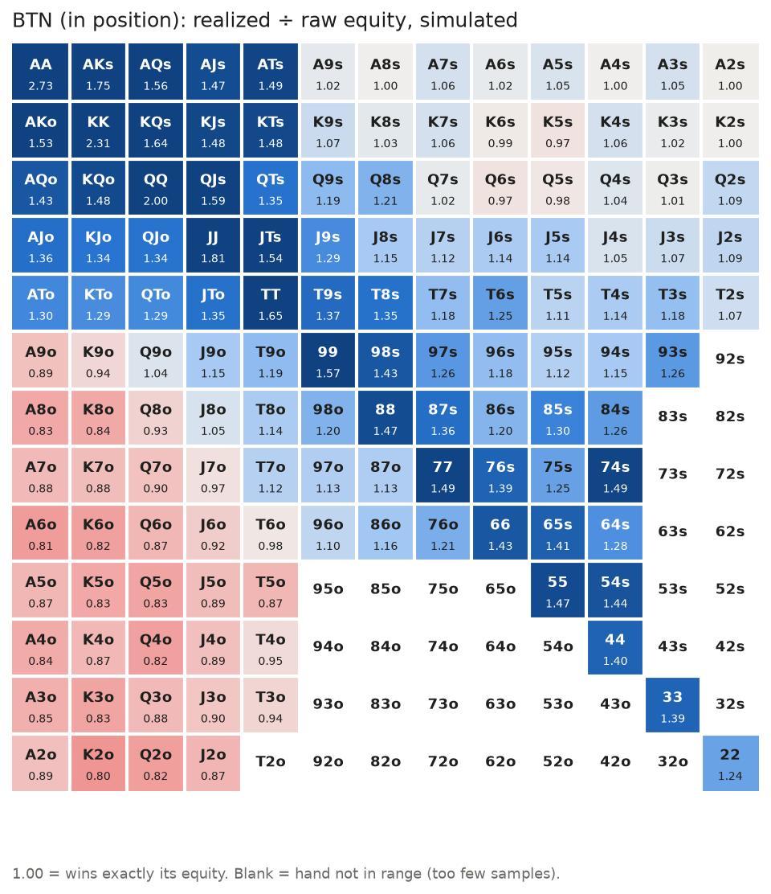
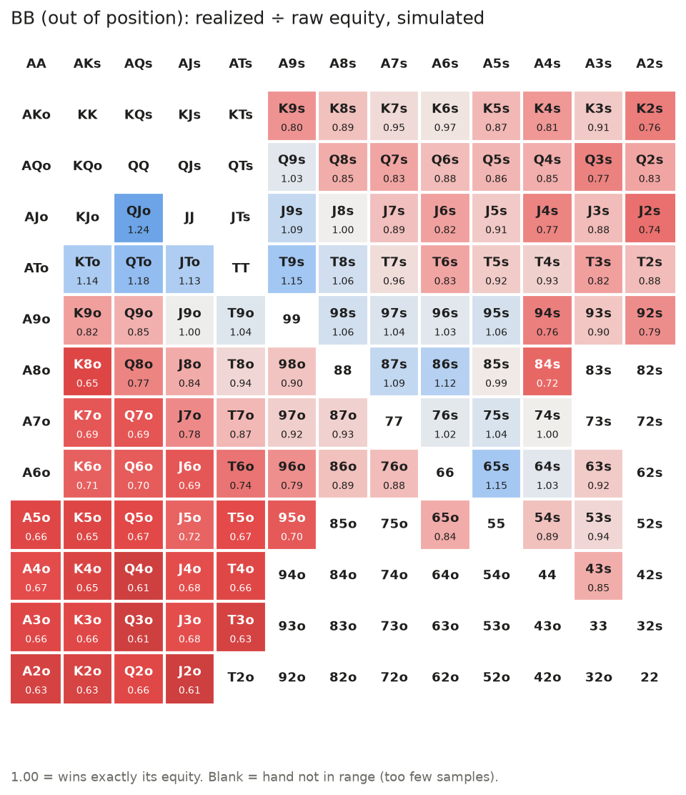

### 6c. How much do the rules matter? (`scripts/rule_sensitivity.py`)

| Rules | α | r_oop | BTN best open |
|---|---|---|---|
| baseline (bluff 1/3, bet 2/3 pot) | 1.35 | 0.78 | 2.50bb |
| never bluff | 1.70 | 0.95 | 2.25bb |
| bluff 2/3 of the time | 1.60 | 0.54 | 2.70bb |
| bet 1/2 pot | 1.05 | 0.89 | 3.10bb |
| bet full pot | 2.12 | 0.50* | 2.10bb |

\* hits the edge of the fit grid.

**Bet size is the biggest driver.** The rules call with any pair whatever the bet size,
so bigger bets just extract more from strong hands, making α larger and the best open
smaller. That the 2/3-pot baseline matches the solver calibration is encouraging,
but partly luck of the rule choice. The obvious next step is calling based on pot odds.

### 6d. Pot-odds calling and balanced bluffing

The 6b rules had two flaws: medium hands called any bet regardless of price, and
bettors bluffed a fixed 1/3 of their weak hands. `preflop/postflop.py` now defaults to:

* **Pot-odds calling:** facing a bet, call if your chance of beating the *bettor* is at least
  `bet / (pot + 2·bet)` (28.6% vs 2/3 pot). Strong hands always call. The chance comes from a
  learned table: hand strength (equity vs a random hand on this board, eval7 Monte Carlo)
  → how often hands that strong actually beat a bettor on that street. Example: on the river,
  a hand that beats 70% of random hands beats a bettor only ~30% of the time.
* **Balanced bluffing:** in each spot (BB leading / BTN after a check, by street), weak hands bluff
  just often enough that bluffs are `bet / (pot + 2·bet)` of all bets, the mix that leaves a
  caller indifferent. Learned rates are 4–9% of weak hands on the flop and 16–18% on the river.

Both are learned from two warm-up batches before the main batch.
(Pot-odds calling with the old fixed 1/3 bluffing ran away to α ≈ 2.9: callers adapt but
bettors don't, and the BTN gets more bluffing spots.)

| Rules | α | r_oop | BTN realizes / equity | BTN best open |
|---|---|---|---|---|
| **pot odds + balanced, 2/3 pot** | **1.25** | **0.92** | 62% / 58% | **2.75bb** (2.6–2.85) |
| pot odds + balanced, 1/2 pot | 1.13 | 0.93 | 61% / 58% | 3.00bb |
| pot odds + balanced, full pot | 1.66 | 0.88 | 67% / 58% | 2.25bb |
| pot odds + fixed bluff 1/3 | 2.91 | 0.69 | 80% / 58% | 1.75bb |
| old rules (call any pair, bluff 1/3) | 1.45 | 0.85 | 67% / 58% | 2.40bb |

Smarter rules give a smaller α (1.25) and a less extreme position penalty, so the best
open moves up to ~2.75bb, and 2.25bb costs 1.0bb/100. Bet size still matters, but less
(open 2.25–3.0bb across 1/2–full pot, vs 2.1–3.1bb with the old rules).

## Experiment 7: The Big Blind vs different raise sizes, preflop and postflop

`scripts/bb_study.py`. For each BTN open (2.0–3.5bb), realization is re-measured *at that
size* (solve → simulate with pot-odds / balanced rules → refit, 2 rounds), then the BB's
preflop and postflop play is summarized. α stays 1.26–1.36 at every size, so in this
range the open size barely changes how well hands realize.

### Preflop

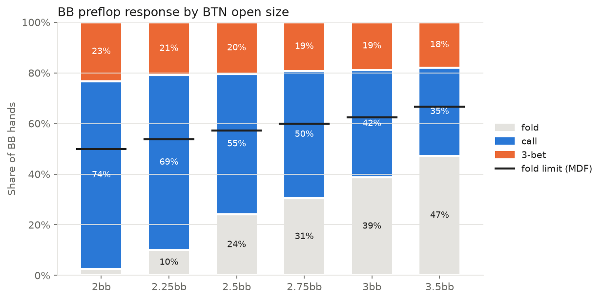

| BTN open | BB fold | call | 3-bet (to) | Fold limit (1 − MDF) |
|---|---|---|---|---|
| 2.0 | 2% | 74% | 23% (6.5bb) | 50% |
| 2.25 | 10% | 69% | 21% (7.3bb) | 54% |
| 2.5 | 24% | 55% | 20% (8.1bb) | 57% |
| 2.75 | 31% | 50% | 19% (9.6bb) | 60% |
| 3.0 | 39% | 42% | 19% (9.75bb) | 63% |
| 3.5 | 47% | 35% | 18% (11.4bb) | 67% |

* **Raise size mostly changes the BB's folds, not its 3-bets.** Each +0.25bb on the open moves
  ~5–10% of hands from call to fold, while the 3-bet share drifts only from 23% to 18%.
* **The best 3-bet stays ~3.25x the open** at every size.
* **The BB always defends more than MDF requires** (MDF = 1.5 / (open + 1): the BTN risks
  open − 0.5 to win 1.5). Calling has real value because the BB's hand still realizes ~90%
  of its equity out of position.
* Vs 2.25bb the BB folds only 11 hands (72o, 93o, 83o-style trash). Vs 3.0bb it folds most
  weak offsuit hands and low suited gappers (T2s–T4s, 92s–95s, 82s–85s, 72s–74s, 62s–64s, 52s–54s).

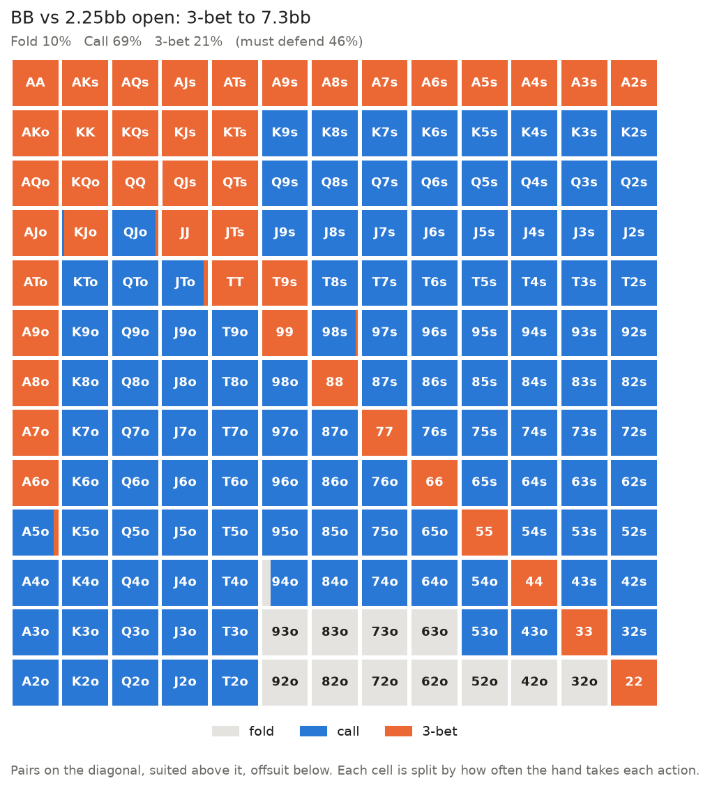

### Postflop (BB-called pots, simulated)

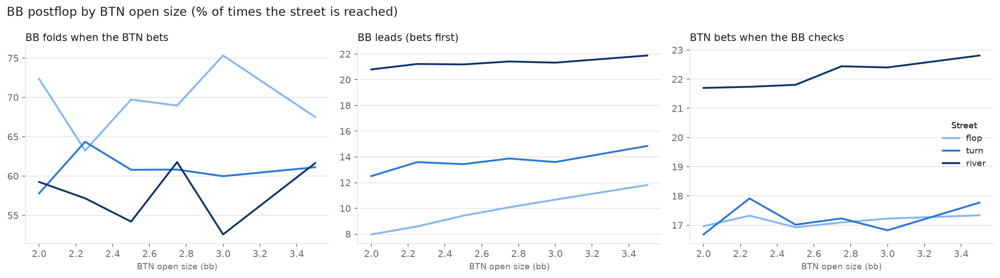
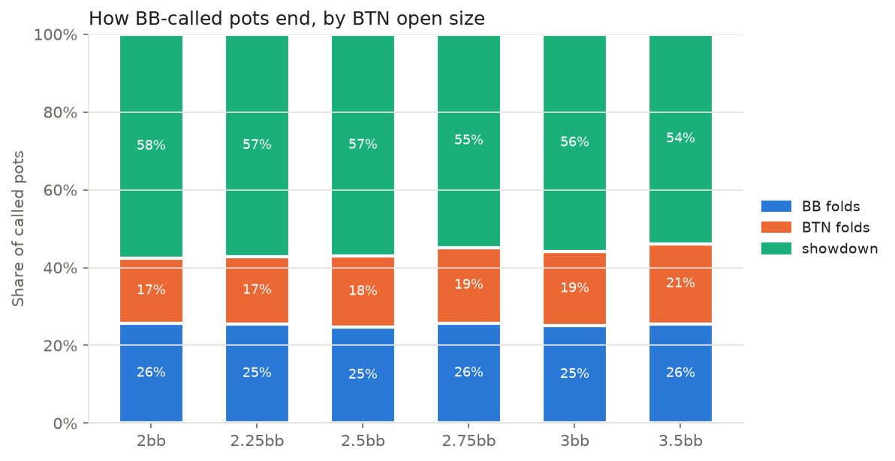

* **The BB realizes ~90% of its equity** (0.89–0.91) at every open size.
* **Called pots end the same way regardless of open size:** BB folds ~25%, BTN folds 17–21%,
  showdown 54–58%.
* **The BB leads more as the open grows** (flop leads 8% → 12%). Its calling range is tighter and
  stronger, so it flops more strong hands. River leads are steady at ~21%.
* **The BB folds 55–75% when the BTN bets.** That's correct against these rules: a balanced
  BTN betting range is ~71% value, so folding weak hands is right. Real players c-bet much
  more widely, so the BB should fold less.
* **BB bluffs work 54–61% of the time** (more often vs bigger opens).
* **Calling beats folding by +0.44 to +0.56bb per called hand.** The BB loses ~0.5bb on
  average postflop, but folding loses 1bb.

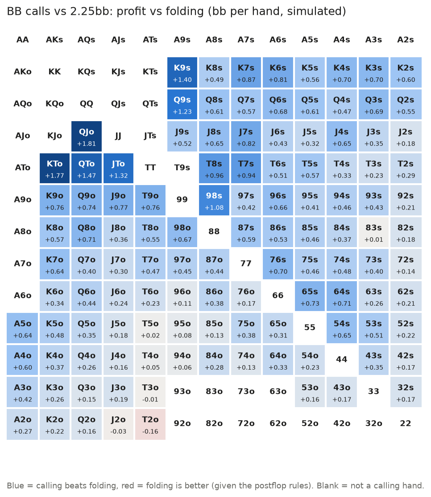

Per hand (vs 2.25bb): **broadway offsuit hands are the most profitable calls** (QJo +1.8, KTo +1.8,
QTo +1.5) along with high suited hands (K9s +1.4, Q9s +1.2). Weak offsuit hands barely break
even (T5o +0.02, T3o −0.01, J2o −0.03, T2o −0.16): those are the next folds as the open grows.
Vs 3.0bb the worst calls (Q2o −0.21, J5o −0.08, K2o −0.03) are already losing.

## Experiment 8: If the BB always checks, what does the Button c-bet, and when should the BB check-raise?

`scripts/cbet_study.py` + `preflop/flopgame.py`. BTN opens 2.25bb, BB calls (ranges from the
preflop solver). On the flop:

```
BB:  always checks
BTN: check | c-bet 1/3 pot
BB:  fold | call | check-raise to 3x the c-bet
BTN: fold | call                      (after a check-raise)
```

Turn and river use the pot-odds / balanced rules. **No flop decision is hand-written.** Each is
learned per (board texture, hand bucket) with CFR+ and Monte Carlo rollouts: every hand's flop
lines are all played to the end, the value of each option is averaged per texture × bucket, and
options that would have done better get played more next round (60 rounds, then 800k hands).

* **Hand buckets:** two pair+, overpair, top pair T+ kicker, top pair weak kicker, weaker pair,
  draw (flush draw / open-ender), two overcards, air.
* **Board texture:** high card (A / K / Q-J / T-or-lower) × paired × suits (rainbow / two-tone /
  monotone) × connected (three ranks within a 5-card span).

### Overall

| BTN c-bets | BB folds / calls / check-raises vs a c-bet | BTN calls a check-raise |
|---|---|---|
| 58% of flops | 32% / 50% / 18% | 80% |

### The Button's c-bet range

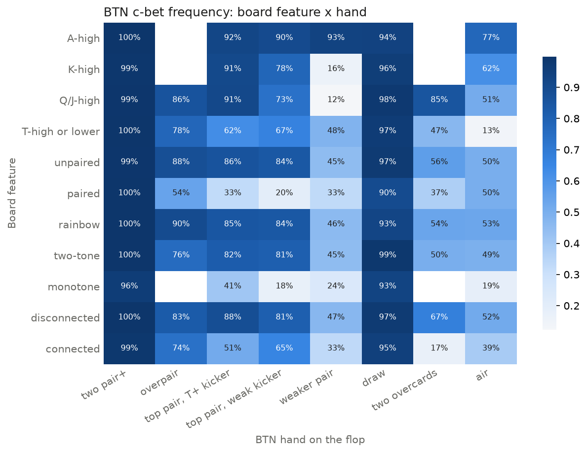

* **Value and draws always bet:** two pair+ 99%, draws 96%, overpairs 80%, top pair 78–81%.
* **Weak pairs mostly check** (44%), keeping the pot small with showdown value.
* **Air bets half the time overall, but it depends on the board.** 77% on A-high flops, 62% K-high,
  51% Q/J-high, only 13% on T-high-or-lower. High boards favor the BTN's range (it has more
  big cards after raising preflop); low, connected boards favor the BB's wider calling range.
* **By texture:** c-bets 85% on A-high flops vs 43% on T-high-or-lower; 46% on connected
  boards and 44% on monotone boards vs ~60% elsewhere.

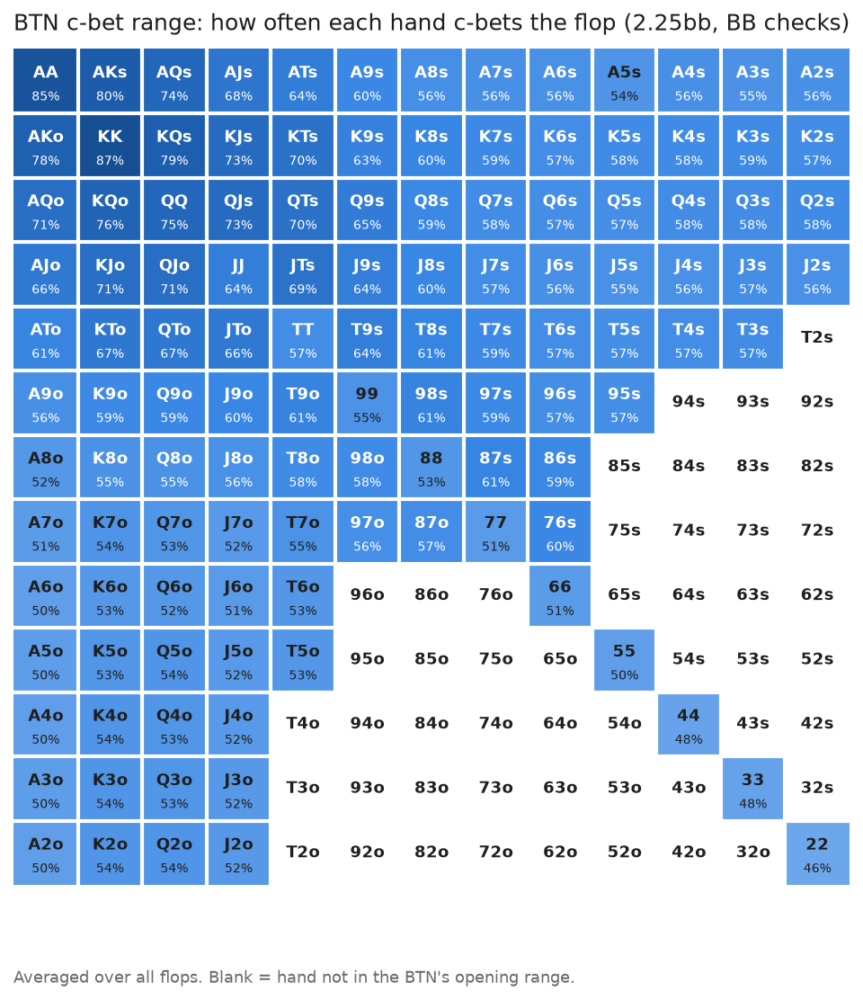

### When should the BB check-raise?

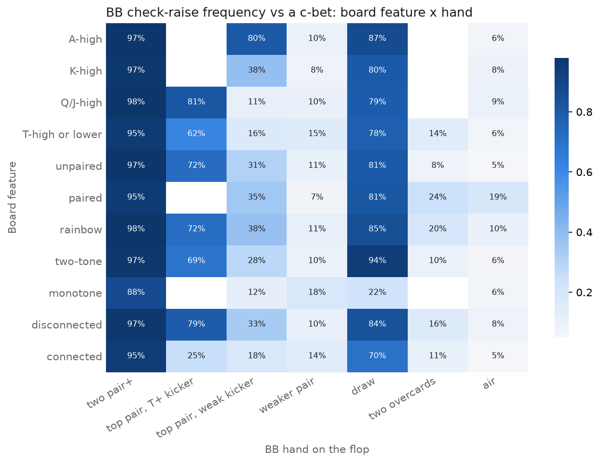

* **By hand:** two pair+ 97% (value), draws 81% (semi-bluff), top pair T+ kicker 67%, top pair
  weak kicker 31%. Weaker pairs and overcards mostly *call* (86% / 80%). Air folds 51% and
  check-raises as a bluff 7%.
* **By board, the BB check-raises most on boards that favor it:**
  * paired boards 27% vs 17% unpaired
  * T-high-or-lower 22% vs A-high 15%
  * top textures: paired low/middle boards and low connected boards (26–31%)
* **It check-raises least on A-high boards** (12–14%), where the BTN's range is strongest.
* **Texture changes which hands raise:**
  * top pair T+ kicker raises 80% on disconnected boards but only 22% on connected ones
    (too many better hands and draws around)
  * draws raise 94% on two-tone boards but only 20% on monotone ones (a flush draw on a
    monotone board is weaker)
  * air bluff-raises more on paired boards (18% vs 5%)

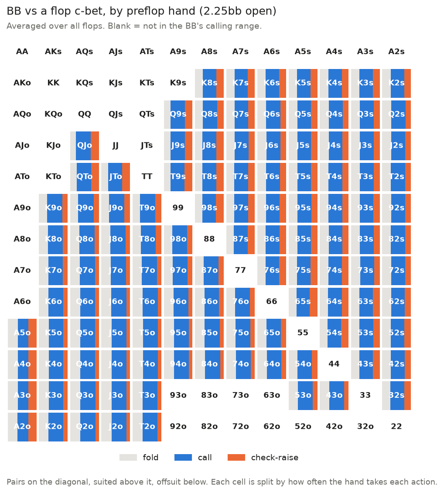

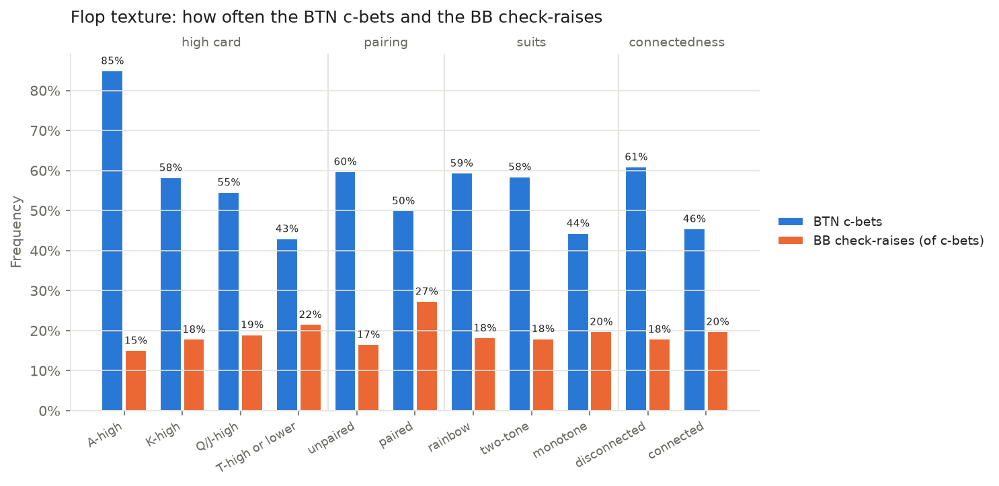

## Experiment 9: The BB study with a Button that bets more

`python scripts/bb_study.py cbet` reruns experiment 7 with the learned flop from experiment 8:
the BB checks the flop, and the BTN's c-bets and the BB's fold / call / check-raise are
learned at every open size (~18 min on an idle machine; each size is saved as it finishes).

### Preflop

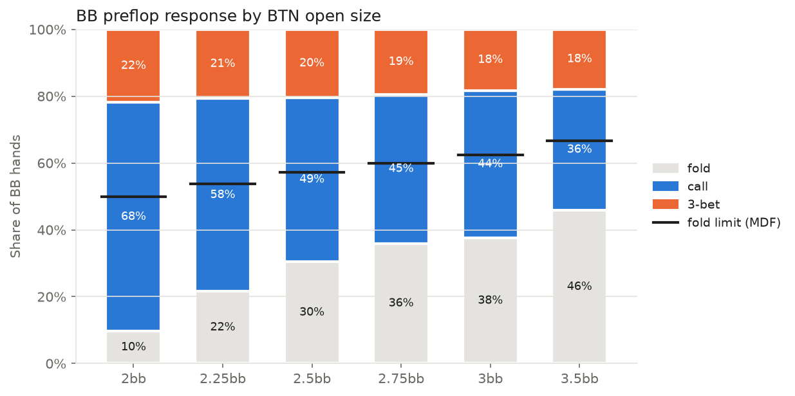

| BTN open | BB fold / call / 3-bet (BTN bets more) | rules-only BTN (exp. 7) | 3-bet to | BB realization (exp. 7) |
|---|---|---|---|---|
| 2.0 | 10% / 68% / 22% | 2% / 74% / 23% | 7.0bb (3.5x) | 0.82 (0.89) |
| 2.25 | 22% / 58% / 21% | 10% / 69% / 21% | 7.9bb (3.5x) | 0.83 (0.90) |
| 2.5 | 31% / 49% / 20% | 24% / 55% / 20% | 8.75bb (3.5x) | 0.83 (0.90) |
| 2.75 | 36% / 45% / 20% | 31% / 50% / 19% | 10.3bb (3.75x) | 0.83 (0.90) |
| 3.0 | 38% / 44% / 18% | 39% / 42% / 19% | 11.25bb (3.75x) | 0.84 (0.90) |
| 3.5 | 46% / 36% / 18% | 47% / 35% / 18% | 13.1bb (3.75x) | 0.85 (0.91) |

* **A Button that c-bets often cuts the BB's realization from ~0.90 to ~0.83** (α ≈ 1.35, r_oop 0.74–0.81).
* **The BB should fold more vs small opens:** +8 to +12 percentage points at 2.0–2.25bb. The gap
  closes by 3.0bb, where the BB's calling range is already tight.
* **The BB 3-bets bigger:** ~3.5–3.75x the open instead of ~3.25x. Taking the pot preflop is
  worth more when calling means facing frequent c-bets out of position.
* **The 3-bet share is unchanged** (22% → 18% as the open grows), and the BB still defends
  more than MDF at every size.
* **Calling still beats folding** by +0.43 to +0.49bb per called hand.

### Postflop

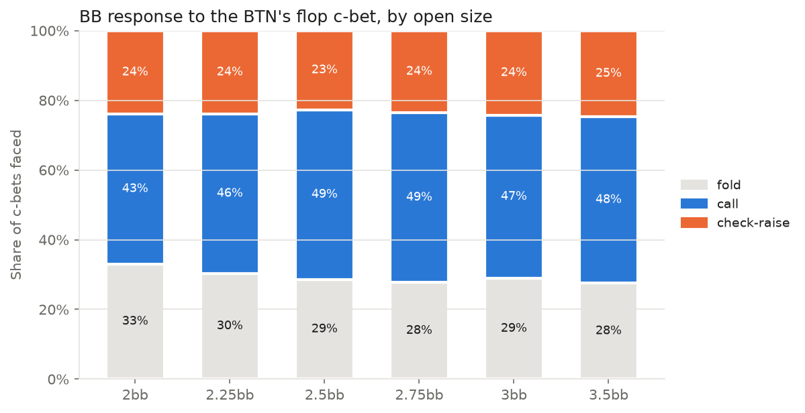

| BTN open | BTN c-bets | BB fold / call / check-raise vs c-bet | BTN calls a check-raise |
|---|---|---|---|
| 2.0 | 54% | 33% / 43% / 24% | 83% |
| 2.25 | 53% | 30% / 46% / 24% | 82% |
| 2.5 | 50% | 29% / 49% / 23% | 84% |
| 2.75 | 48% | 28% / 49% / 24% | 81% |
| 3.0 | 46% | 29% / 47% / 24% | 81% |
| 3.5 | 44% | 28% / 48% / 25% | 82% |

* **The bigger the open, the less the BTN c-bets** (54% → 44%). The BB's calling range gets
  tighter and stronger, so fewer flops favor the BTN.
* **The BB's answer to a c-bet barely depends on the open:** fold ~28–33%, check-raise ~24%.
  It folds slightly less vs bigger opens, because its range is stronger.
* **Called pots:** BB folds ~28–33%, BTN folds ~17%, showdown ~51–54%. That's more BB folds and
  fewer showdowns than with the rules-only BTN.

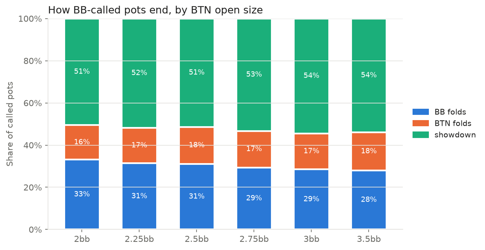

## Experiment 10: A Button that c-bets 75% on its boards and 50% on the BB's

`scripts/cbet_frequency_test.py`, 2.25bb open.

**Which boards favor whom:** for each flop texture, the BTN's average equity vs the BB's calling
range (measured from the simulated showdowns). The BTN averages 58%; textures above that
favor the BTN (46% of flops). A-high and K-high boards favor the BTN (61–64%). T-high-or-lower
unpaired boards favor the BB (52–55%), especially connected ones.

**The fixed strategy:** c-bet exactly 75% on BTN boards and 50% on BB boards, filling the frequency
in priority order: two pair+, overpair, top pair, then draws, then air (bluffs), then two
overcards, with weak pairs checking last. The BB (and the BTN's answer to a check-raise) learn
their best response.

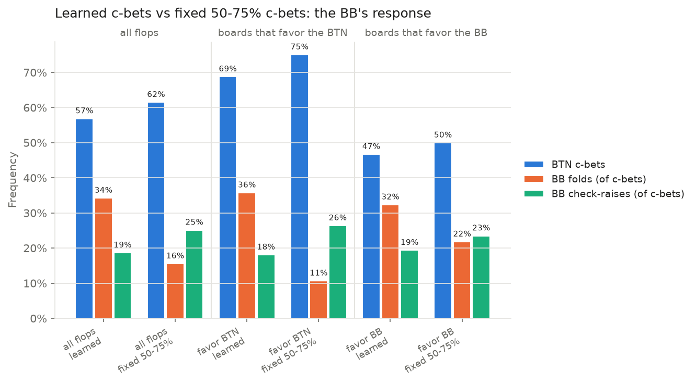

| | BTN c-bets | BB fold / call / check-raise vs c-bet | BTN EV from the flop (bb/hand) |
|---|---|---|---|
| learned c-bets | 57% (69% BTN boards, 47% BB boards) | 34% / 47% / 19% | 0.705 |
| fixed 50–75% | 62% (75% / 50%) | 16% / 59% / 25% | 0.643 |

* **The learned BTN already c-bets ~69% / 47% by board.** The 50–75% rule gets the frequencies
  roughly right.
* **It still loses 0.06bb per flop, because of *which* hands bet.** The rule always bets top pair
  and draws, bluffs 78% of its air, and checks nearly all weak pairs and overcards. That betting
  range is polarized and bluff-heavy, so the BB stops folding: it **calls air 62% of the time**
  (36% vs the learned BTN), folds only 16% overall, and check-raises more (25%), especially
  with weak top pairs (44% vs 31%).
* **Lesson:** a good c-bet frequency is not enough. The hands inside it have to be balanced. The
  learned BTN mixes in some weak pairs and overcards and checks back some air.

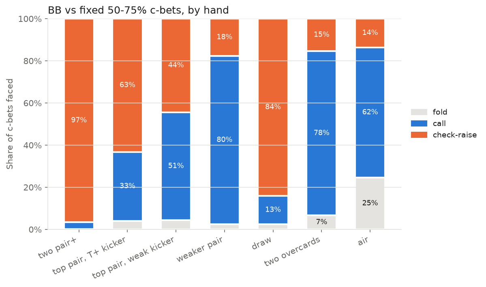

## Experiment 11: The BB called the c-bet. What now on the turn?

`scripts/turn_study.py` + `preflop/turngame.py`. After a flop c-bet and BB call, the turn is a
learned game:

```
BB:  check | lead 2/3 pot
 after a check:  BTN check | bet 2/3 pot  ->  BB fold | call | check-raise 3x  ->  BTN fold | call
 after a lead:   BTN fold | call | raise 3x  ->  BB fold | call
```

* **Inputs:** hands are weighted by how likely the flop c-bet and call were under each flop
  strategy from experiment 10. The river uses the rules.
* **Turn texture:** what the turn card did (blank / overcard / pairs the board / flush card /
  straight card) × dry or wet flop.
* **Learning:** decisions are learned with CFR+ per texture × hand bucket (40 rounds, then
  800k hands), with fixed seeds, so reruns give identical numbers.

What the BB holds on the turn after calling a learned c-bet: weaker pairs 42%, air 35% (floats
that missed), two pair+ 7%, top pair 8%, draws 7%.

### The BB's turn strategy (after learned flop c-bets)

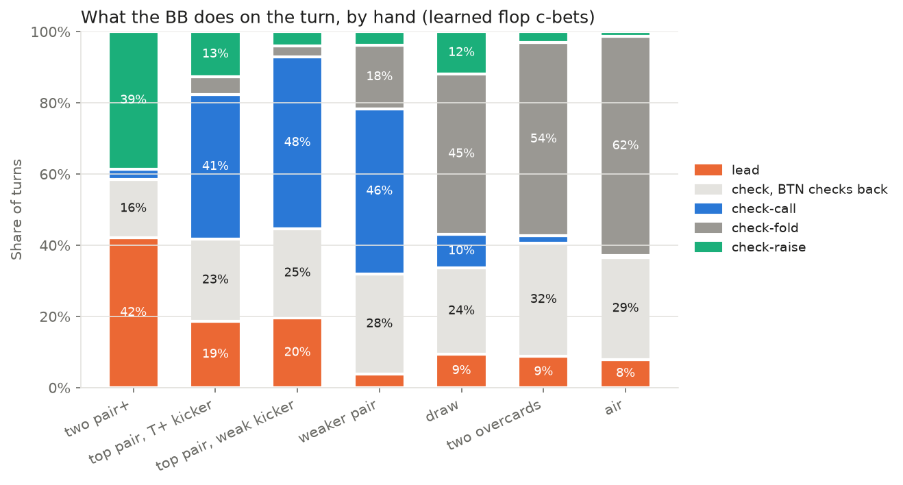

| BB hand | Leads | vs a BTN bet: fold / call / check-raise |
|---|---|---|
| two pair+ | 42% | 0% / 7% / 93% |
| top pair, T+ kicker | 19% | 8% / 70% / 22% |
| top pair, weak kicker | 20% | 6% / 87% / 7% |
| weaker pair | 4% | 26% / 68% / 6% |
| draw | 9% | 68% / 14% / 18% |
| two overcards | 9% | 91% / 3% / 5% |
| air | 8% | 97% / 1% / 2% |

* **Mostly check.** The BB leads only 9% of turns; the BTN bets 70% when checked to.
* **Strong hands:** two pair+ splits between leading (42%) and check-raising (93% of the times
  it checks and faces a bet).
* **Pairs check-call.** Top pair calls 70–87%, weaker pairs 68%.
* **Draws mostly fold to a 2/3-pot bet (68%).** One card to come gives ~18–20% equity vs the
  28.6% needed, and the river rules pay off little extra, so there are few implied odds.
  Some draws check-raise as semi-bluffs (18%).
* **Air and overcards give up** (91–97% fold); air bluff-leads 8%.

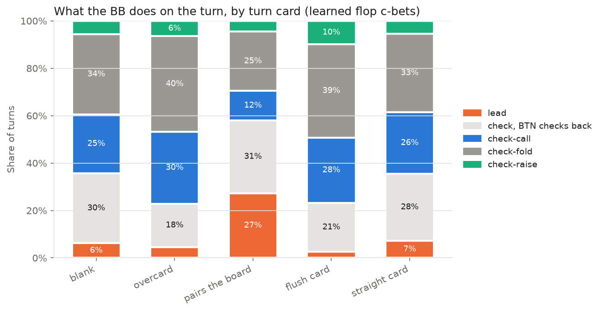

**By turn card:**

* **Board pairs: the BB leads 27%** (vs 3–7% on other turns): two pair+ leads 71% and weak top
  pairs 79%. Turns that pair the board help the BB's range, which is full of middling pairs.
  The BTN bets less (58%), and the BB folds more when it does bet (60%).
* **Flush-completing turns:** the BB almost never leads (3%) but check-raises the most (13%).
  Draws fold 78% (their remaining draw is usually weaker once three suited cards are out), and
  weaker pairs fold more (36%).
* **Overcard turns:** the BTN bets the most (81%), since overcards hit its preflop-raising range;
  the BB leads only 5%.
* **Blank and straight-completing turns sit in between.** Straight cards give the BB's draws the
  most check-raises (22%).
* **Dry vs wet flop:** on dry flops draws fold far less (23% vs 76%) and check-raise 49%. The few
  draws there are usually strong (open-enders with overcards).

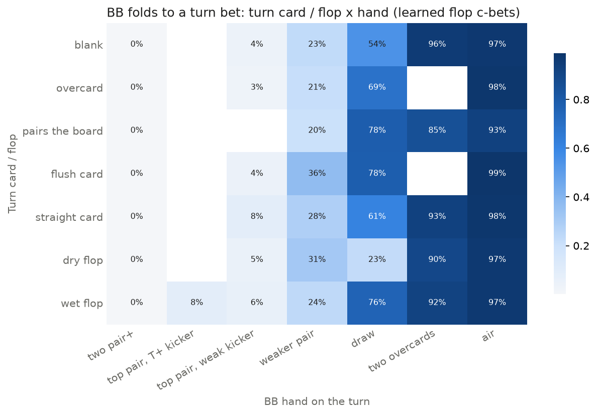

### After the fixed 50–75% flop c-bets

The BB arrives on the turn with more air (47% of hands, from floating the bluff-heavy c-bets)
and its turn strategy shifts:

* **Weaker pairs and draws defend more vs a turn bet:** pairs fold 14% (vs 26%); draws fold 37%
  (vs 68%) and call 45%. The BTN's turn betting range is weaker, carrying air from the flop.
* **More check-raises with top pair** (31% / 18% for strong / weak kicker, vs 22% / 7%) and on
  board-pairing turns (18% vs 11%).
* **Fewer leads on board-pairing turns** (14% vs 27%).

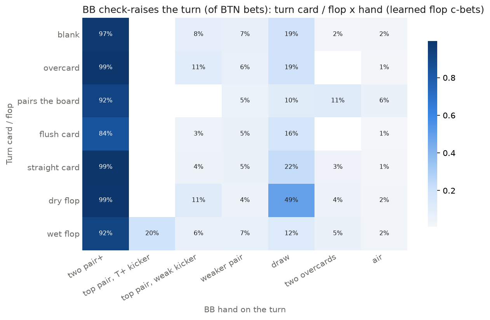

## Experiment 12: The BB called the turn too. What now on the river?

`scripts/river_study.py` + `preflop/rivergame.py`. The line: BTN c-bets the flop, BB calls; BB checks
the turn, BTN bets 2/3 pot, BB calls. The river uses the same learned tree as the turn (check / lead,
bet, fold / call / check-raise, raises; 2/3-pot bets, 3x raises).

* **Exact values:** every river line ends in a fold or a showdown, so each hand's values are exact.
* **Weighting:** hands are weighted by how likely they reach this river under the learned flop *and*
  turn strategies.
* **Texture and buckets:** river texture = what the river card did. River buckets match the flop's,
  with "draw" becoming **missed draw**.
* **Learning:** 60 CFR+ rounds, then 1.5M hands.

**What the BB holds on this river:** weaker pairs 73%, two pair+ 14%, top pair 10%, missed draws 2%.
After check-calling two streets, its range is mostly bluff-catchers.

### The BB's river strategy (after learned flop c-bets)

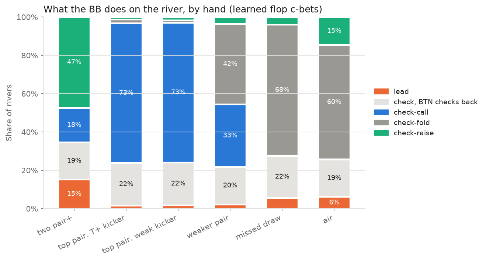

| BB hand | Leads | vs a BTN bet: fold / call / check-raise | Wins when it calls |
|---|---|---|---|
| two pair+ | 15% | 0% / 27% / 73% | 72% |
| top pair (either kicker) | 1–2% | 2–3% / 96% / 2% | 46–48% |
| weaker pair | 2% | 54% / 42% / 5% | **28%** |
| missed draw | 6% | 94% / 0% / 6% | — |
| air | 6% | 80% / 0% / 20% | — |

* **Check and let the BTN bet.** The BB leads only 4% of rivers; the BTN bets 79% when checked to.
* **Weaker pairs are pure bluff-catchers at the exact break-even point.** Calling a 2/3-pot bet needs
  28.6% equity, and when they call they win **28%**. The learned BB mixes fold (54%) and call (42%),
  which is what equilibrium theory says an indifferent bluff-catcher should do.
* **Top pair always calls** (96%) and wins about half the time.
* **Two pair+ check-raises for value (73%),** except on rivers that pair the board (31%) or put a third
  suited card out (68%). There, two pair can be beaten by full houses and flushes, so it calls instead.
* **Missed draws give up (94% fold).** Their bluffing role goes to air, which check-raises as a bluff 20%
  of the time: hands with no showdown value are the ones that can afford to bluff.

### Benchmarks: MDF and bluff share

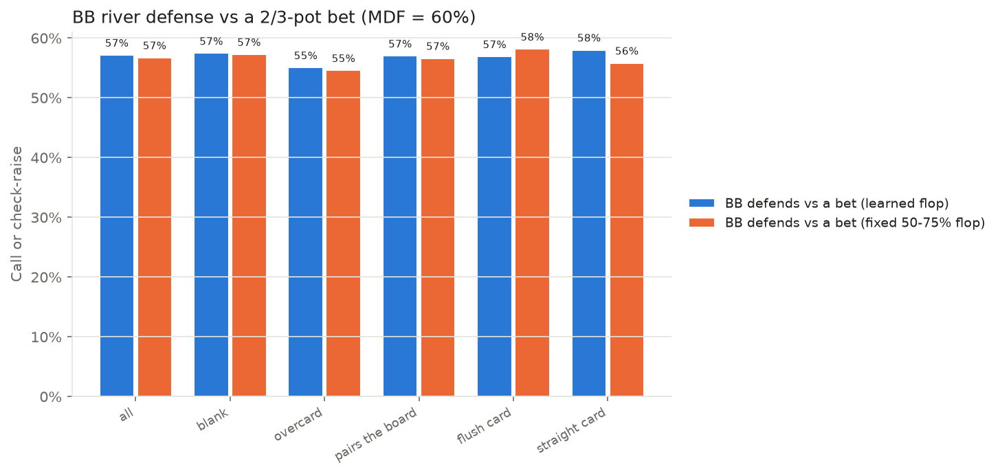

* **The BB defends 57% vs a river bet,** a little under the 60% MDF. That's fine here: the BTN's river
  bets aren't a pure bluff-or-nuts range, so the BB doesn't have to defend the full MDF to keep the
  BTN from betting any two cards.
* **34% of the BTN's river bets lose at showdown,** vs 28.6% for a perfectly balanced bettor. The excess
  is mostly thin value bets that run into the BB's better hands, not pure bluffs.

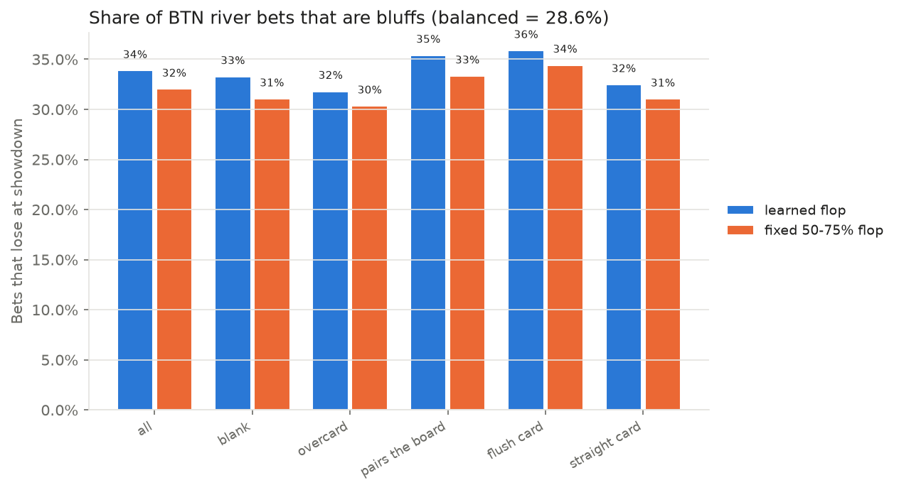

### By river card

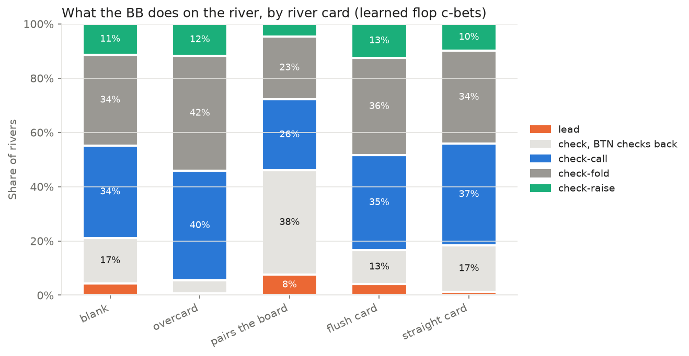

| River card | BB leads | BTN bets when checked to | BB fold / call / check-raise | BB wins when calling |
|---|---|---|---|---|
| blank | 4% | 83% | 43% / 43% / 14% | 33% |
| overcard | 1% | 95% | 45% / 43% / 12% | 31% |
| pairs the board | 8% | 58% | 43% / 49% / 9% | 42% |
| flush card | 4% | 87% | 43% / 42% / 15% | 37% |
| straight card | 1% | 83% | 42% / 46% / 12% | 33% |

* **Board-pairing rivers favor the BB:** the BTN bets least (58%), the BB leads most (8%; missed draws
  lead 13% as bluffs), and the BB's calls win most often (42%).
* **Overcard rivers favor the BTN:** it bets 95% and the BB almost never leads.
* **Flush rivers bring the most check-raises** (15%).

### After the fixed 50–75% flop c-bets

Nearly the same river strategy. The BB arrives with more missed draws (7% vs 2%) and air (2% vs 1%),
and that air leads the river as a bluff 26% of the time. Defense stays at 57%; the BTN's losing-bet
share drops to 32%.

## Experiment 13: Multiple bet sizes on every street

`scripts/bet_sizing_study.py` + `preflop/sizedgame.py`. Same line as experiments 8, 11 and 12
(2.25bb open; BB checks the flop and calls a c-bet; BB check-calls a turn bet), but every bet or
lead now picks a size:

| Street | Sizes (fraction of the pot) |
|---|---|
| flop c-bet | 1/3, 3/4 |
| turn bet / lead | 1/2, pot |
| river bet / lead | 1/2, pot, 1.5x (overbet) |

Raises stay at 3x the bet. Every response is learned separately for each size faced. The turn
and river remember earlier sizes, so each flop size (and each flop-size × turn-size pair) gets its
own strategy, since the pot differs.

**Validation:** `python scripts/bet_sizing_study.py single` runs the same code with one size per
street. It reproduces experiment 8 (c-bets 58.5%; BB fold / call / check-raise 34 / 47 / 19%),
experiment 11 (turn 52 / 38 / 10%; BB leads 26% when the turn pairs the board) and experiment 12
(river 43 / 44 / 13%; the BB's calls win 36%; 34% of BTN bets lose at showdown).

### The Button: big bets are polarized, small bets are merged

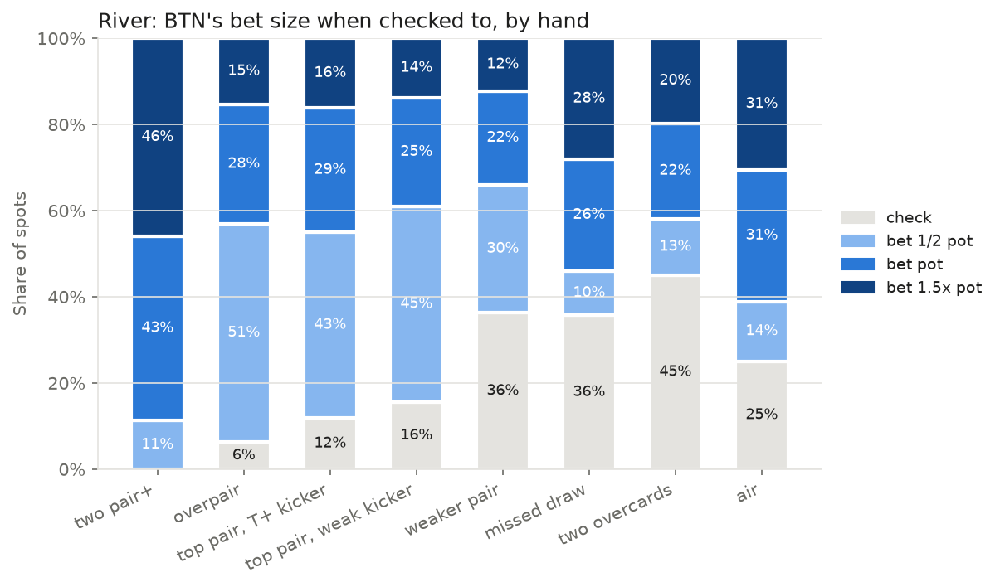

* **Flop (c-bets 61%):**
  * big (3/4) with two pair+ (73%) and draws (78%)
  * small (1/3) with overpairs and top pair (50–69%)
  * weak pairs mostly check (57%)
  * air splits check / small / big (46 / 28 / 27%)
* **Flop by board:** A-high boards are mostly small bets (57%) with few checks (11%). Boards that
  favor the BB get checked half the time.
* **Turn (bets 74% when checked to):** pot-size with two pair+ (72%) and draws (62%, semi-bluffs);
  half-pot with overpairs and top pair.
* **River (bets 79%):** the textbook polarized / merged split. Two pair+ bets pot or 1.5x 89% of
  the time (46% overbets). Overpairs and top pair mostly bet 1/2 pot (43–51%). The bluffs (air,
  missed draws) go big: pot or overbet 54–61%.

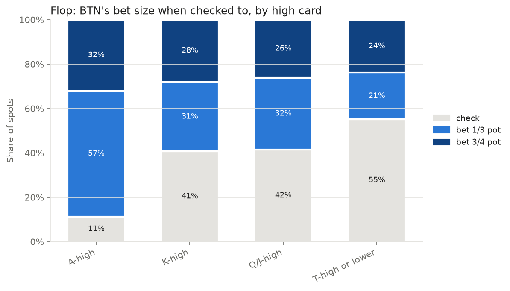

### The Big Blind: how it answers each size

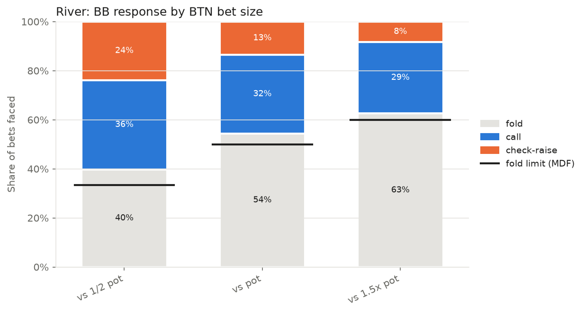

| Street | BTN bet | BB fold / call / check-raise | BB defends | MDF |
|---|---|---|---|---|
| flop | 1/3 pot | 42% / 31% / 27% | 58% | 75% |
| flop | 3/4 pot | 59% / 25% / 16% | 41% | 57% |
| turn | 1/2 pot | 40% / 40% / 20% | 60% | 67% |
| turn | pot | 58% / 29% / 13% | 42% | 50% |
| river | 1/2 pot | 40% / 36% / 24% | 60% | 67% |
| river | pot | 54% / 32% / 14% | 46% | 50% |
| river | 1.5x pot | 63% / 29% / 8% | 37% | 40% |

* **Small bets get check-raised a lot.** Vs a 1/3-pot flop c-bet, the BB check-raises 27% (vs 19% when
  1/3 was the only size). The BTN bets its strongest hands big, so its small-bet range is capped,
  and the BB attacks it: top pair raises 61–76%, weaker pairs 33%, draws 88%. Vs a 3/4-pot c-bet
  it raises only its best hands and draws.
* **Bigger bets get more folds,** but the BB stays close to MDF on the turn and river and well
  below it on the flop. The BTN's big flop bets are mostly value and draws, so folding is right.
* **River bluff-catching follows the theory.** A balanced bettor's share of bluffs should rise
  with bet size (25% / 33% / 37.5% for 1/2 / pot / 1.5x). Here the share of BTN bets that lose
  at showdown rises the same way: 33% / 37% / 38%.
  * Vs a half-pot bet the BB's calls win 27%, just above the 25% break-even.
  * Vs pot and overbets they win 42% and 48%, well above break-even. The BB only calls big bets
    with strong hands.

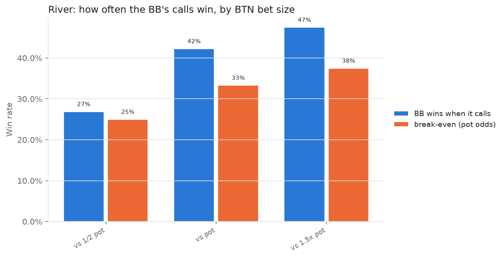

* **Turn leads become block bets.** With a half-pot option, the BB leads the turn far more with
  medium hands: top pair 24–32% (mostly half-pot), two pair+ 35% (half split between sizes).
  It leads 31% when the turn pairs the board.
* **River leads are small.** Medium and weak hands lead 1/2 pot as blockers or bluffs: top pair
  weak kicker 21%, air 20%, missed draws 18%. Big leads are rare.

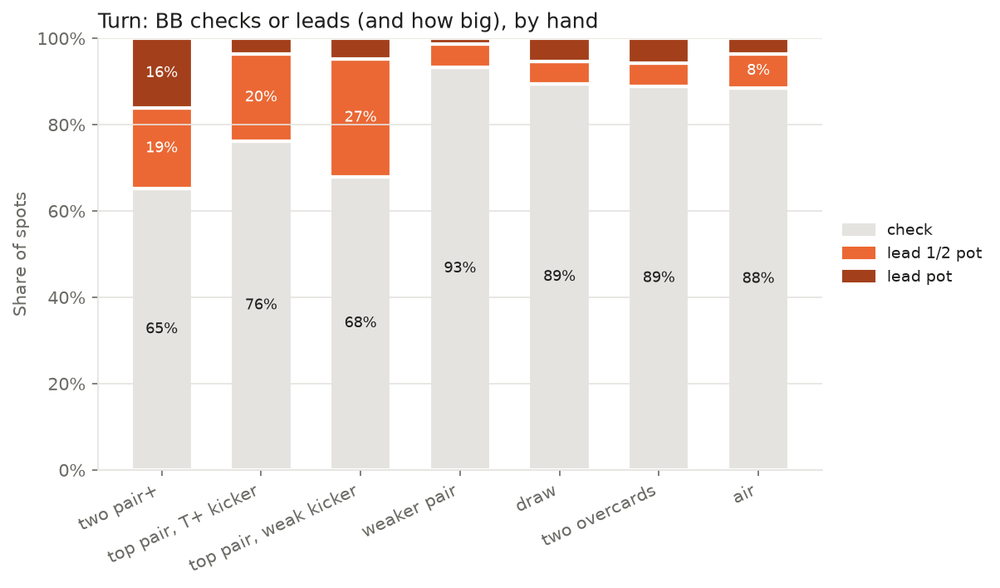

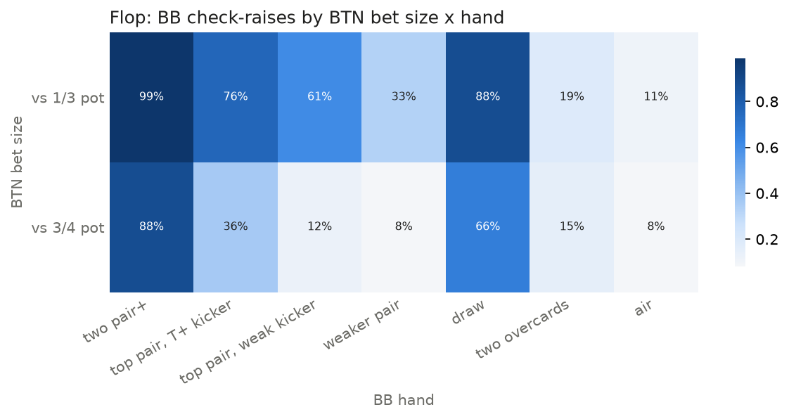

## Experiment 14: How close is the model to a real solver?

`scripts/solver_compare.py` solves 12 flops with **TexasSolver**
([bupticybee/TexasSolver](https://github.com/bupticybee/TexasSolver), AGPL-3.0, not included in this
repo: download the v0.2.0 macOS release into `tools/`; the binary runs under Rosetta on Apple
silicon). TexasSolver plays the real game on exact cards, with no buckets or rules. Each flop uses
the same preflop ranges, pot (4.5bb) and stacks (97.75bb) as experiment 13, and the same flop
decisions: the BB checks, the BTN checks or bets 1/3 or 3/4 pot, and the BB folds, calls or
raises (about 3x).

**The solver's later streets have to be smaller than the model's.** With leads, raises and one size
on the turn and river, each flop needed 10–16 GB of memory and ~3 min per iteration, which is
impractical on a laptop. The main comparison uses a **medium** tree: either player can bet the turn
(2/3 pot) and the river (3/4 pot), with no raises there. Every flop solved to 0.22–0.30% exploitability
(~3–13 min each, three at a time). A **simple** tree, where the BB can only call or fold on the turn
and river, is kept as a sensitivity check.

Flops: A♠7♦2♣, A♥K♦5♥, K♥8♦3♣, Q♦J♥4♦, T♦9♥6♣, 8♠6♠4♦, 7♣5♦3♥, J♥7♥2♥ (single-suit), K♦K♣4♠, 7♥7♦2♠, T♠5♣2♦, 9♣6♣5♦.

### Board level: the model gets the pattern right

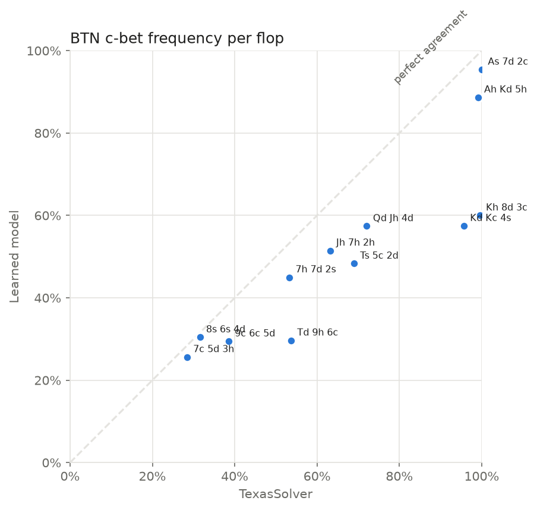

| Decision | Solver avg | Model avg | Mean abs. difference | Correlation across flops |
|---|---|---|---|---|
| BTN c-bets | 67% | 52% | 15 pts | **0.88** |
| BTN bets big (share of its bets) | 69% | 49% | 26 pts | 0.52 |
| BB folds vs 1/3-pot c-bet | 29% | 36% | 8 pts | 0.77 |
| BB check-raises vs 1/3-pot c-bet | 18% | 26% | 8 pts | 0.62 |
| BB folds vs 3/4-pot c-bet | 52% | 59% | 7 pts | **0.88** |
| BB check-raises vs 3/4-pot c-bet | 10% | 16% | 6 pts | **0.85** |

* **C-bet frequency tracks the solver closely across boards (r = 0.88).** Both bet nearly everything on
  A-high flops (solver 99–100%, model 89–95%) and bet least on low connected boards (solver 28–39%,
  model 26–30%). The BB's response to a big bet is also well matched (r = 0.85–0.88).
* **The model c-bets too little on K-high and paired boards.** On K♥8♦3♣ and K♦K♣4♠ the solver bets
  96–100%, mostly *small*; the model bets ~60%. Those boards look "neutral" to the model's texture
  features, but with these ranges the BTN has a big advantage there (the BB's calling range has few
  kings).
* **The model under-uses the big size,** especially on low boards. There the solver bets 3/4 pot with
  almost every bet (98% on 8♠6♠4♦ and 7♣5♦3♥) and checks the rest, a very polarized strategy.

### Hand level: where the abstraction breaks down

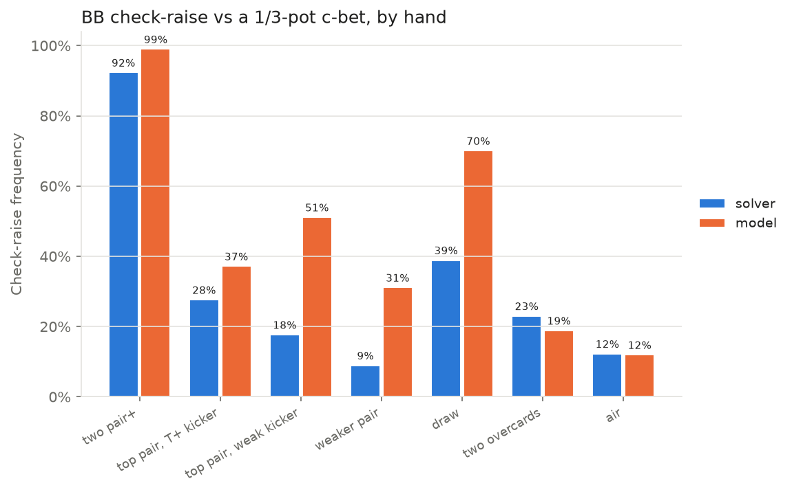

* **The BB never folds a pair or draw to a small c-bet in the solver** (0%), but the model folds top
  pair 12–22% and weak pairs 8% of the time.
* **The model check-raises medium hands far too often:**
  * top pair with a weak kicker 51% (solver 18%)
  * weaker pairs 31% (solver 9%)
  * draws 70% (solver 39%)

  The solver *calls* with them instead (pairs 82–91%, draws 61%). Only two pair+ (92–99%) and air (12%) match.
* **The solver's BTN protects its checking range:** it checks 35% of overpairs and 18–25% of top pairs.
  It also bluffs more: air bets 71% vs the model's 45%. The model bets nearly all of its strong
  hands and checks too much air.
* **Why:** the model's buckets lump very different hands together. "Top pair, T+ kicker" includes
  both AK on A-high and T9 on T-high, and "air" includes backdoor draws and overcards with
  blockers. The model's turn and river are also played by simple rules, so it can't plan the
  multi-street lines (check-call, slowplay, delayed bluffs) that make calling and checking
  valuable in the solver.

### Sensitivity: what the BB can do on later streets changes the flop

With the **simple** tree (the BB can never bet the turn or river), the solver c-bets **87%** of flops
instead of 67% and bets big 72% of the time. Giving the BB later-street betting rights shrinks the
BTN's flop betting by 20 points. Flop strategy depends heavily on what each player can do on later
streets, which is also why the model's rules-based turn and river limit its flop accuracy.

## Experiment 15: The whole hand learned together

`scripts/fullgame_study.py` + `preflop/fullgame.py`. Earlier experiments learned one street at a time and
played later streets with rules, so no player could plan multi-street lines. Here flop, turn and river are
**one game**, learned with external-sampling Monte Carlo CFR: for each sampled hand, the learning player
tries every option while the opponent's moves are sampled. A flop decision is valued by how the rest of
the hand actually plays out.

* **Hand buckets (12):** straight or better, set / trips, two pair, overpair, top pair (T+ kicker / weak
  kicker), middle pair, weak pair, strong draw, weak draw (gutshot / backdoor flush), overcards, air.
  On the river the draws become missed draws.
* **Line memory:** later streets know who bet last on the previous street and how deep the stacks are
  vs the pot.
* **Sizes:**
  * BB flop lead ("donk") 1/3 pot
  * BTN flop bets 1/3 / 3/4
  * turn leads 1/2, bets 1/2 / pot
  * river leads 1/2, bets 1/2 / pot / 1.5x
  * raises 3x
* **Training:** 250 batches × 60k hands per scenario, then each is evaluated exactly on the same 300k
  hands. Re-training the `donk` scenario with a different seed gave the same result to 0.001bb, so
  differences between scenarios aren't training noise.

Results are the BB's **net result for the whole hand, in bb per called pot**:

| Scenario | BB net |
|---|---|
| base: BB never donks | −0.869 |
| donk: BB may lead the flop 1/3 pot (learned) | −0.872 |
| donk_often: BB leads 50% of flops with every hand | **−1.156** |
| no_early_bluffs: BB never bluffs the flop or turn | −0.916 |
| slowplay 0% / 25% / 50% / 75% of strong hands | −0.882 / **−0.876** / −0.879 / −0.887 |

### Multi-street lines: check-calling with medium hands

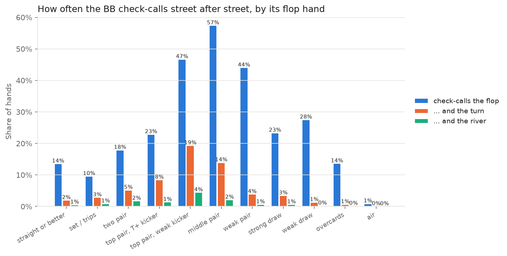

How often the BB check-calls a bet on the flop, then the turn too, then the river too, by its flop hand
(the BTN has to bet each time):

| BB flop hand | Check-calls the flop | ... and the turn | ... and the river |
|---|---|---|---|
| top pair, weak kicker | 47% | **19%** | 4% |
| middle pair | 57% | **14%** | 2% |
| weak pair | 44% | 4% | 1% |
| top pair, T+ kicker | 23% | 8% | 1% |
| two pair | 18% | 5% | 2% |
| strong draw | 23% | 3% | 1% |

* **Check-calling twice is a medium-hand line,** mainly weak top pair and middle pair. They have enough
  showdown value to call twice but are too weak to raise.
* **Weak pairs usually stop after one call;** their turn calls drop to 4%.
* **Strong top pair and two pair call less** because they check-raise more often.
* **Calling down all three streets is rare** (≤4%): by the river, most medium hands either face a check or
  give up.

### Slowplaying: how often, and with what

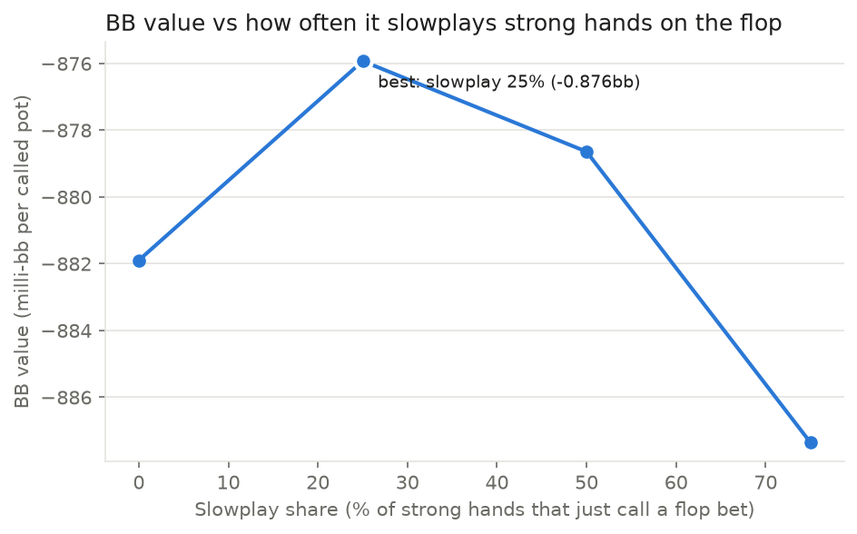

* **The best slowplay share is about 25%.** Forcing the BB to just call a flop bet with 0 / 25 / 50 / 75%
  of its strong hands (straight+, sets, two pair) gives −0.882 / −0.876 / −0.879 / −0.887bb. Never
  slowplaying costs 0.006bb per called pot and slowplaying 75% costs 0.011bb. The value curve is flat,
  so getting the mix roughly right matters more than the exact number.
* **The learned strategy agrees.** Facing a flop bet, the BB calls instead of raising with:
  * two pair 25% of the time
  * straights or better 26%
  * sets 18%, the least: sets are the hands that most want the pot to grow now
* **The BTN almost never slowplays:** it checks back strong hands on the flop only 4–7% of the time.

### Bluff timing: preflop and river vs flop and turn

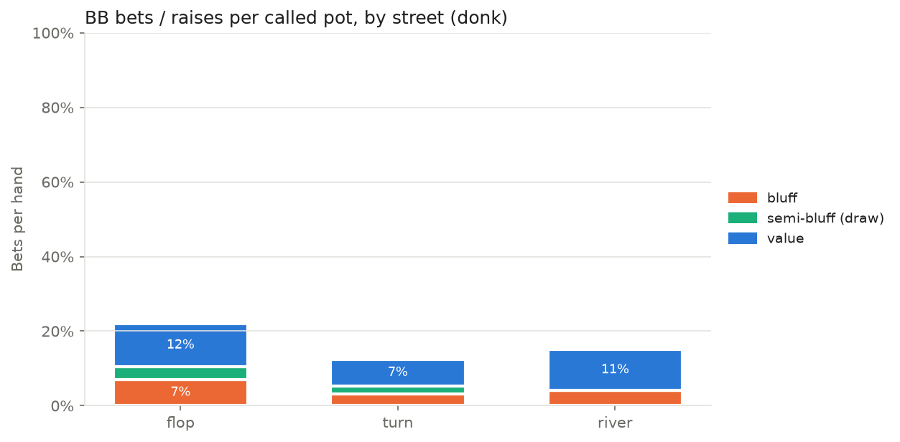

* **In the learned strategy, half of the BB's postflop bluffs happen on the flop** (check-raise and donk
  bluffs): flop 0.071, turn 0.031, river 0.041 bluffs per called pot, plus semi-bluffs with draws on the
  flop and turn.
* **Moving bluffs to the river costs the BB.** Banning weak-hand bets and raises on the flop and turn raises
  its river bluffs by 27% (0.041 → 0.052 per hand) but costs **0.044bb per called pot** (−0.872 → −0.916).
  Early bluffs work because the BTN's wide c-betting range folds a lot to check-raises.
* **Preflop bluffs barely exist in this model:** the BB 3-bets 21% of its hands, but only 0.45% of hands
  (22) are 3-bets with under 50% equity vs the BTN's opening range. The preflop model uses equity
  realization, not postflop play, so it has no reason to 3-bet bluff. Adding real 3-bet-bluff value
  would need a preflop model that plays out the postflop game.

### Donk bets: often, small, and on which boards?

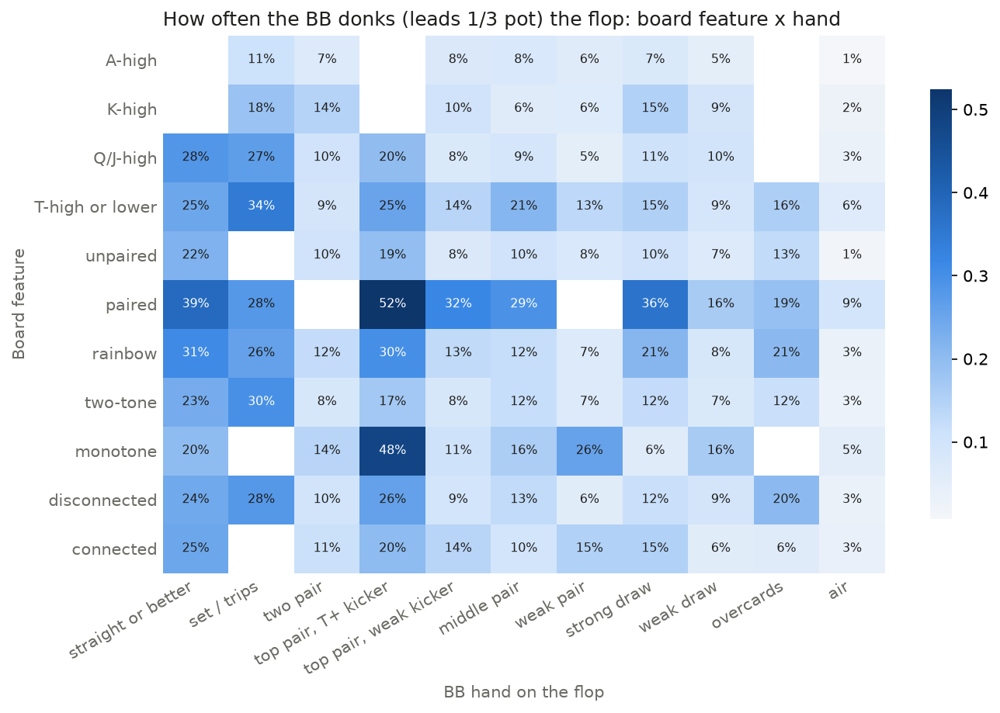

* **When it may choose, the BB donks rarely:**
  * A-high boards 4%, K-high 6%, Q/J-high 7%, T-high or lower 13%
  * paired boards 16%, single-suit boards 12%
* **It donks mostly with strong top pairs and sets on boards that favor it:** top pair T+ kicker donks
  52% on paired boards and 48% on single-suit boards; sets donk 34% on low boards.
* **Having the donk option is worth almost nothing:** −0.009 to +0.024bb per called pot by board, and
  −0.003 overall. That matches solver lore that donking adds little when the caller is out of position.

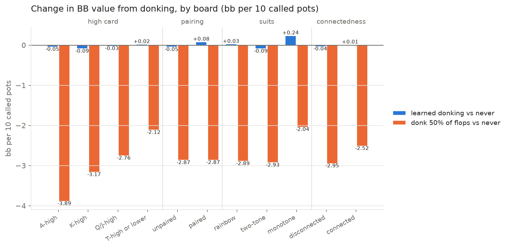

* **Donking 50% of flops with every hand is a big leak: −0.29bb per called pot.** The BTN raises and floats
  a weak, capped donking range. Board by board, the cost (bb per 10 called pots):

| Board | Cost of donking 50% |
|---|---|
| A-high | −3.9 |
| K-high | −3.2 |
| Q/J-high | −2.8 |
| connected | −2.5 |
| T-high or lower | −2.1 |
| single-suit | −2.0 |

* **If the BB wants to donk often, low and single-suit boards are where it hurts least,** because those boards
  favor the BB's range. A-high and K-high boards, where the BTN's range is strongest, are the worst. On
  every texture, small frequent donking with the whole range still loses vs donking selectively.

## Experiment 16: Best sizes vs every open, the BTN's 2.25bb plan, and TexasSolver again

`scripts/open_size_study.py` (train / solve / report). The whole-hand model (experiment 15) is trained
at BTN opens of **2.0, 2.25, 2.5 and 3.0bb**, with preflop ranges from the preflop solver at each size.
It has a bigger sizing menu so it can pick its own sizes:

| Street | BB leads | BTN bets | Raises (either player) |
|---|---|---|---|
| flop | 1/3 or 3/4 pot (donk) | 1/3 or 3/4 pot | 2.5x or 4x |
| turn | 1/2 or pot | 1/2 or pot | 2.5x or 4x |
| river | 1/2 or pot | 1/2, pot or 1.5x | 2.5x or 4x |

The generalized model reproduces experiment 15 exactly when given its old sizes. Each open size took
16–23 min to train (250 batches × 60k hands) and was evaluated exactly on 150k hands.

### The BB vs each open size

| BTN open | BB preflop fold / call / 3-bet (to) | BB net per called pot | BTN bets the flop when checked to | BB vs 1/3 c-bet: fold / call / raise 2.5x / raise 4x |
|---|---|---|---|---|
| 2.0 | 1% / 76% / 23% (6.5) | −0.85 | 78% | 48 / 21 / 19 / 12% |
| 2.25 | 10% / 69% / 21% (7.3) | −0.85 | 75% | 46 / 19 / 23 / 12% |
| 2.5 | 19% / 61% / 20% (8.1) | −0.81 | 72% | 45 / 22 / 22 / 12% |
| 3.0 | 35% / 47% / 18% (9.75) | −0.84 | 69% | 40 / 26 / 24 / 10% |

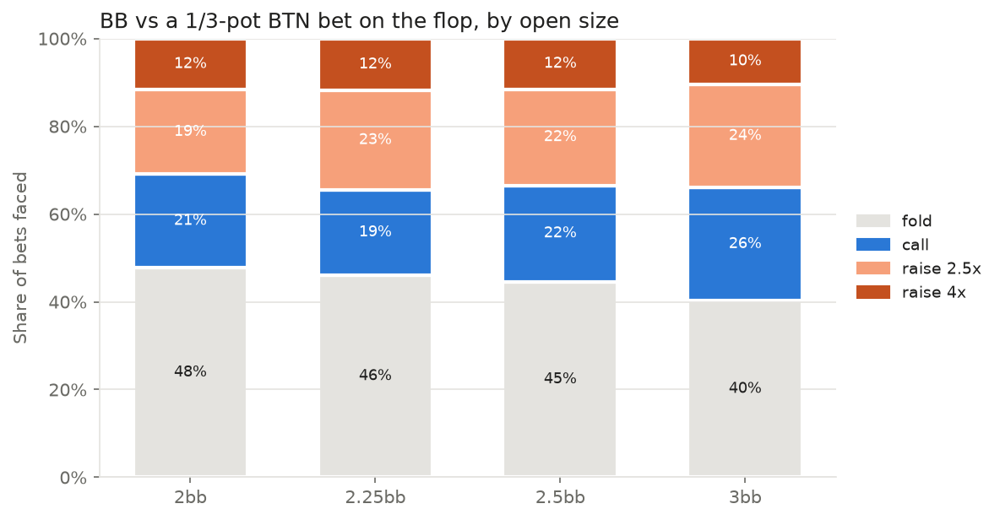

* **Bigger opens get a tighter BB, and its postflop results barely change** (−0.81 to −0.85bb per called
  pot). The adjustment happens preflop (folding 1% → 35%); afterwards the BB folds less to c-bets
  (48% → 40%) because its range is stronger, and the BTN c-bets less (78% → 69%).
* **Raise sizes depend on the street:**
  * **Flop:** the BB prefers the **small 2.5x check-raise** (19–24% vs a 1/3 c-bet, 12% vs a 3/4 c-bet),
    with 4x as a smaller, stronger part (10–12% / 5%).
  * **Turn:** vs a half-pot bet the **4x raise** is used more (10–11%) than 2.5x (7–10%).
  * **River:** vs a half-pot bet the BB raises almost only **4x** (15%, vs 2% at 2.5x), a polarized
    nuts-or-bluff raise. Vs pot and overbets it raises rarely, and small.
* **BB leads:**
  * flop donks are rare: 9–11%, mostly 1/3 pot (5–7%)
  * turn leads grow with the open: 12% → 18%, split evenly between 1/2 and pot
  * the river is where the BB leads most: ~31% (1/2 pot 18%, pot 13%)

### The BTN's 2.25bb plan: c-bet, turn barrel, river

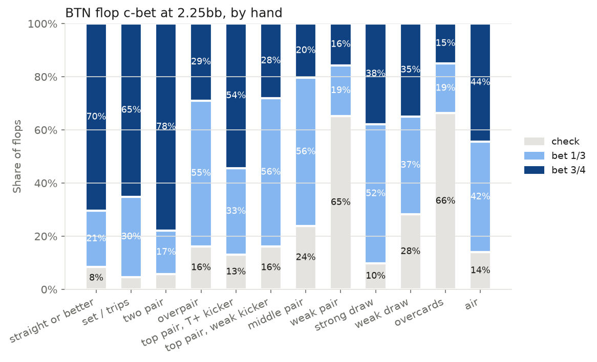

* **Flop c-bet: 75% of flops** (1/3 pot 40%, 3/4 pot 36%).
  * **By board:** A-high flops are bet almost always (check 11%, mostly 3/4 pot); K-high mostly 1/3 pot
    (50%); low, connected and single-suit flops are checked 34–36% of the time.
  * **By hand:** two pair+ goes big (65–78% 3/4 pot). Overpairs, weak top pair and middle pair go small
    (55–56% 1/3 pot). Weak pairs and overcards check (65–66%). Air bets 86% (split small / big), and
    draws bet small (strong draws 52% at 1/3).
* **Turn barrel after a called c-bet:**
  * value keeps betting: straights 99%, sets 92%, two pair 84%, mostly pot-size
  * top pair barrels 66–73%
  * middle and weak pairs check (83–94%) to control the pot
  * draws semi-bluff: weak draws 81%, strong draws 56%
  * air barrels 42%

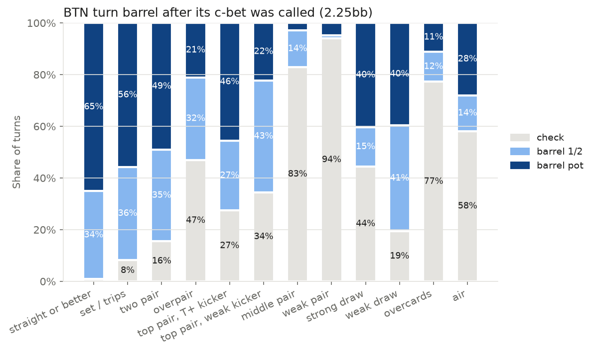

* **River after a called barrel: the bluffs are the missed weak draws.**
  * value overbets: straights+ bet 100% (65% at 1.5x), sets 99% (49% at 1.5x), two pair 86%
  * top pair mostly checks (64–78%)
  * the main bluff is **missed gutshots / backdoors: they bet 83%, 54% as a 1.5x overbet**
  * pure air bets only 25% and missed strong draws 23%. Hands with a little showdown value check;
    the weakest missed draws bluff big.

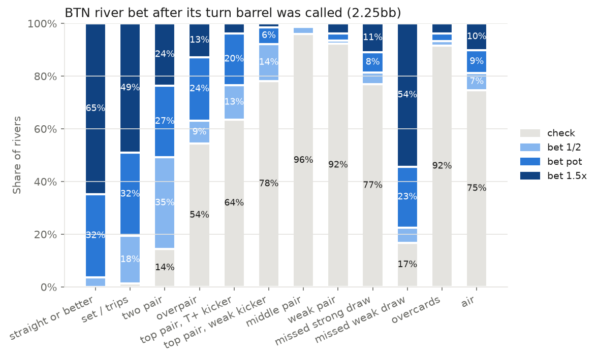

### The most probable lines (2.25bb)

Across all called pots, the most common outcomes are short:

| Line | Probability | BTN holds (strong / pair / draw / air) |
|---|---|---|
| BTN bets 3/4, BB folds | 19.0% | 10 / 26 / 18 / 46% |
| BTN bets 1/3, BB folds | 16.5% | 3 / 39 / 18 / 40% |
| checked down on every street | 4.1% | 0 / 62 / 8 / 31% |
| flop checked through, BTN bets pot on the turn, BB folds | 3.3% | 3 / 34 / 21 / 42% |
| BTN bets 1/3, BB raises 2.5x, BTN folds | 2.0% | 0 / 2 / 2 / 97% |

**When the BTN c-bets and barrels and gets called twice,** the river goes:
* **check-check** in 47% of these lines (most common: 3/4 then 1/2, 17%; 3/4 then pot, 16%)
* **a BTN 1.5x overbet** in 25% (the BB folds to it in 16%)

The BTN's river overbets hold 17% strong hands, 12% pairs, 38% missed draws and 33% air: mostly bluffs.
37% of the BTN's air ends with a flop c-bet the BB folds to.

### TexasSolver comparison (flop decisions, medium tree)

Solved at **2.25bb (12 flops)** and, new, **3.0bb (6 flops)** with that open's ranges (0.25–0.29%
exploitability, 2–8 min each, three at a time).

| Decision | 2.25bb: solver / model / correlation | 3.0bb: solver / model / correlation |
|---|---|---|
| BTN c-bets | 67% / 70% / **0.97** | 61% / 66% / 0.86 |
| BTN bets small (1/3) | 25% / 35% / 0.89 | 33% / 39% / **0.98** |
| BB folds vs 1/3 | 29% / 42% / 0.78 | 35% / 41% / 0.88 |
| BB raises vs 1/3 | 18% / 29% / 0.13 | 15% / 29% / **0.94** |
| BB folds vs 3/4 | 52% / 60% / 0.83 | 55% / 57% / 0.76 |
| BB calls vs 3/4 | 38% / 25% / **0.94** | 38% / 29% / 0.50 |

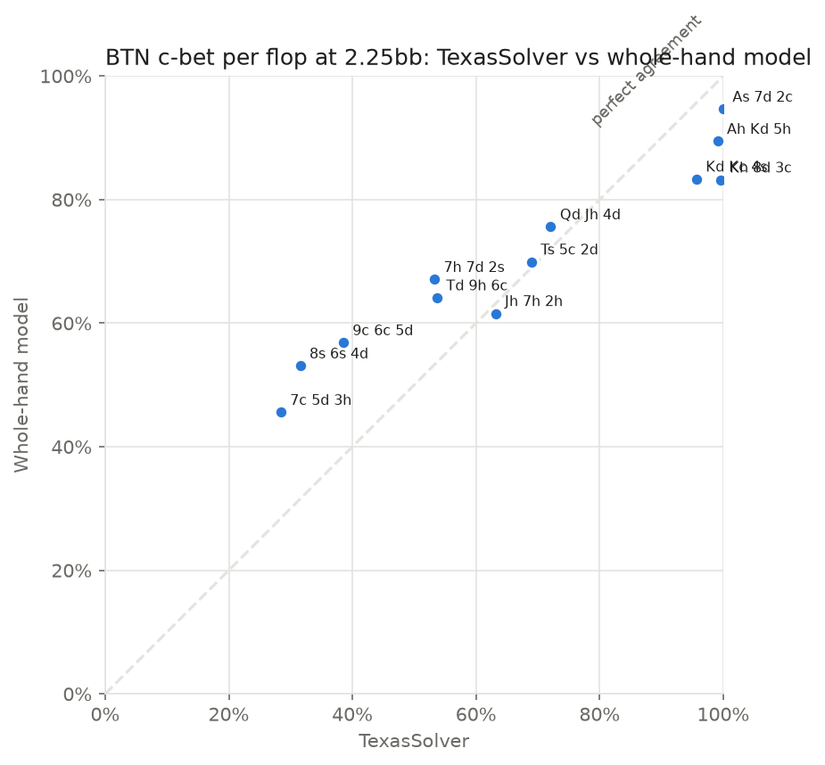

* **Much closer than the street-by-street model.** C-bet frequency per flop correlates **0.97** with the
  solver at 2.25bb (0.88 in experiment 14), and the BTN's c-bet by hand is close: air 87% vs 76%,
  top pair 74–76% vs 75–82%, two pair+ 90–96% vs 100%.
* **The old "BB folds pairs" error is gone:** the model now folds pairs and draws 0–5% to a small
  c-bet, like the solver.
* **It tracks how the open size changes things.** On K♥8♦3♣ the solver's c-bet drops from 100% at
  2.25bb to 59% at 3.0bb (the BB's tighter calling range has more kings); the model goes 83% → 56%.
* **The remaining gap: the BB check-raises too much and calls too little.** It raises middle pair 54%
  and weak top pair 64% vs the solver's 7–18%. The pattern across flops matches at 3.0bb (r = 0.94),
  but the level is about twice the solver's. Likely causes (not yet tested):
  * the model's BTN bluffs air about 10 points more than the solver, which makes raising profitable
  * the model can raise a cheaper 2.5x, while the solver's raise is about 3x
  * the solver's tree has no turn or river raises, so a flop raise there carries less threat

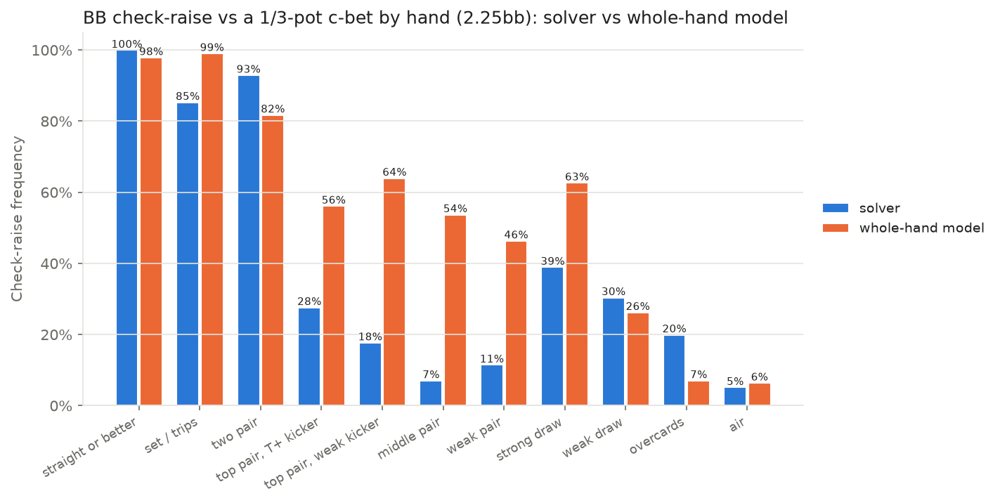

## Experiment 17: The BTN's 2.25bb ranges, and exploiting a BB that donks often

`scripts/donk_exploit_study.py`, using the 2.25bb whole-hand model from experiment 16 (same sizes).

### The BTN's opening and c-bet ranges

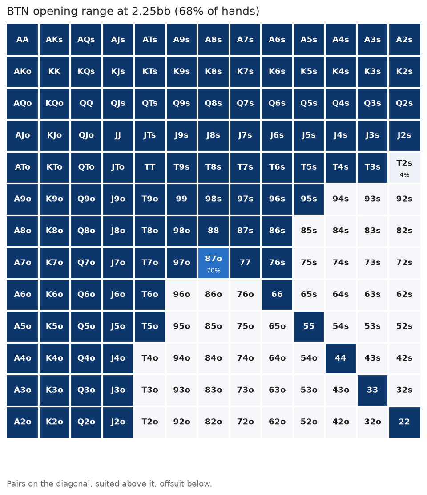

* **The BTN opens 68% of hands at 2.25bb.**
* **It c-bets 75% of flops when the BB checks:** 39% at 1/3 pot, 35% at 3/4 pot (averaged over random flops).
  * **A-high flops: 89%. T-high-or-lower flops: 64%.**
* **Most hands c-bet 70–80%.** The exceptions check more:
  * **small pocket pairs** (22–66: 44–57%) keep showdown value
  * **big offsuit broadways** (AKo 55%, AQo 62%, AJo 63%) bet A-high flops ~85% but check low flops
    two-thirds of the time (32–33%): they have overcards and showdown value, not much to bet for
  * **overpairs bet more on low boards:** AA c-bets 95% on A-high and 89% on low flops, KK 77% / 87%


Per-hand c-bet ranges on A-high and low flops, and the share bet big:
`btn_cbet_range_A-high.png`, `btn_cbet_range_T-high_or_lower.png`, `btn_cbet_big_share.png`,
data in `btn_ranges_225.csv`.

### Exploiting three frequent donkers

Each BB opponent donks 1/3 pot with fixed frequencies by hand. Everything else is re-learned, so the
BTN learns a best response:

| Opponent | Donk rate by hand (value / middle-weak pair / draw / air) | Donks the flop | Donks are value / pair / draw / air | BTN with equilibrium play | BTN best response | Gain (bb / 100 called pots) |
|---|---|---|---|---|---|---|
| value donker | 90 / 30 / 30 / 5% | 27% | 44 / 23 / 25 / 8% | +0.94 | +1.06 | **+12** |
| balanced donker | 80 / 30 / 50 / 25% | 39% | 27 / 16 / 28 / 29% | +0.93 | +1.00 | **+6** |
| bluffy donker | 60 / 30 / 60 / 50% | 49% | 16 / 12 / 27 / 45% | +0.97 | +1.16 | **+19** |

(Against an equilibrium BB, which donks ~9%, the BTN nets +0.85bb per called pot.)


* **Donking often loses for the BB even when the BTN doesn't adjust:** the BTN's ordinary strategy
  already earns +0.09bb more per called pot.
* **The best response depends on what the donks contain:**

| BTN hand vs a 1/3-pot donk | vs equilibrium BB | vs value donker | vs balanced | vs bluffy donker |
|---|---|---|---|---|
| air: fold / raise | 45% / 26% | **92% / 4%** | 23% / 39% | **2% / 70%** |
| overcards: fold / raise | 10% / 35% | 72% / 6% | 13% / 22% | 1% / 50% |
| middle pair: raise | 50% | 35% | 48% | **85%** |
| sets: raise (rest call) | 88% | **48%** | 82% | 97% |
| top pair T+ kicker: raise | 73% | 85% | 86% | 95% |

* **Vs the value donker:** fold air and overcards (92% / 72%), and **slowplay sets** (raise only 48%; just
  call the rest so the donker keeps betting its strong hands). Top pair and two pair still raise.
* **Vs the bluffy donker:** **raise almost everything** (air 70%, middle pair 85%) and fold nothing.
  The donks are 45% air, so a raise wins the pot right away most of the time.
* **Vs the balanced donker:** close to equilibrium play, so there's less to gain (+6).


### Figuring out the donker during a session (Bayesian inference)

The BTN starts not knowing which donker it faces: equal prior on the three profiles. After every hand it
updates the posterior from what it can see:
* did the BB donk?
* if the BTN called or raised, did the BB fold, or what did it show down?

The likelihoods were estimated from 300k simulated hands per profile. Once one profile has ≥ 70%
posterior, the BTN switches to that profile's best response. 300 sessions × 400 hands per opponent and
strategy:


| Opponent | Hands until the posterior on the truth hits 90% (median) | BTN static | BTN adaptive | adaptive + probe raises | BTN knows the truth |
|---|---|---|---|---|---|
| value donker | 35–45 | 101 | **106** | 100 | 106 |
| balanced donker | 83–92 | 99 | 99 | 104 | 101 |
| bluffy donker | 42–49 | 102 | **121** | 110 | 124 |

(BTN result in bb per 100 called pots; the standard error is about ±4.)

* **The donker is identified within ~40 hands, or ~90 for the balanced one.** The balanced profile sits
  between the other two, so it takes the most evidence. By 150 hands the posterior on the truth averages
  88–96%.
* **Adapting captures nearly all the exploit:** vs the bluffy donker the adaptive BTN earns 121 vs 124 for a
  BTN that knew all along, and vs the value donker 106 vs 106.
* **Probe raises didn't help.** Raising medium hands into donks early (40% of the time until 90% sure) did
  not identify the opponent any faster. The donk *frequency* and the showdowns already carry most of
  the information. It cost EV vs the value donker (−6) and the bluffy donker (−11 vs plain adaptive),
  because probing raises the wrong hands at the wrong time. The best response already raises a lot vs
  bluffy donkers; a separate "test raise" adds risk without much new information.

## Experiment 18: Donk sizes × open sizes, and the BTN as the short stack

`scripts/donk_size_stack_study.py` (`donk` / `stacks` / `report`). Retrained after experiment 22 with the
solver's pot-sized raise (`OPTS_POT`); the first version's numbers are in git history (commit 6f00baf).

### Part A: four donk sizes at four open sizes

At BTN opens of 2.0 / 2.25 / 2.5 / 3.0bb (pots of 4 / 4.5 / 5 / 6bb), the BB may donk **1/4, 1/2, 3/4 or
pot**; everything else matches experiment 16, with pot-sized raises. Each open was trained for 250 batches
(~15 min).

**"What if" evaluation (new in `fullgame.py`):** for every board and BB hand, every flop option is played
out against the BTN's actual responses. That gives the value of donking each size vs checking in that spot.

| BTN open (pot) | BB donks (learned) | 1/4 | 1/2 | 3/4 | pot | Avg cost of donking vs checking, 1/4 → pot (bb / 100 called pots) |
|---|---|---|---|---|---|---|
| 2.0 (4bb) | 14% | 5.4% | 3.9% | 2.5% | 2.0% | −17 / −26 / −36 / −48 |
| 2.25 (4.5bb) | 15% | 6.9% | 4.0% | 2.3% | 2.1% | −17 / −25 / −39 / −48 |
| 2.5 (5bb) | 16% | 7.2% | 4.1% | 3.0% | 2.0% | −17 / −26 / −36 / −47 |
| 3.0 (6bb) | 16% | 7.7% | 4.1% | 2.8% | 1.8% | −21 / −29 / −41 / −55 |

* **Checking is the better default at every open size and on every board type.** Averaged over all of
  the BB's hands, donking costs more the bigger it is (−0.17bb per called pot at 1/4 pot, about −0.5 at
  pot) and a bit more in the biggest pots (3.0bb opens).
* **The smallest donk (1/4 pot) is the least bad and the most used.** Bigger pots push the BB to donk
  slightly more (14% → 16%), mostly at 1/4.
* **Donking is break-even (within 1bb / 100 of checking) in about a fifth of spots** (18–24%, weighted by
  how often each spot comes up), mainly:
  * **paired boards with top pair:** break-even 49–83% of the time (by open size), donking mostly 1/4–1/2
    pot. At a 2.0bb open, 1/4 pot even slightly beats checking here.
  * **connected boards with two pair+:** 31–74%, sizes spread from 1/4 to pot
  * **low boards (T-high or lower) with draws:** 27–59%
  * **A-high boards:** only with two pair+ (17–56%)
* **The BTN folds more vs bigger donks** (10–11% vs 1/4, 43–46% vs pot). Vs the 1/4 donk it **calls or
  raises about equally** (41–50% / 40–49%). A tiny donk invites a raise.
* **Caveat:** the break-even shares come from noisy per-cell values and swing between open sizes, so
  read them as "sometimes" vs "rarely" rather than exact rates.


### Part B: the BTN as the short stack

**Only the effective (smaller) stack matters heads-up.** A 50bb BTN vs a 150bb BB plays exactly a 50bb game,
because chips beyond the shorter stack can't be won or lost. The study compares 25 / 50 / 100bb effective
at a 2.25bb open.

| | 25bb | 50bb | 100bb |
|---|---|---|---|
| stack-to-pot ratio after the call | 5.1 | 10.6 | 21.7 |
| BTN's best open size (preflop model) | **2.25bb** | 2.75bb | 2.75bb |
| BTN opens (at 2.25bb) | 66% | 71% | 68% |
| BB fold / call / 3-bet | 11 / 68 / 21% | 9 / 73 / 18% | 10 / 69 / 21% |
| BB 3-bet size | **13.5bb (near all-in)** | 7.3bb | 7.3bb |
| BTN folds / jams vs a 3-bet | **65% / 11%** | 49% / 12% | 42% / 8% |
| BB calls a BTN jam | **100%** | 38% | 20% |
| BTN c-bets (1/3 / 3/4) | **68%** (49 / 19) | 74% (42 / 31) | 81% (50 / 31) |
| BTN barrels the turn after a called c-bet | 56% | 52% | 53% |
| BTN bets the river after a called barrel | 59% | 53% | 50% |
| BB vs 1/3 c-bet: fold / call / raise | 47 / 28 / 25% | 46 / 32 / 22% | 47 / 30 / 24% |
| stacks all-in before the river | **3.2%** | 0.2% | ~0% |
| BB net per called pot | −0.76 | −0.76 | −0.88 |


* **Preflop at 25bb, everything becomes "all-in or fold" after a 3-bet.** The BB's best 3-bet is 13.5bb
  (over half the stack); the BTN folds 65% to it, jams 11%, and the BB always calls the jam. The BTN's
  best open shrinks to 2.25bb (2.0–2.25 are about equal), since raises are a bigger share of the stack.
* **The BTN's postflop edge shrinks with the stack:** the BB loses 0.76bb per called pot at 25–50bb vs 0.88
  at 100bb. There's less room to use position over three streets.
* **Short-stacked, the BTN c-bets less and smaller** (68% vs 81% at 100bb; mostly 1/3 pot) **but follows
  through more on the river** (59% after a called barrel vs 50%): with a low stack-to-pot ratio, a hand
  that bets the flop is often committed.
* **By hand at 25bb:**
  * **strong hands slowplay more:** two pair+ c-bets 60–76% (vs 94–96% at 100bb), since the stack is
    easy to get in later
  * **top pairs bet almost always** (93–95%)
  * **weak pairs mostly check** (bet 32%)
  * **the BB check-raises top pair 89% vs a small c-bet**, effectively getting it in. Middle pair now
    mostly calls (check-raises 36%, down from 71% with the old 2.5x raise).


## Experiment 19: The BB's ranges and sizes when stacks are short, by BTN open size

`scripts/bb_short_stack_study.py` (`preflop` / `postflop` / `report`). Retrained after experiment 22 with the
solver's pot-sized raise; the first version is in git history (commit 0ed0a58).

Only the effective (smaller) stack matters heads-up, so a 25bb BB vs a 175bb BTN plays exactly the same
game as a 25bb BTN vs a 175bb BB (experiment 18). This study covers **20–100bb effective** against BTN opens
of **2.0–3.0bb**.

**What's new:**
* **All-in 3-bets.** The BB can now 3-bet all-in, in addition to 2.5x–6x the open. Calling an all-in
  3-bet means no postflop play (`solver.py`).
* **Realization by stack.** The preflop model's BB realization (0.915) was fit at 100bb. The whole-hand
  models from experiment 18 show how much better the BB does with shorter stacks, so r_oop is scaled by that
  ratio: **1.00 at 20–30bb, 0.98 at 50bb, 0.92 at 100bb** (capped at 1.0, the BTN's level). With shallow
  stacks there are fewer streets of betting left, so position is worth less.

### Preflop: fold, call, 3-bet and the 3-bet size


| Stack | BB's best 3-bet | BB folds vs 2.0 / 2.5 / 3.0 open | BB 3-bets | BTN folds to the 3-bet |
|---|---|---|---|---|
| 20bb | **all-in** vs every open | 0 / 18 / 38% | 24–25% | 55–70% |
| 25bb | **all-in** vs every open | 0 / 16 / 37% | 22–23% | 64–76% |
| 30bb | **all-in** vs every open | 0 / 15 / 37% | 21–22% | 70–80% |
| 40bb | 6.5bb vs 2.0; **all-in** vs 2.25+ | 0 / 15 / 35% | 18–19% | 51% / 77–84% |
| 50bb | 3.25x (6.5–8.1bb) vs 2.0–2.5; **all-in** vs 2.75+ | 0 / 15 / 35% | 17–19% | 50–51% / 82–84% |
| 75–100bb | ~3.25x the open (6.5bb vs 2.0, 9.75bb vs 3.0) | 0–1 / 17–19 / 35% | 18–23% | 42–49% |


* **The fold rate depends on the open size, not the stack.** The BB folds almost nothing vs a 2.0bb open and
  ~35–38% vs a 3.0bb open at every depth. A bigger open lays the BB a worse price, but that price is the same
  at any stack.
* **At 30bb and below, every 3-bet is all-in.** A jam earns the BB 5–14 milli-bb per hand more than the best
  smaller 3-bet (only +2 at 20bb vs a 2.75–3.0bb open). A small 3-bet commits a third to half of the
  stack anyway, and the BTN can jam over it.
* **At 40–50bb it depends on the open:** a small 3-bet vs small opens, all-in vs big opens (2.25+ at 40bb,
  2.75+ at 50bb). Vs a bigger open, a 3.25x 3-bet is already a large share of the stack. Near the switch
  point the options are within a few milli-bb of each other, so either is fine.
* **At 75bb and above, an all-in 3-bet is a clear mistake** (−39 to −90 milli-bb vs a small 3-bet). Several
  3-bet sizes are about equally good: anything from ~3x to ~3.75x the open is within 2 milli-bb of the best.
* **A wider BB range costs the BTN more when stacks are short:** the BTN folds 64–80% to an all-in 3-bet vs
  42–49% to a small 3-bet at 100bb.


**What the ranges look like (25bb):** the all-in range is the strong hands plus **every pair, suited aces,
and suited connectors and one-gappers** (T9s–54s, 97s–64s). Offsuit hands like A2o–A8o, KJo, K9o and Q8o
**call**. They have showdown value but aren't good enough to jam.


| BB vs open | 2.0bb | 3.0bb |
|---|---|---|
| 25bb: jams | 23%: all pairs, A3s+, A9o+, KTs+, KQo, QTs+, suited connectors / one-gappers to 54s / 64s, 98o | 22%: similar, plus A2s and J7s |
| 25bb: folds | nothing | 37%: offsuit hands below ~J6o / T7o, weak suited hands (T3s–T2s, 9x–7x low) |
| 50bb: 3-bets | 19% to 6.5bb: all pairs, most suited aces, A7o+, KJo+, KTs+, QTs+, T9s / 98s / 87s | 17% all-in: pairs, broadways, suited connectors; suited A8s–A2s now **call** |

* **The bigger the open, the more the BB's continuing range shifts toward hands that play well all-in.**
  Pairs and suited connectors keep jamming while the weakest offsuit hands fold.

Per-hand charts: `bb_range_{25,50,100}bb_{open}.png`, `hands_3bet_{2,3}.png`, `hands_fold_{2,3}.png`.
Data: `preflop_summary.csv`, `threebet_sizes.csv`, `notable_hands.csv`.

### Postflop: how the short-stacked BB plays a called open

Whole-hand models (experiment 16 sizes with pot-sized raises, 250 batches each) at 25 / 50bb for 2.0 / 2.25 /
3.0bb opens, using the BB's stack-adjusted calling ranges. 100bb = experiment 18's 100bb model.

| | 25bb / 2.0 | 25bb / 2.25 | 25bb / 3.0 | 50bb / 2.0 | 50bb / 2.25 | 50bb / 3.0 | 100bb / 2.25 |
|---|---|---|---|---|---|---|---|
| stack-to-pot ratio after the call | 5.8 | 5.1 | **3.7** | 12.0 | 10.6 | 7.8 | 21.7 |
| BB net per called pot | −0.82 (−20% of pot) | −0.88 (−19%) | −1.01 (−17%) | −0.77 (−19%) | −0.88 (−19%) | −0.93 (−15%) | −0.88 (−20%) |
| BB donks the flop | 11% | 14% | **21%** | 10% | 11% | 14% | 12% |
| BB vs 1/3 c-bet: fold / call / raise | 50 / 27 / 23% | 49 / 28 / 23% | 47 / 25 / 27% | 48 / 28 / 24% | 48 / 31 / 21% | 43 / 35 / 22% | 47 / 30 / 24% |
| BB vs 3/4 c-bet: fold / call / raise | 60 / 25 / 15% | 61 / 23 / 16% | 63 / **14** / **23**% | 59 / 29 / 12% | 56 / 29 / 15% | 55 / 27 / 19% | 60 / 25 / 15% |
| BB leads the turn after calling the flop | 12% | 15% | **34%** | 12% | 12% | 13% | 9% |
| BB vs turn barrel: fold / call / raise | 47 / 35 / 18% | 47 / 34 / 19% | 48 / 25 / 27% | 47 / 38 / 14% | 47 / 38 / 16% | 48 / 36 / 15% | 48 / 40 / 12% |
| BB vs river bet after a barrel: fold / call / raise | 45 / 29 / 26% | 43 / 27 / 30% | 41 / 27 / 32% | 52 / 33 / 15% | 52 / 32 / 17% | 52 / 26 / 22% | 52 / 38 / 10% |
| all-in before the river | 2.4% | 3.1% | **7.6%** | 0.1% | 0.2% | 1.0% | ~0% |


* **Shorter stacks and bigger opens push the BB from calling to raising on later streets.** The flop fold
  rates barely move (~43–50% vs a small c-bet everywhere). The turn and river raise rates are where the
  difference shows: 18–27% vs a turn barrel at 25bb vs 12% at 100bb, and 26–32% vs a river bet vs 10%.
  With a low stack-to-pot ratio, a raise is often all-in, so calling and raising later merge into "get it
  in now".
* **At 25bb vs a 3.0bb open (SPR 3.7) it's close to all-in-or-fold.** Vs a 3/4-pot c-bet the BB calls only
  14% and raises 23%. It donks the flop 21% and leads the turn 34% after calling, and 8% of hands are all-in
  before the river.
* **The BB loses less, as a share of the pot, the bigger the open** (−20% → −17% at 25bb, −19% → −15% at
  50bb). It defends a tighter range vs a big open, so the called pots are better for it. In bb, the bigger
  pot still costs more.


**By hand, vs a 1/3-pot c-bet:**
* **top pair / overpair:** check-raises **80–89% at 25bb** vs 49–58% at 50bb and 40% at 100bb.
  Short-stacked, raise and get it in.
* **two pair+:** raises 52–61% at 25bb (the rest slowplay by calling) vs 68–83% at 50bb.
* **middle / weak pairs mostly call:** at 50bb they raise 27% vs a 2.0 open and 14% vs a 3.0 open, calling
  72–85%. (With the old 2.5x raise they raised 28–60%.)
* **weak draws:** at 25bb vs a 3.0 open they raise 43% (vs 29–34% vs smaller opens), using fold equity
  while it still exists.
* **air:** folds 80–91% everywhere.

Data: `postflop_summary.csv`, `postflop_by_hand.csv`; also `post_hand_vs_third_fold.png` and
`post_hand_turn_vs_barrel_fold.png`.

**Caveats:**
* The preflop model has no BTN open-jam or limp, which matter at 20bb and below.
* Its 3-bet pots use the same realization formula as single-raised pots.
* The stack adjustment comes from three whole-hand models at a 2.25bb open and is extrapolated to 20bb.
* The whole-hand model's BB realization is lower than the 0.915 fit even at 100bb. The study uses the
  *relative* stack effect, not the absolute level.
* One seed per configuration.

## Experiment 20: BTN open-jams and limps for stacks under 20bb

`preflop/shortstack.py` (new solver) and `scripts/short_stack_jam_limp.py` (~1 min).

Experiments 1–19 followed the "never limp" rule, and the BTN could only fold or raise. At short stacks that
leaves a lot out, so the new preflop tree has more options:

```
BTN:  fold | limp | raise to s | all-in
  limp   -> BB: check | raise to r | all-in       (vs the raise, BTN: fold | call | all-in)
  raise  -> BB: fold | call | all-in             (experiment 19: all-in is the best 3-bet at <= 30bb)
  all-in -> BB: fold | call
```

* **Same assumptions as before.** Pots that see a flop use the realization formula with the BB's
  stack-adjusted r_oop of 1.0 (experiment 19); all-in pots use raw equity.
* **Sizes are chosen by each player.** For each stack the BB picks its best raise size vs a limp
  (2.5–5bb) for every open size, and the BTN picks its best open (2.0–3.0bb) given that.
* **Checks:**
  * With limps and open-jams turned off, the new solver reproduces `solver.py` exactly (unit test).
  * Every solution is within 0.04 milli-bb of an equilibrium.
  * With limps off, it matches the known heads-up push/fold numbers: at 10bb the BTN shoves ~58% and the BB
    calls ~37%.

### What the BTN should do, by stack


| Stack | Fold | Limp | Raise | All-in | Best open | BB calls an all-in | BTN EV (mbb / hand) |
|---|---|---|---|---|---|---|---|
| 6bb | 32% | 0% | 0% | **68%** | – | 54% | +38 |
| 8bb | 30% | 15% | 0% | **55%** | – | 44% | +2 |
| 10bb | 26% | 30% | 0% | **44%** | – | 37% | −24 |
| 12bb | 23% | **44%** | 0% | 33% | – | 32% | −40 |
| 15bb | 20% | **51%** | 4% | 25% | 2.25 | 26% | −50 |
| 17bb | 19% | **52%** | 9% | 20% | 2.25 | 23% | −56 |
| 20bb | 16% | **57%** | 18% | 8% | 2.25 | 20% | −58 |
| 25bb | 16% | **55%** | 28% | 1% | 2.5 | 18% | −53 |

* **Below 10bb: mostly all-in or fold.** At 8bb the BTN shoves 55%: any ace, any suited king, most suited
  queens, broadways, pairs 22–99 (TT+ limp to trap) and suited connectors. It folds only trash (T2s, 9x–7x low suited and low offsuit).
* **10–20bb: limping takes over.** The BTN limps 30–57%. That includes **trapping** with premiums
  (AA, KK, QQ, JJ limp at 8–15bb), plus most medium offsuit hands that want to see a cheap flop.
  * **The all-in range is the hands that play badly after the flop but have good equity when called**
    (15bb): suited A7s–A2s, offsuit A9o–A2o and broadways, suited connectors 98s–53s, small pairs 22–44.
  * **Small raises appear from ~15bb** (4%) and grow to 28% at 25bb.
* **Open-jams fade out by 20–25bb** (8% at 20bb, 1% at 25bb).

### What each option is worth


| Stack | Value of limping | Value of open-jamming | Value of both (vs raise-only) |
|---|---|---|---|
| 6bb | 0 | **+141** | +144 |
| 8bb | +6 | **+116** | +132 |
| 10bb | +16 | **+84** | +112 |
| 12bb | **+40** | +37 | +79 |
| 15bb | **+37** | +29 | +75 |
| 20bb | **+42** | +6 | +55 |
| 25bb | **+44** | 0 | +47 |

(milli-bb per hand the BTN loses if that option is removed)

* **Open-jamming is worth the most at 10bb and below** (+84 to +141 mbb per hand), and almost nothing by 25bb.
* **Limping is worth ~40 mbb per hand from 12bb up.** The "never limp" rule costs the BTN a lot at short
  stacks in this model.
* **Caveat on limps:** a limped pot uses the same realization formula as a raised pot, and the BB has r_oop = 1.0
  at these depths (it realizes equity as well as the BTN). Limped pots have not been checked with the
  whole-hand model yet.

### How the BB should respond

| Stack | vs a limp: check / raise / all-in | BB's raise size vs a limp | vs a raise: fold / call / all-in | Calls an all-in |
|---|---|---|---|---|
| 8bb | 50 / 18 / 33% | 3.5bb | (BTN never raises) | 44% |
| 10bb | 53 / 15 / 32% | 3.5bb | (BTN never raises) | 37% |
| 12bb | 57 / 14 / 30% | 3.5bb | (BTN never raises) | 32% |
| 15bb | 60 / 18 / 22% | 3.5bb | 18 / 55 / 28% | 26% |
| 20bb | 61 / 22 / 16% | 3bb | 17 / 60 / 23% | 20% |
| 25bb | 61 / 29 / 10% | 3bb | 27 / 53 / 20% | 18% |


* **Vs a limp, the BB is polarized three ways:**
  * **raise small with premiums and strong kings/queens** (AA–99, AK–AJ suited, KQ, KJ), hoping to get
    called or jammed on
  * **jam with hands that want fold equity but play badly after the flop:** suited aces and kings, offsuit
    aces, suited connectors, small and medium pairs
  * **check the rest**, plus a few small-raise bluffs with junk (82o, 93o, 32s)
* **Vs the BTN's all-in, call tighter as stacks grow:** 44% of hands at 8bb, 37% at 10bb, 26% at 15bb,
  20% at 20bb.
  * At 10bb that's any ace, any suited king, K5o+, Q6s+, J8s+, T8s+, and pairs.
  * At 20bb it's A4s+, A7o+, K9s+, KJo+, Q9s+, J9s+, T8s+, and 33+.
* **Vs a raise at 15–25bb, the BB rarely folds** (17–27%), calls 53–60%, and 3-bets all-in 20–28%. The
  BTN's raising range is narrow, because most of its hands limp or jam.

Per-hand charts: `btn_{8,10,12,15,20}bb.png`, `bb_vs_jam_*.png`, `bb_vs_limp_*.png`, `bb_vs_raise_{15,20}bb.png`;
data in `summary.csv` and `by_hand.csv`.

**What this changes:**
* **Experiments 18–19 assumed the BTN never limps.** At 25bb this experiment has it limping 55% and
  raising only 28%, so the raise-only results at 20–25bb describe a BTN that is giving up ~45 mbb per hand.
* **The BTN's EV is negative from 10bb up in this model.** That's because the BB realizes as well as the
  BTN at these depths. The position edge is only in the whole-hand models, which haven't been run for limped
  pots.

## Experiment 21: The whole-hand model on limped pots (10–25bb)

`scripts/limped_pot_study.py` (`train` / `report`). Retrained after experiment 22 with the solver's pot-sized
raise; the results moved by less than 0.01bb per pot (first version: commit 1f18e5e).

Experiment 20 valued limped pots with the preflop realization formula only. Here the whole-hand model
(experiment 16 sizes with pot-sized raises, 250 batches, ~10 min per model) plays them out:

* **Limped pots (2bb pot) at 10 / 12 / 15 / 20 / 25bb.** Ranges are experiment 20's: the BTN's limps vs the
  BB's checks.
* **Raised pots at 15 / 20 / 25bb**, with the BTN's raises vs the BB's calls, so limped and raised pots
  are measured by the same model.

### Limped pots are worth about twice what the preflop formula said


| | 10bb | 12bb | 15bb | 20bb | 25bb |
|---|---|---|---|---|---|
| BTN net per limped pot, whole-hand model | +0.44 (22%) | +0.39 (20%) | +0.40 (20%) | +0.33 (17%) | +0.32 (16%) |
| same, preflop formula (experiment 20) | +0.22 (11%) | +0.19 (10%) | +0.17 (9%) | +0.14 (7%) | +0.12 (6%) |
| BTN net per raised pot, whole-hand / formula | – | – | 25% / 17% | 24% / 15% | 19% / 12% |

* **The formula undersells the BTN's position in every pot,** not just limped ones. Its BB realization of 1.0
  implies the BB realizes as well as the BTN; the whole-hand model implies **0.57–0.63 in limped pots** and
  **0.62–0.69 in raised pots**.
* **Limped pots favor the BTN slightly more than raised pots:** the limped / raised ratio of implied r_oop
  is 0.86, 1.01 and 0.91 at 15 / 20 / 25bb, pooled to **0.93**. Each pair of models has different ranges,
  so the per-stack ratios are noisy.

### Re-solving the preflop tree

Two calibrations of experiment 20's tree:
* **relative:** raised pots keep r_oop = 1.0 (experiment 19); limped pots get 1.0 × 0.93. This changes only
  how limped pots compare with raised ones.
* **absolute:** both pot types use the whole-hand model's implied r_oop. This puts the BTN's full
  postflop edge into the preflop model.

| Stack | Exp 20: fold / limp / raise / all-in | Relative | Absolute |
|---|---|---|---|
| 8bb | 30 / 15 / 0 / 55% | 28 / 18 / 0 / 54% | 24 / 32 / 0 / 44% |
| 10bb | 26 / 30 / 0 / 44% | 24 / 34 / 0 / 42% | 14 / 58 / 6 / 22% |
| 12bb | 23 / 44 / 0 / 33% | 22 / 46 / 0 / 32% | 10 / 63 / 20 / 7% |
| 15bb | 20 / 51 / 4 / 25% | 17 / **59** / 1 / 24% | 2 / **80** / 13 / 5% |
| 20bb | 16 / 57 / 18 / 8% | 14 / **63** / 16 / 7% | 2 / **70** / 27 / 1% |
| 25bb | 16 / 55 / 28 / 1% | 14 / **61** / 25 / 0% | 1 / **77** / 23 / 0% |


* **The limping result holds up and gets stronger.** Limping is worth **+47–55 mbb per hand at 12–25bb**
  (relative), up from +37–44. With the BTN's full postflop edge (absolute) it's worth +49–78.
* **Relative:** the BTN limps a bit more (59–63% at 15–25bb), folds a bit less, and open-jams about as
  often.
* **Absolute:** with its full postflop edge, the **BTN plays 98–99% of hands at 15–25bb** (limping 70–82%),
  and its EV turns positive (+25 to +108 mbb per hand). That matches the usual heads-up picture, where the
  SB / BTN has the edge. Below 10bb all-ins still dominate. The BB stops making small raises vs a limp and
  instead **jams 23–58%** (more at shorter stacks) or checks.

Data: `preflop_resolved.csv`, `realization.csv`; the re-solved charts are in `resolve_relative/` and
`resolve_absolute/` (same files as `output/short_stack/`).

### How limped pots are played

| | 10bb | 12bb | 15bb | 20bb | 25bb |
|---|---|---|---|---|---|
| stack-to-pot ratio | 4.5 | 5.5 | 7.0 | 9.5 | 12.0 |
| BB leads the flop | 8% | 10% | 11% | 14% | 14% |
| BTN bets when checked to (1/3 / 3/4) | 76% (50 / 26) | 76% (53 / 23) | 72% (45 / 27) | 72% (43 / 29) | 76% (51 / 25) |
| BB vs a flop bet: fold / call / raise | 54 / 25 / 21% | 52 / 29 / 19% | 50 / 29 / 20% | 49 / 29 / 22% | 48 / 30 / 23% |
| BTN vs a lead: fold / call / raise | 24 / 39 / 37% | 25 / 40 / 35% | 25 / 43 / 32% | 26 / 43 / 32% | 25 / 44 / 31% |
| BTN bets the turn after a checked flop | 61% | 56% | 57% | 54% | 57% |
| checked down on every street | 4% | 4% | 4% | 4% | 4% |
| all-in before the river | 5.1% | 2.6% | 1.5% | 0.6% | 0.1% |


* **When the BB checks, the BTN bets about 75%, like a c-bet.** Nobody has shown strength preflop, so the
  BTN's position does the work.
  * **air bets 78–83%** (mostly small)
  * **top pairs bet 90–94%**
  * **middle / weak pairs check more as stacks get deeper** (bet 66% at 10bb, 49–59% at 15–25bb)
  * **two pair+ slowplays at 10bb** (bets 70%) **but bets 92–96% at 15–25bb**
* **The BB defends by hand strength:**
  * **air folds 85–92%**
  * **weak draws fold 24–38%**, much less than in raised pots (46–65%), because the limped pot gives a
    better price against a small bet
  * **top pairs and better almost never fold**, and raise 40–77%: two pair+ raises more as stacks get
    deeper (40% at 10bb, 77% at 25bb)
* **The BB leads 8–14%,** mostly top pair (21–28%) and two pair+ (16–33%). The BTN raises those leads 31–37%.

Data: `postflop_summary.csv`, `postflop_by_hand.csv`; also `limped_bb_leads_flop.png` and
`limped_bb_folds_to_bet.png`.

**Caveats:**
* The absolute version relies on the whole-hand model's postflop play. Its check-raise level now matches
  TexasSolver (experiment 22), but the BB still over-folds air to small bets. The relative version is the
  safer read.
* One seed per model. The limped / raised ratio varies 0.87–1.02 across stacks.

## Experiment 22: Why the BB check-raised twice as often as TexasSolver

`scripts/xr_level_study.py` (`train` / `report`). New in `fullgame.py`:
* **`opts["raise_pot"]`:** raises use the solver's convention, raising by a fraction of the pot after
  calling.
* **`opts["raise_streets"]`:** limits which streets allow raises.

The defaults are unchanged; a quick training run gives bit-identical values before and after.

Experiment 16's whole-hand model check-raised a 1/3-pot c-bet **29%** of the time on the 12 solved 2.25bb
flops, vs the solver's **18%**. Middle pair and weak top pair raised 54–64% vs 7–18%. Two of the suspected
causes are about the game the model plays, so each was changed to match the solver's medium tree
(2.25bb open, 100bb, 250 batches, same ranges):

| Variant | What changes |
|---|---|
| **exp16** | experiment 16's model: raises of 2.5x or 4x the bet on every street, flop donks allowed |
| **pot raise** | one raise size, the solver's: 50% of the pot after calling (3.5x a 1/3 bet, 2.7x a 3/4 bet) |
| **solver tree** | the solver's whole tree: no flop donk, one turn / river size, raises on the flop only |

### Result: the cheap 2.5x raise was the main cause


| On the 12 solved flops | TexasSolver | exp16 | pot raise | solver tree |
|---|---|---|---|---|
| **BB check-raises vs 1/3** | **18%** | 29% | **20%** | **17%** |
| BB calls vs 1/3 | 53% | 29% | 38% | 42% |
| BB folds vs 1/3 | 29% | 42% | 42% | 42% |
| BB check-raises vs 3/4 | 10% | 16% | 14% | 11% |
| BB calls vs 3/4 | 38% | 25% | 25% | 30% |
| BTN checks back | 33% | 30% | 25% | 43% |
| BB net per called pot (all flops) | – | −0.85 | −0.88 | −0.83 |

* **Making the raise as expensive as the solver's removes most of the gap** (29% → 20%), without
  touching anything else.
  * **weak top pair:** 64% → 33%
  * **middle pair:** 54% → 24%
  * **calling vs a small c-bet:** up from 29% to 38%
  * A 2.5x raise risks little vs a 1/3-pot bet, so the model raised pairs that should call.
* **The solver's full tree closes the rest** (17% vs 18%). Without turn and river raises, a flop raise
  is the BB's only chance to raise. The remaining pairs then call like the solver's:
  * **middle pair** raises 5% (solver 7%)
  * **weak pair** 10% (solver 11%)
  * **weak draws** 27% (solver 30%)
* **The BTN's extra air c-bets were not the cause.** The pot-raise BTN c-bets air *more* (83% vs 78%),
  yet the BB check-raises less.

**What's still off:**
* **The BB folds too much vs a small c-bet** (42% vs 29%) and calls too little (38–42% vs 53%).
* **Two pair slowplays more than the solver's** (raises 57–62% vs 93%).
* **Which flops get check-raised most still doesn't match the solver well** (per-flop correlation 0.35–0.42).
  The level now matches; the board-by-board pattern doesn't yet.
* **The BB's total result barely changes (−0.83 to −0.88bb per called pot),** so the values in earlier
  experiments hold up, but their check-raise frequencies by hand (especially pairs) were too high.
  **Experiments 18–21 have been retrained with the pot-sized raise** (sections above). Experiments 15–17
  still use the old 2.5x / 4x raises.

Data: `model_stats.csv`, `solver_agreement.csv`, `xr_by_bucket.csv`; also `xr_level.png`.

### Why the BB still folds too much to a small c-bet

The remaining gap (42% vs 29% folds vs 1/3 pot) comes almost entirely from two hand groups. On the 12 solved
flops, solver tree vs TexasSolver:

| BB hand vs 1/3 c-bet | Solver folds | Model folds |
|---|---|---|
| **air** | 68% | 91% |
| **overcards** | 22% | 65% |
| weak draw | 5% | 10% |
| every made hand / strong draw | 0% | 1–4% |

**Not backdoor draws.** Splitting the solver's own strategy shows overcards folded 18% without a backdoor
draw and 23% with one. The difference is **ace-high:** the solver folds ace-high air only 15%, vs 72% for
other air.

**"What if" values** (`whatif` subcommand, `whatif_by_hand.csv`): each option played out vs the BTN's actual
play, averaged over all boards:

| BB hand (share of hands facing a 1/3 c-bet) | Call minus fold | Model folds |
|---|---|---|
| air (46%) | −0.26bb | 92% |
| overcards (2%) | +0.06bb | 39% |
| weak draw (14%) | +0.49bb | 12% |
| middle pair (11%) | +1.84bb | 2% |

* **The model treats all air the same, so it folds nearly all of it.** Calling with the average air hand
  loses 0.26bb. The solver sees individual cards and keeps the ace-high and backdoor hands, where calling
  is roughly break-even. Air is 46% of the BB's checking range, so this alone accounts for ~10 of the
  13-point gap.
* **Overcards are almost break-even for the model** (+0.06bb for calling), so how it mixes them barely
  matters in EV.
* **So the remaining fold gap comes from the 12 coarse hand groups, not from a learning error.** It costs
  little: the hands involved are close to break-even. An "ace-high air" group would be the next refinement
  if this matters.

## Experiment 23: Giving ace-high air its own hand group

`scripts/xr_level_study.py` (same commands; two new variants). New in `fullgame.py`: **`opts["ace_air"]`**
puts air hands holding an ace (no pair, no draw) in a 13th hand group. The default stays 12 groups, and a
quick training run gives bit-identical values before and after.

Experiment 22 found the BB folds 42% to a 1/3-pot c-bet vs the solver's 29%, mostly because it folds
nearly all air: the solver keeps ace-high air (folds only 15%). Both 2.25bb / 100bb models (pot raise,
and the solver-like tree) were retrained with ace-high air split out.


(In the three 12-group columns, "air" still includes ace-high air.)

| On the 12 solved flops | TexasSolver | pot raise | + ace air | solver tree | + ace air |
|---|---|---|---|---|---|
| BB folds **ace-high air** vs 1/3 | **15%** | (90%, inside "air") | **57%** | (91%, inside "air") | **43%** |
| BB folds other air vs 1/3 | 72% | – | 93% | – | 95% |
| BB folds vs 1/3, all hands | 29% | 42% | 43% | 42% | 42% |
| BB check-raises vs 1/3 | 18% | 20% | 19% | 17% | 16% |
| BB net per called pot (all flops) | – | −0.88 | −0.89 | −0.83 | −0.84 |

* **The split works for the hands it targets.** Once the model can see them, ace-high air is defended far
  more: it folds 43–57% instead of ~90%. Its "what if" value backs this up: calling is **+0.40bb** better
  than folding (all boards, solver tree), and the model now calls 64% of the time and folds only 21%.
* **The overall fold rate doesn't move** (42–43%). Ace-high air is only ~3% of the BB's checking range,
  and the remaining air folds slightly *more* (93–95%), because the defended aces are no longer averaged
  in.
* **The rest of the gap is ordinary air.** The solver defends 28% of non-ace air (it folds 72%) and 78% of
  overcards. For the model, calling with ordinary air loses **0.45bb** vs folding, so it folds. The
  solver's floats depend on card details the 13 groups don't capture (backdoor combinations, blockers,
  specific runouts). Each such hand is close to break-even, so the gap costs little.
* **Kept as an option, not the new default.** It doesn't change the BB's results or the check-raise
  level, and it adds a group to every table.

Data: `xr_by_bucket.csv` and `whatif_by_hand_solver_tree_plus_ace_air.csv`.

## Experiment 24: Preflop ranges from postflop values

`scripts/realization_loop.py` (`run <version> [rounds]` / `report <version>`; other spots via `LOOP_OPEN` /
`LOOP_STACK`). New in `solver.py`:
**per-hand postflop adjustments** (`adj_ip` / `adj_oop`). New in `fullgame.py`: the evaluation records each
side's result by preflop hand.

The preflop solver values every called pot with one realization formula for all 169 hands, so it never
learns that some hands play better after the flop than their equity says. Here the whole-hand model
measures that for each starting hand, and the result goes back into the preflop solver:

```
called pot (BTN hand i, BB hand j) = formula[i, j] + pot x (a[i] - b[j])
```

* **a[i]** is how much better the BTN's hand i does postflop than the formula says (as a share of the
  pot); **b[j]** is the same for the BB's hand j.
* **Additive, not a realization multiplier.** A multiplier caps a hand's value at the whole pot, and
  strong hands win more than the pot postflop, so the first attempt's fit blew up.

**Each round:**
1. **Preflop solve** with a and b (the BB picks its best 3-bet size).
2. **Train the whole-hand model** on the resulting ranges (pot-sized raises, 250 batches).
3. **Evaluate 1.5M hands** and average each side's result by preflop hand.
4. **Refit a and b.**

**How the fit and the loop are set up:**
* **Hands nobody plays** get adjustments from a smooth fit on hand features; noisy hands are shrunk
  toward it.
* **The smooth fit is limited to the range of well-measured hands** (5th–95th percentile of hands with at
  least 500 samples). Without that, it could run away: the first version gave the BB's AA +52bb per pot at
  the 3.0bb open, and its 55–TT −1.4 to −4bb at 2.25bb. Those hands only 3-bet, so they never get
  called-pot data. All results below use the fixed fit; the first version is in commit 05e578a.
* **The fit reproduces the per-hand averages** within 0.002–0.008bb, weighted by how often each hand is
  played.
* **Damping:** each round moves halfway from the old adjustments to the new fit. The undamped loop
  oscillated, with the BTN opening 68% → 100% → 96% → 86%.

**Two versions:**
* **shape:** each side's adjustments are centred on zero. The formula's overall BTN-vs-BB level stays;
  only which hands play well postflop changes.
* **absolute:** the BTN's overall postflop edge comes along too.

### Which hands play better or worse postflop than their equity


(bb per called pot, vs the formula; `adjustment_btn.png` for the BTN)

(2.25bb / 100bb shown; the same pattern holds at all three spots)

* **Suited, connected hands do better:**
  * **65s, 75s, 76s, 87s, 98s, T9s:** +0.45 to +0.6bb for the BB. JTo too.
  * **76s, 87s, 98s, JTs:** about +0.5 to +0.6bb for the BTN.
  * **Premium pairs most of all:** AA +1.6 to +2.2bb for the BTN.
* **Offsuit aces and kings do worse,** at every spot: A2o–A9o and K2o–K7o lose 0.45–0.9bb for the BTN and
  0.25–0.55bb for the BB. They make top pair with a weak kicker and get outplayed.
* **Small pairs do worse for the BTN** (22 −0.4 to −0.55bb): they rarely improve and face overcards on
  most flops. For the BB the effect is small and mixed.

### The new ranges at three spots (shape version)

Each spot was run for 8 rounds (0–7); the loop settles by round 5. "Settled" is the range over rounds 5–7.

| | 2.25bb open, 100bb | 3.0bb open, 100bb | 2.25bb open, 50bb |
|---|---|---|---|
| BTN opens: before → settled | 68% → **60–65%** | 64% → **60%** | 71% → **65–67%** |
| BB fold / call / 3-bet, before | 10 / 69 / 21% | 35 / 47 / 18% | 9 / 73 / 18% |
| BB fold / call / 3-bet, settled | 14 / 60 / **26–27%** | 34–35 / 42 / **23–24%** | 12–13 / 66–67 / **21–23%** |
| BB 3-bet size, settled | 6.75bb (was 7.3) | 7.5–8.25bb (was 9.75) | 5.6–6.2bb (was 7.3) |
| **BB 3-bet bluffs** (< 50% equity vs the open) | **0.5% → 6–7%** | **0.6% → 4–5%** | **0.9% → 4–5%** |
| BB net per called pot (whole-hand model) | −0.86 → −0.96 to −1.03 | −0.91 → −1.08 to −1.13 | −0.79 → −0.86 to −0.89 |


* **The BB 3-bet bluffs at every spot, always with the hands that play well postflop:**
  * **suited kings** (K2s–K5s)
  * **suited queens** (Q2s–Q8s)
  * **suited jacks and suited connectors / gappers** (J7s–J9s, T7s–T9s, 95s–98s, 87s)
  * **JTo** at 100bb

  This is the shape of a typical solver 3-bet range. Before, the BB 3-bet only hands with good equity
  (0.5–0.9% bluffs, experiment 15).
* **Bluffing is highest at 2.25bb / 100bb** (6–7% of hands). A bigger open (3.0bb) or shorter stacks
  (50bb) cut it to 4–5%. A 3-bet costs more relative to the pot or to the stack, and at 50bb there's less
  postflop play left for the suited hands to cash in.
* **The BB stops 3-betting hands that play badly postflop** (weak offsuit aces such as A6o–A8o, and small
  pairs) and calls them instead.
* **The BB's best 3-bet gets smaller** at every spot (by 0.5–1.5bb). Its range now has more hands that
  want to see a flop cheaply.
* **The BTN tightens at every spot** (by 3–8 points). It drops weak offsuit hands (Kx–Jx offsuit, A2o) and
  22, and adds suited connectors and gappers.

**Convergence:**
* **The BB's totals settle by round 5 at every spot.** Its fold / call / 3-bet moves by about a point per
  round after that.
* **The BTN's opening rate still wobbles by a few points** (60–65% at 2.25 / 100bb).
* **3–7% of individual hands switch action each round.** That's the noise floor of the 1.5M-hand
  evaluation on near-indifferent hands.
* **The 3-bet size alternates between neighbouring sizes** that are nearly tied.

### The absolute version doesn't settle

With the whole-hand model's full postflop edge, the BTN opens **68% → 89% → 57% → 81%**, and the BB
3-bets 22% → 34% → 32% even with damping. Its BTN EV jumps between −0.17 and +0.18bb per hand. That edge
is large (experiment 21: the model's BB realizes ~0.62 vs the formula's 0.915) and partly comes from the
BB over-folding (experiment 22), so each round over-corrects. The bluffs it finds are the same kind:
suited connectors, 98s–54s. Stronger damping or many more rounds would be needed to get a stable answer.

**Caveats:**
* 3-bet pots reuse the single-raised-pot adjustments scaled to their pot; the whole-hand model doesn't
  play 3-bet pots.
* Hands the BB only 3-bets (its premiums) never get called-pot data, so their adjustments come from the
  bounded smooth fit.
* One seed per model. In the preflop model the BTN's EV falls from −20 to −100 mbb per hand (2.25bb /
  100bb), −12 to −82 (3.0bb) and −4 to −68 (50bb), partly from the bigger, more effective BB 3-bet range.
* The absolute version was run before the extrapolation fix.

Data per spot in `shape/` (2.25bb / 100bb), `shape_3_100/`, `shape_2.25_50/` and `absolute/`: `rounds.csv`,
`by_hand.csv`, `range_changes.csv`, plus each spot's charts.

## Experiment 25: Is a 2/3-pot c-bet "mathematically wrong" for the BTN?

`scripts/cbet_size_study.py` (`train` / `report`), plus TexasSolver with flop sizes 33 / 66 / 100%.

**The claim:** a common online rule says solvers never c-bet 2/3 pot as the BTN, so that size is "just
wrong". Two checks, both at the 2.25bb open and 100bb:

1. **TexasSolver** (medium tree) on six flops, with the BTN allowed to c-bet 33%, 66% or 100% pot.
2. **The whole-hand model** (pot-sized raises) trained seven times, changing only the BTN's flop c-bet
   sizes. The BB re-learns its best response each time, so the BTN's value per called pot shows what each
   size set is worth.

**A solver bug found on the way:** TexasSolver rounds bets to whole chips. With a 4.5bb pot entered as
4.5, a "33%" c-bet became 1bb (22% pot) and "75%" became 3bb (67% pot). That affected every earlier
solver comparison (experiments 14, 16, 22): their "small" and "big" c-bets were really about 22% and 67%.
`solver_compare.py` now takes `SOLVER_CHIP_SCALE` (10 chips per bb makes the sizes accurate). The
default stays 1 so the old results reproduce.

### TexasSolver uses 2/3 pot, just not most of the time

| Flop | Check | 33% | 66% | 100% |
|---|---|---|---|---|
| A♠7♦2♣ | 0% | 51% | **21%** | 28% |
| K♥8♦3♣ | 2% | 84% | 9% | 6% |
| K♦K♣4♠ | 5% | 76% | **19%** | 0% |
| T♦9♥6♣ | 49% | 20% | 13% | 18% |
| 7♣5♦3♥ | 72% | 4% | 14% | 10% |
| J♥7♥2♥ | 39% | 3% | **26%** | 32% |
| **Average** | 28% | 40% | **17%** | 16% |

(share of the BTN's range, after the BB checks)

* **The solver uses 2/3 on every flop** (9–26% of hands), even with both a small and a pot-sized option
  available. The claim is false as stated.
* **The small bet does most of the work on dry, high boards** (K83: 84%, KK4: 76%). On wet or low boards
  the solver checks much more (753: 72%) and bets bigger when it bets (J♥7♥2♥: 2/3 or pot 58%).

### What each size set is worth to the BTN (whole-hand model)


| BTN flop c-bet sizes | BTN net per called pot | vs current (bb / 100 called pots) | BTN c-bets |
|---|---|---|---|
| 1/3 only | +0.817 | −1.1 | 82% |
| **2/3 only** | +0.802 | **−2.5** | 70% |
| 3/4 only | +0.790 | −3.7 | 63% |
| pot only | +0.777 | −5.0 | 55% |
| 1/3 + 3/4 (current) | +0.828 | 0 | 81% |
| **1/3 + 2/3 + pot** | **+0.832** | **+0.4** | 81% (40 / 25 / 15) |
| 1/3 + 3/4 + 1.25x overbet | +0.827 | −0.1 | 80% |


* **Where the claim is right: one size for everything.** If the BTN uses a single c-bet size, 2/3 pot
  costs 2.5bb per 100 called pots vs the current two sizes, more than twice what 1/3-only costs (1.1).
  Bigger single sizes cost more (pot only −5.0). A small bet keeps the BTN's whole range betting cheaply.
  A 2/3 bet forces it to check more (70% vs 82% c-bets) and lets the BB fold its weakest hands for free.
* **Where the claim is wrong: 2/3 as one of several sizes.** Given 1/3, 2/3 and pot, the model uses 2/3
  on 25% of hands, mostly two pair+ (41%) and draws (27%). That set is the best one tested (+0.4bb / 100
  vs current, within noise of it). A 1.25x overbet adds nothing.
* **The best single size depends on the board:**
  * **Small (1/3)** is best on paired boards (+1.5 vs current) and fine on K-, Q- and J-high boards.
  * **2/3** is best on monotone boards: 1/3-only loses 10bb / 100 there, 2/3-only loses nothing.
  * **Big sizes do better on connected boards** (pot only +0.2).
  * This matches the solver: small on dry high-card boards, bigger on wet ones.
* **Differences under about 1bb per 100 called pots are within the model's noise** (one training seed
  per version). The single-size gaps (2.5–5) and the board patterns are well above it.

**Applied:** `open_size_study.OPTS_MATCH` (BTN c-bets 1/3, 2/3 or pot; everything else as `OPTS_POT`) is
the configuration for the heads-up match bot. The current `OPTS_POT` (1/3 + 3/4) stays as the reference
for experiments 18–24.

Data: `versions.csv`, `by_board.csv`, `size_usage.csv`, `solver_usage.csv`.

## Experiment 26: The complete 100bb heads-up strategy (for the match)

`scripts/match_strategy.py` (`preflop` / `postflop` / `book`). **The full strategy book:
[output/match/STRATEGY.md](output/match/STRATEGY.md)**: every preflop decision for both seats, and
flop, turn and river tables (by hand strength, and by who bet last street) for every pot type. The trained
policies the bot will read are in `output/match/policy/`.

Everything is solved for **100bb effective against an opponent playing the same game**:

**1. Preflop: one tree with every option.** It uses `preflop/shortstack.py`, extended with a normal 3-bet
size and experiment 24's per-hand postflop values (a new test checks it matches `solver.py`):

```
BTN:  fold | limp | raise to s | all-in
  limp  -> BB: check | raise to r | all-in        -> BTN: fold | call | all-in -> BB: fold | call
  raise -> BB: fold | call | 3-bet to t | all-in  -> BTN: fold | call | 4-bet all-in -> BB: fold | call
```

Grid over s = 2–4bb, t = 2.5x–5x the open and r = 3–5bb (144 solves). The BB picks t and r against each
open and the BTN picks s. The other sizes are kept as answers in case the opponent uses them.

**2. Postflop: the whole-hand model for every pot that reaches a flop.** It uses `OPTS_MATCH`: c-bets 1/3,
2/3 or pot (experiment 25), and pot-sized raises (experiment 22). Each pot type uses the preflop ranges
that reach it. A 4-bet is all-in at 100bb, so there is no 4-bet pot.

| Pot | How it happens | Pot / behind | BTN net per pot |
|---|---|---|---|
| single-raised | BTN raises to 3bb, BB calls | 6 / 97bb | +1.04bb |
| 3-bet | BB 3-bets to 9bb, BTN calls | 18 / 91bb | −1.01bb |
| limped | BTN limps, BB checks | 2 / 99bb | +0.47bb |
| iso-raised | BTN limps, BB raises to 4bb, BTN calls | 8 / 96bb | −0.20bb |
| single-raised, 2.25bb open | for an opponent who opens smaller | 4.5 / 97.75bb | +1.07bb |

### Preflop


| Decision | Strategy |
|---|---|
| **BTN first action** | **raise to 3bb 41%**, limp 34%, fold 25% |
| BB vs the 3bb open | fold 30%, call 50%, **3-bet to 9bb 19%** |
| BTN vs the 3-bet | fold 47%, call 41%, 4-bet all-in 12% |
| BB vs the 4-bet | fold 77%, call 23% |
| BB vs a limp | check 47%, **raise to 4bb 53%** |
| BTN vs the raise over its limp | fold 40%, call 56%, all-in 4% |

* **The BTN's best open is 3.0bb once limping is allowed** (3.5bb is almost as good; 2.25bb, the best in the
  raise-or-fold tree, now gives up 9 mbb per hand). The weakest playable hands limp, so the raises can be
  bigger.
* **Raise vs limp is close for many hands.** TT: limp +2.373bb vs raise +2.370. A9o: −0.047 vs −0.077. The
  exact mix matters little; folding the bottom 25% matters more.
* **The BB's answer to other open sizes** (from the same solve):

| BTN opens to | 2bb | 2.25 | 2.5 | 3 | 3.5 | 4 |
|---|---|---|---|---|---|---|
| BB fold / call / 3-bet | 8 / 65 / 27% | 13 / 63 / 24% | 21 / 57 / 23% | 30 / 50 / 19% | 40 / 43 / 17% | 47 / 38 / 15% |
| BB's 3-bet size | 6bb | 6.75 | 7.5 | 9 | 10.5 | 12 |

* **The BTN's answer to other 3-bet sizes:** it folds 39% to a 7.5bb 3-bet, rising to 56% vs 15bb. It
  4-bets all-in 12–15% throughout.

### Postflop highlights (all hands; the book has every hand group, street and line)

| | Single-raised | 3-bet | Limped | Iso-raised |
|---|---|---|---|---|
| Aggressor's flop bet (c-bet) | BTN 78% (1/3 38, 2/3 24, pot 16) | BB leads 67% (1/3 35, 3/4 32) | BTN 86% | BB leads 44% |
| Defender vs a flop bet: fold / call / raise | BB 51 / 28 / 21% | BTN 33 / 48 / 18% | BB 57 / 23 / 20% | BTN 36 / 38 / 26% |
| BTN bets the turn when checked to | 49% | 45% | 57% | 44% |
| BTN bets the river when checked to | 45% (incl. 14% at 1.5x) | 52% (22% at 1.5x) | 41% | 46% |
| BB vs a river bet: fold / call / raise | 52 / 32 / 15% | 45 / 28 / 27% | 53 / 36 / 11% | 50 / 30 / 20% |

* **In 3-bet and iso-raised pots the BB is the aggressor and leads out** (c-bets out of position) 67% and
  44% of flops. When it checks, the BTN usually checks back (61% / 51%).
* **The 1.5x river overbet is used in every pot** (14–22% when checked to). In the single-raised pot it's
  polarized: 42% of overbets are straights or better, 26% missed draws and 8% air. Straights or better
  overbet 60% of the time.

**Caveats:**
* Postflop strategies are per hand group (12 groups) × board texture × line, not per exact card; the bot
  maps each hand with `fine_bucket`.
* Preflop uses the realization formula plus experiment 24's adjustments (fit at a 2.25bb open). Some
  choices are near-indifferent, and **22 folds as the BTN** (folding −0.50 vs limping −0.58bb). That
  follows from experiment 24 rating small pairs poorly postflop, likely a hand-group artifact.
* Postflop models exist for the 3bb and 2.25bb opens. Other open sizes will need the nearest model. Only
  one pot-sized raise per street (more raises are all-in later in the hand).
* Known model gaps carry over: the BB over-folds air to small bets (experiments 22–23), and TexasSolver
  agreement was measured with the old rounded sizes (experiment 25).

## Experiment 27: Card-level strategy on one flop (K♥8♦3♣)

`scripts/flop_study.py` (`solve` / `report`). New in `solver_compare.py`: `SOLVER_FLOP_DONK` (lets the
BB lead the flop) and `SOLVER_DUMP_ROUNDS` (saves the turn strategy as well).

The whole-hand model plays each flop by texture class × 12 hand groups. This solves **one exact flop,
every combo separately**, with TexasSolver and the match setup from experiment 26:

* **Ranges:** the BTN's 3bb opening range vs the BB's calling range (pot 6bb, 97bb behind).
* **Flop:** the BB may check or lead 33%. The BTN may check or bet 33 / 66 / 100%. Raises are 50% of the
  pot after calling.
* **Turn and river:** one size for either player (66% / 75%), no raises.
* **Sizes are exact:** 10 chips per bb, so bets aren't rounded.
* **Solve time:** 0.3% exploitability after about 110 iterations, about 3.5 hours (machine sleep included).

**The board:** K♥8♦3♣ is dry, king-high and rainbow, one of the most common kinds of flop.

**Also in this commit:** **22 as the BTN is overridden from fold to limp** (`OVERRIDES` in
`match_strategy.py`, experiment 26's caveat). It's applied to the book and to the bot's preflop policy
(`output/match/policy/preflop.json`).

### The BTN's c-bet: solver vs the 12-group model


| BTN after the BB checks | Check | 33% (2bb) | 66% (4bb) | 100% (6bb) |
|---|---|---|---|---|
| **TexasSolver (per combo)** | 23% | **59%** | 14% | 4% |
| whole-hand model (K-high texture class) | 14% | 47% | 27% | 11% |


* **On a dry king-high board the solver's main move is a small range bet.** It c-bets 77% of hands, mostly
  for 33% pot. Even two pair and overpairs mostly bet small (55–63%). The model bets bigger and more often
  (86%; pot size with 53–54% of two pair and overpairs). It plays every K-high flop the same way, and wet
  K-high boards want bigger bets.
* **The biggest differences come from cards the 12 groups can't see:**
  * **Top pair, weak kicker:** K9 always bets, but K6o and K7o check about half the time (solver 69% for
    the group, model 96%).
  * **Weak pairs:** the solver bets 73%, the model only 29%. The solver bets bottom pair with a high
    kicker (Q3s, T3s, A3) 100% for thin value and protection, but checks pocket pairs between the 3 and
    the 8 for showdown value (77 never bets, 66 bets 39%).
  * **Air:** the solver bets 75%, the model 99%. A2 and A4 always bet: they have backdoor straight draws
    with the 3. A9s and A7s check, with ace-high showdown value and no draw.
* **Inside one hand group, the solver's check frequency varies by 0.2–0.4 between combos** (standard
  deviation). The model has to treat all of those combos the same.

### The BB

* **The BB never leads this flop** (the model leads 9%).
* **Its defence depends on the c-bet size:**

| BB vs c-bet | Fold | Call | Raise |
|---|---|---|---|
| 33% | 39% | 46% | 15% |
| 66% | 51% | 41% | 8% |
| 100% | 60% | 37% | 3% |

* **It folds less to the small bet than the whole-hand model's BB does in general** (51% vs a 1/3 c-bet,
  experiment 26), in line with experiment 22's finding that the model over-folds.


### Turn

| Line | BB leads | BTN bets when checked to | BTN bets most on | BTN bets least on |
|---|---|---|---|---|
| flop check-check | 30% | 63% | 4, 5 (72%) | A, Q (50%) |
| BTN bet 33%, BB called | 16% | 48% | A, J, T (61–65%) | 3, 8 (35–38%) |

* **After a called c-bet, the BTN barrels overcards** (A, J, T) and checks when the board pairs (3, 8).
  When the turn pairs the 8, the BB leads 44–47%. It gets to represent trips from its calling range.
* **After check-check, the BTN stabs 63%**, most on low cards that change nothing (4, 5).

**Output for the bot:** `output/match/flops/Kh8d3c.json`, the flop strategy for every combo at every
flop decision. Plus `Kh8d3c_btn_cbet.csv`, `Kh8d3c_turn.csv` and `Kh8d3c_summary.json`. The full solve
with turn strategies (66MB) stays in the gitignored raw folder.

**Caveats:**
* One flop.
* One turn and one river size, no turn or river raises.
* The river isn't saved.
* With these settings a flop takes hours on this machine, so covering many flops needs fewer saved
  streets, cloud compute, or solving the turn and river during play.

## Experiment 28: One solved flop per texture class

`scripts/flop_study.py solve-all` / `report-all`. This repeats experiment 27 on **32 flops, one for each of
the model's texture classes** (high card × paired × suits × connected). Each flop is a typical example of its
class, checked to land in its own class. The setup is the same: the match's 3bb single-raised pot, BTN sizes
33 / 66 / 100%, BB lead 33%, exact sizes (10 chips per bb).

* **Solve time and accuracy:** each flop took 1–3 minutes on AC power, 0.23–0.32% exploitability. A♠A♥7♠ is
  the exception at 0.66%.
* **Lookup file:** `output/match/flops/index.json` maps each class to its flop's per-combo policy
  (`<flop>.json`) for the bot.
* **Summary:** `classes.csv` has one row per class.


### The BTN checks much more than the 12-group model, and the size depends on the board

| BTN after the BB checks (weighted by how often each class comes up) | Check | 33% | 66% | 100% |
|---|---|---|---|---|
| **TexasSolver** (32 flops) | **39%** | 30% | 15% | 17% |
| whole-hand model | 22% | 39% | 24% | 16% |

* **Paired boards with a high card** (AA8, AA7, KK7, JJ6): the solver bets almost every hand, nearly all
  small (91–97% for 33% on AAx). The BB has very few aces or kings.
* **Dry A-high and K-high boards** (AT5, K83): a mostly small range bet, as in experiment 27.
* **Low boards** (963, 864): **the solver checks 55–65%.** These flops hit the BB's calling range. When the
  BTN bets, it bets big (66% or pot) and almost never 33%. The model c-bets these about 60–75% of the time.
  This is its biggest error.
* **Monotone boards:** the 33% size disappears (1–5%). The BTN checks about half and bets the rest 66% or
  pot.
* **Connected and two-tone Q/J/K boards** (KJ9, QT8-type): about 40% checks and more big bets, since the
  equities run close.
* **Low paired boards** (844): check about 45%, otherwise bet small.


### The BB

* **The BB never leads on any of the 32 flops** (the model leads 9% vs the BTN's 3bb open). In practice the
  bot's BB should check every flop of a single-raised pot.
* **It folds 19–57% to a 33% c-bet**, depending on the board:
  * least on monotone and low boards, which its range hits;
  * most on AAx (54–57%).
* **Against a pot-sized bet it folds 53–72%.**

### What this means for the match bot

* **Flops:** play from the nearest solved flop instead of the 12-group model. The texture class sets the
  check frequency and size well, and the solved file gives the per-combo detail.
* **Within a class**, which cards are on the board still matters (experiment 27: suits and kickers). Solving
  on the fly, or more flops per class, would close that gap.
* **The whole-hand model's flop c-bet is too frequent**, especially on low boards. Its turn and river
  strategies were trained against that flop play.

## Experiment 29: The match bot's decision engine

`bot/engine.py`, `bot/selfplay.py`, `bot/ask.py`. **One function answers any 100bb heads-up spot:**
`Engine().decide(seat, hole, board, history)`. It returns an action, its size, the full action mix and
where the answer came from. Nothing in `bot/` touches a poker site. A PokerNow interface only has to turn
the table into a list of actions and turn the decision back into a click.

### Where each decision comes from

| Spot | Source |
|---|---|
| **Preflop, every node** | experiment 26's solved tree (`policy/preflop.json`, per hand class, with the 22 override). The opponent's open and 3-bet sizes go to the nearest trained size, and our 3-bet is scaled to match. A raise to 60% of the stack or more counts as all-in. |
| **Flop of a 3bb single-raised pot** (BB first, BTN after a check, BB vs a c-bet) | experiment 28's solved flop for the board's texture class. The hand is mapped onto that flop: suit groups map to suit groups, and other ranks keep their distance below the next board rank. If the mapped combo isn't in the solved range, or lands in a different hand group, the bot uses the solver's average over that hand group. |
| **Every other postflop spot** (turn, river, 3-bet, limped, iso and 2.25bb-open pots, check-raises) | the whole-hand model (`policy/<pot>.npz`) by texture, line and hand group. Opponent bet sizes go to the nearest trained size (on a log scale). |
| **Re-raises of raises** (not in any model) | a simple rule: jam a straight or better, call sets and two pair, fold the rest. |

* **Raising an all-in player is impossible,** so the raise share goes to call.
* **A raise bigger than the stack is an all-in.**
* **The command-line tool:** `python -m bot.ask btn AcQd Kh8d3c "r3 c / x"` prints the action mix for one
  spot.

### Sanity checks (duplicate matches: every deal played twice with seats swapped)

Every match is 40,000 hands unless noted.

| Bot vs | bb / 100 hands |
|---|---|
| itself | −1.2 ± 4.4 (zero, as it should be) |
| calling station (never folds, never bets) | **+207 ± 7** |
| maniac (bets or raises pot every time, never folds) | **+82 ± 16** |
| the same bot with model flops instead of solver flops (600,000 hands) | −1.0 ± 1.2 |

* **Solver flops vs model flops: no measurable difference** (−1.0 ± 1.2 bb/100, about a tenth of a big blind
  per 10 hands). This doesn't mean the solver's flops are no better:
  * When two near-equilibrium strategies play each other, neither wins much. The solver flop's advantage
    is that it is harder to exploit, and a head-to-head match doesn't measure that.
  * The turn and river strategies were trained against the model's own flop ranges, which takes back
    some of the gain.

  Measuring the gain properly needs a best-response opponent. For the match, the solver flops stay on:
  they match TexasSolver on the spots it was solved for.
* **Exact solved hand vs group average:** in self-play, two thirds of solver-flop decisions find the exact
  mapped combo; a third use the hand group's average. Hands the bot would never have there (for example
  KQs and T9s, which always 3-bet) always use the average.
* **Tests:** `tests/test_bot.py` checks:
  * the betting state;
  * the combo mapping keeps the hand group (above 80% of random deals);
  * every decision is a valid distribution with legal sizes;
  * facing an all-in leaves only fold and call;
  * hands settle correctly.

### Not done yet

* **The PokerNow interface.** Keep to its rules on bots, and never act on a live table without the
  player's confirmation.
* **Turn and river sizes are rounded to the model's sizes.** An opponent's 40% turn bet is played as the
  50% node. *(Fixed in experiment 30.)*
* **The model's turn and river strategies expect the model's own flop play,** not the solver's.

## Experiment 30: Finer turn and river bet sizes

`scripts/turn_river_sizes.py`, `match_strategy.py postflop-fine`, `bot.engine.size_weights`.

Experiment 26's postflop policies have two sizes on the turn (1/2, pot) and three on the river (1/2, pot,
1.5x). The bot had to round every other bet to one of them: an opponent's 40% river bet was played as if
it were 50%.

* **Retrained with finer sizes** (`OPTS_FINE`, flop unchanged), for all five pot types, into
  `output/match/policy_fine/`. 1.6x the batches for the bigger tables. Each file stores its own sizes, and
  the bot uses these policies by default.

  | | Turn | River |
  |---|---|---|
  | **Bets** | 1/3, 1/2, 3/4, pot, 1.5x | 1/3, 1/2, 3/4, pot, 1.5x, 2x |
  | **Leads** | 1/3, 1/2, 3/4, pot | 1/3, 1/2, 3/4, pot, 1.5x |

* **Training time:** 29–41 minutes per raised pot. The deep-stacked limped and iso pots took 78 and 107
  minutes, so they were evaluated on a quarter of the hands.
* **Blending between sizes:** facing a bet between two trained sizes A < x < B, the bot mixes the two nodes'
  strategies. It uses the **pseudo-harmonic mapping** (Ganzfried & Sandholm, 2013): weight on A
  = (B − x)(1 + A) / ((B − A)(1 + x)). Bets outside the trained range use the nearest end size. The
  decision's notes show the mapping, for example `facing 0.50 pot -> 0.33 (44%) / 0.67 (56%)`.

### How the sizes get used (single-raised pot)


* **The river is polarized by hand strength:**
  * **Two pair or better** bets pot or bigger 66% of the time (2x alone is 25%).
  * **Missed draws** bluff big too (48% pot or more).
  * **Top pair and overpairs** bet small for thin value: 48% at 1/3–1/2, 28% check.
  * **Weak pairs** check 87%.
* **The turn is less polarized.** Two pair or better bets pot or 1.5x 49% of the time. Top pair spreads over
  1/3–3/4.
* **The BB's river leads mirror the BTN's bets:** a 1/3 "blocker" lead with top pair (34%), and big leads
  with two pair or better and missed draws.
* **Overall the size split is broad.** No single size takes more than 14% of the BTN's turn hands or 10% of
  its river hands. The 2.5x jump between 1/2 and 1.5x in the old grid left real options unused.
* **Full tables:** `usage_*.csv` (by hand group, line and board) and `old_vs_fine.md` (old vs fine size use).

### Folds by bet size


* **Each player folds more as the bet gets bigger,** roughly tracking the break-even bluffing frequency
  x / (1 + x).
* **The BB still over-folds to the BTN's small bets:** 33% vs a 1/3-pot turn bet, where 25% is break-even.
  This is experiment 22's leak. On the river it reaches the break-even line at about 1.5x and under-folds
  against 2x. On the turn it stays above the line at every size.
* **Against the BB's leads, the BTN folds close to break-even:** slightly less often on the turn, slightly
  more on the river.

### Does it help? (duplicate matches, 200,000 hands each)

| Match | bb / 100 |
|---|---|
| fine-size bot vs old bot | +2.2 ± 2.0 |
| vs an old bot that bets 0.8x its sizes (40%, 80%): **fine** (blend / nearest) | **+1.8 / +5.0** |
| same opponent: **old** (blend / nearest) | **−2.9 / −3.2** |
| vs an old bot that bets 1.3x its sizes (65%, 130%): fine (blend / nearest) | +2.5 / −0.7 |
| same opponent: old (blend / nearest) | +0.4 / +3.0 |

* **The finer sizes pay off against smaller off-grid bets:** about +6.5 bb/100 vs the 0.8x opponent, about
  3 standard errors. The old grid's smallest size was 1/2 pot, so a 40% bet was played as 50% (or blended
  toward pot). The fine grid has a 1/3 node underneath.
* **Against bigger off-grid bets (1.3x) there's no difference.** The old grid already had pot and 1.5x.
* **Head-to-head with the old bot:** +2.2 ± 2.0, not significant.
* **Equilibrium value is unchanged** (BTN result per pot within 0.04bb in every pot type, `value.csv`).
  Giving both players more sizes helps neither much.
* **Blending vs snapping to the nearest size: no measurable difference.** The four pairs differ in both
  directions, averaging −0.6 bb/100. Blending stays on: it costs nothing here, and it's the standard defence
  against an opponent who picks sizes to sit between the nodes.

## Experiment 31: PokerNow interface (advice overlay)

`bot/pokernow/` (`server.py`, `parse.py`, `client.js`). This connects the engine to a PokerNow table with
nothing to install. It is set up for a private 100bb game: 20.00 stacks, blinds 0.10 / 0.20, so 0.20 chips
is 1bb.

```bash
.venv/bin/python -m bot.pokernow.server        # prints a bookmarklet
```

Open the PokerNow game, sit down, and click the bookmarklet (or paste `client.js` into the developer
console). An overlay appears on the table.

* **Where the hand comes from: PokerNow's own game log** (the "Download log" CSV, or the JSON the log panel
  loads). Each hand's log has the seats and starting stacks, the dealer, the blinds (which set the chip →
  bb unit), every action with its street total, the board and "Your hand is …". `parse.py` turns the
  latest hand into the engine's history. Calls are recomputed from the opponent's bet, so it doesn't matter
  whether PokerNow writes the total or the increment.
* **Your seat is locked on first load.** The script finds your name on the table, matches it to a seat
  number in the log and keeps that seat (stored per game). Every hand, the hero is whoever sits in that
  seat. Heads-up, the dealer is the BTN / small blind, so your position changes every hand, but the seat
  doesn't. The seat can also be picked by hand in the overlay.
* **The overlay keeps every number separate:**
  * hand number, street, and who has the button;
  * your and the opponent's position, stack and bet this street (chips and bb);
  * the pot from earlier streets vs the total pot including this street's bets;
  * the amount to call and the effective stack;
  * your cards and the board;
  * the recommended action with its size in chips and bb, the full mix, and where the answer came from
    (solved flop / model / preflop tree, with any size blending).

  Player names come from the log and are escaped before display.
* **Stacks other than 100bb:** the bot is told the effective stack, so all-ins and bet caps are right. The
  strategies themselves are the 100bb ones.
* **Every recommendation is logged** to `output/pokernow/decisions.jsonl` for review after a session.
* **Advice only: the overlay never clicks;** you make each move. An auto-play version (clicking the
  buttons) was blocked by Claude Code's permission check, and is left for Allen to decide on.
* **Testing:**
  * `tests/test_pokernow.py` replays a sample log (`demo_log.csv`) line by line. It checks seats, button,
    blinds, stacks, bets vs pot, to-call and the big-blind history, and gets a decision at every turn.
  * `http://127.0.0.1:8765/games/demo` is a mock table that replays the same log for checking the overlay
    in a browser.
* **Checked on a live PokerNow table** (a private 0.10 / 0.20 game, two players with 20.00 each):
  * **Log endpoint:** the JSON log at `/games/<id>/log` works, so the overlay reads it first. The CSV
    download sits behind a captcha.
  * **Log format:** matches the parser line for line.
  * **Your player on the page:** found with `.you-player .table-player-name`. PokerNow numbers
    `table-player-N` by where you sit on your own screen (each viewer sees themselves as 1), so the seat
    comes from the log's `#N`, not the page.
  * **A full hand, both seats, every action from the bot:** limp, isolation raise, call; flop lead 1/3, call;
    turn pot-sized lead, call; river check, bet 1/2, fold. Amounts went in through the raise box's "Your
    bet" field, which is the total, matching the engine's "to" amounts. The final pot (7.98) matched the
    parser's pot.
  * **Turn off PokerNow's decision timer** (Game Configurations → Decision Time Limit, blank). The default
    20 seconds folds a player who hasn't acted.
* **Local network permission:** Chrome asks before a public page may contact a server on the same computer
  ("access other apps and services on this device"). Allow it once for pokernow.com, or the overlay can't
  reach the bot. The Claude desktop app's browser pane blocks it outright.

### Auto-play: a whole game with no clicks (experiment 32)

The overlay now plays on its own: auto-play is on by default, with a button to switch it off.

* **Fixed timing: every action is committed exactly 5 seconds after PokerNow gives the bot its turn**, so
  its speed tells the opponent nothing.
  * A DOM observer notices PokerNow's `decision-current` marker on the bot's seat the moment it appears.
  * The decision and any raise-box typing happen in the first second.
  * Only the final click waits for the 5.00 s mark.
  * The clock runs in a Web Worker, because browsers slow a hidden tab's own timers to once a second or
    slower.
  * On the demo table (`/games/demo?k=…`), all 8 actions in the sample hand landed between 5.000 and
    5.009 s, raises included.
* **Thinking takes far less than 5 seconds.** Measured over about 22,000 self-play decisions: median
  0.02 ms, worst 46 ms (a solved flop's first load). The server preloads everything at startup, and parsing a
  400-hand log plus deciding takes 14 ms. Nothing needed retraining to fit.
* **Legal sizes:** bets and raises are kept between PokerNow's minimum raise (parsed from the log) and the
  stack. A size at the stack goes in with the All In button.
* **Safety net:** if the log hasn't recorded a move 6 s later, the bot retries with check, or fold if
  checking isn't free. That never commits chips. It also clicks "I'm back" if PokerNow marks it away.
* **Monitoring:** every click is reported to the server. It prints a status line every 30 s with the hand,
  the time-to-act range, any actions more than 0.25 s off the mark, and errors. Clicks are logged to
  `output/pokernow/actions.jsonl`.
* **Access control:** the server answers only the PokerNow tab. That means requests from PokerNow's own
  domains carrying a key, which is kept in `output/pokernow/.token` (gitignored, owner-only) and built into
  the bookmarklet.
* **Settings for a match:** a decision time limit of at least 15 s, or none, since the bot uses 5 s plus a
  6 s retry window. Keep the PokerNow tab open; it may be in the background.

## Experiment 33/34: Calibrated preflop, 2.25x open, retrained postflop

Live play against a human showed big bets, a 3x button open and a high limp rate. Two checks:

- **Turn/river sizes (exp 34, `scripts/turn_river_check.py`).** TexasSolver on K83 after a ⅓-pot c-bet and call
  uses pot and 1.5x-pot bets often (e.g. 1.5x pot 34% on a 2♠ turn). The bot bets big no more often, so sizes stay.
- **Preflop (exp 33, `scripts/preflop_calibration.py`).** The preflop model gave the button far less of each pot than
  the whole-hand model (BTN EV −7.7 bb/100). Each pot type now gets a level correction (whole-hand minus preflop
  share, one step; the limped-pot correction is set to 0, since the full one made the BTN limp 73%).

Result: open 2.25x; BTN raise 65% / limp 26% / fold 9%; BB vs open fold 36%, call 28%, 3-bet 36% (to 6.75);
BB raises limps to 5; BTN EV +7.3 bb/100. All 32 flops were re-solved at 2.25x, and every postflop policy was retrained
on the new ranges (BTN net per pot: srp +0.76bb, 6bb srp +0.74bb, 3-bet −0.61bb, limped +0.33bb, iso −1.10bb).
The old policies are in `output/match/backup_exp30/`.

## Experiments 35–37: Fixes from the second live game; opponent modelling

A 57-hand game against a human (`python -m bot.opponent import <log>`) raised five issues.

**1. An early 100bb all-in with A4o (exp 36).** Facing a min-3-bet at 79bb, the bot shoved. The preflop
tree's BTN could only fold, call or jam over a 3-bet, so every 4-bet was 100bb. Now (`preflop/shortstack.py`
`f4`, `jam4_depth`): a 4-bet to 2.2x the 3-bet (BB: fold / call / 5-bet jam), likewise a re-raise over the BB's
raise of a limp, and the BTN's all-in 4-bet only exists at 40bb or shorter. The main spot is also solved at
60 / 40 / 25 / 15bb and the engine uses the nearest depth. At 100bb A4o now folds to a 3-bet (calls a min-3-bet);
KK / AA / QQ / AKo 4-bet small; at 25–30bb they jam.

**2. Limping too much (exp 36).** In the model limping is worth only +1.2 bb/100 over never limping, and the
best limp rate falls to 0% if limped and iso-raised pots are 3% of the pot worse for the BTN than modelled,
inside the model's error (its BB over-folds, below). With a -1.5% shift the BTN limps 14% (was 26–32%), raises
68%, folds 18%, for -1.1 bb/100 in the model's own terms. Against aggressive BBs (locking the BB to raise
60–100% of limps), the unchanged strategy earns *more* (+5.9 to +6.9 bb/100): over-raising limps is a mistake
the limp-trap punishes, and the tree now has a re-raise to do it with.

**3. Too tight out of position; too few leads (exp 35).** The exact flop solves agree with the bot (BB folds
31 / 47 / 56% to 1/3 / 2/3 / pot; it never leads the flop in a single-raised pot). On the turn and river the bot
(whole-hand model, 12 hand groups) was compared with TexasSolver on the same spots (K83, three turns, six
rivers; `scripts/bb_turn_compare.py`): on blank turns it folded 10–15 points more than the solver, on rivers
5–7 more, and led the river after a turn check-through ~43% vs 56–62%. Cause: bluff-catchers share a group
with air. Engine correction (`DEFEND_KEEP`, `RIVER_LEAD`): part of a model fold moves to call for pairs or
better, turn draws, and overcards against bets up to 0.6 pot (air still folds); value hands lead the river
more after a turn check-through. Mean fold error vs the solver: ~10 → ~7 points (blank turns +9..+15 → +1..+7;
an ace turn ends a little too loose). The full fix is finer hand groups and a retrain.

**4. Opponent tracking (exp 37, `bot/opponent.py`).** The server stores every finished hand
(`output/pokernow/hands/<opponent id>.jsonl`, git-ignored): positions, all actions, board, our cards, shown
cards, result. `profile()` counts the opponent's frequencies at every preflop node and postflop (c-bet, fold to
bets, leads, raises) plus their shown hands.

**5. Adapting (exp 37, `bot/adapt.py`).** Preflop: a restricted Nash response (Johanson et al. 2007). The
opponent's observed frequencies become a fixed strategy (strongest hands take the most aggressive action),
which they follow with probability n / (n + 30) (max 85%) at each node, best-responding otherwise; the tree is
re-solved (two solves, one per seat, ~8 s, in a background thread after every 3 new hands) without all-in
options for the bot. A plain best response to the shrunk read was tried first and lost 250 bb/100 to a maniac
(it bluffed into lines that only work if the read is exact). Postflop: bluffs scale with the opponent's fold
rate and calling down with their betting rate, relative to the bot's own self-play profile, shrunk by sample
size and clipped to [0.5, 2].

| opponent (60,000 hands, duplicate) | plain | adapted (after 300 hands) |
|---|---|---|
| itself | +2 ± 5 | +3 ± 5 |
| calling station | +252 ± 8 | +312 ± 6 |
| maniac (bets / raises pot always) | +19 ± 13 | +243 ± 19 |

The unadapted bot does worse than before against the maniac (+92): it 4-bets small instead of shoving, and the
maniac re-raises any two. That is the price of not shoving 100bb; the adaptation recovers it and more.

## Experiments 38–39: Bet sizes, pot odds, the QQ fold, sharper adaptation

From a 44-hand game against a very aggressive human (BB vs the bot's open: 3-bet 47%, shove 18%; raised 43% of
the bot's flop bets). The bot lost 100bb, most of it folding to flop bets.

**QQ folded to a shove (hand #32): a client bug, not strategy.** The engine said call 100%; PokerNow labels the
button for calling off a stack "All In", not "Call", so the client found no call button and its fallback folded.
Calls now use that button too (outside the raise box), and if an attempt clicked nothing the decision itself is
retried once before the check-or-fold fallback.

**Big turn and river bets (exp 38, `scripts/size_compare.py`).** Against TexasSolver on experiment 34's spots:
as the c-bettor on a blank turn the solver bets *bigger* than the bot (1.5x pot 34% on the 2s; the bot 8%), and
on the river it is more polarized (more 3/4-pot to overbets; the bot more 1/3–1/2). So pot-sized bets are not
overused. The one misfit: when the preflop *caller* leads the turn, the solver only ever leads 1/3 pot (12–17%
of its range), the bot ~4% bigger. Those leads now go to the smallest size (bot 14 / 15 / 6% vs solver 17 / 12 / 0%).

**Pot odds on every call (exp 39, `bot/potodds.py`).** Facing a bet, the bot builds the opponent's range: their
preflop line through the solved nodes (with a floor), then each postflop action narrows it by hand strength on
that street's board. A bet keeps the top f(1 - beta) for value plus the weakest f * beta as bluffs (draws first),
where f is how often they bet there (their profile) and beta the break-even bluff share x / (1 + 2x), scaled by
their aggression and by what their bets of that size showed down. Equity against it (exact on turn and river, Monte
Carlo on the flop; x0.85 out of position / x0.95 in position before the river) is compared with the price
call / (pot after calling): +4 points better → call; on the river 10 points worse → fold. ~0.03 s a decision.

| opponent (12,000 hands, duplicate) | without | with pot odds |
|---|---|---|
| loose-aggressive (engine + 40% extra pot bets / raises) | +13 ± 15 | +61 ± 16 |
| maniac | +42 ± 34 | +377 ± 37 |
| itself | -12 ± 11 | +5 ± 12 |
| calling station | +278 | +278 |

With the adaptation on as well (after 300 hands of each opponent): loose-aggressive +113 ± 22, maniac
+938 ± 41, itself +10 ± 13.

**Sharper adaptation.** Every PokerNow id is its own player and starts from zero; `python -m bot.opponent compare <id> <id>` reports how alike two ids play (evidence only), and ids are linked by hand (`link`) only on overwhelming evidence.
Per-node confidence n / (n + 15) (was 30). Aggression beyond the equilibrium's frequency (a human shoving 11%
where equilibrium shoves 0%) is modelled as half loose (any hand alike) and half strong, instead of all premiums:
against this player's shoves the bot now calls 77+, AJs+, KQs (was 99+ / AQ+). Bet sizes: the profile counts
the opponent's bets by size (small / medium / big) and, from showdowns, how often each size was a bluff; that
scales the bluff share in the pot-odds range.

## Experiments 40–41: Raise sizes, short stacks, river calibration, a learned bluff model

From a 42-hand game (the bot lost 100bb).

**River raises: the size was ignored.** Facing a river raise the model looked up the bot's own bet size ("facing
0.50 pot") and the pot-odds range treated a raise like a bet (63–84% equity for middle pair against 3x and 5x
raises; both were value). Now a raise narrows by the opponent's *raise* rate (not their bet rate) and its real
size; raises carry fewer bluffs than bets (x0.5 on the river); value raises need two pair or better beyond the
board and value bets of 3/4 pot or more a pair (whatever the rest of their range); bluffs are a share of the
betting range (value x beta / (1 - beta)), not of the whole range; and the floor that kept 3% of every hand in a
narrowed range is 0.3%. On the river the price decides, smoothly: P(call) = logistic((equity - price + 0.02) / 0.07)
(a hard threshold flipped all bluff-catchers together). Against TexasSolver's river defense on experiment 34's
spots the bot now folds 27 / 37 / 43 / 51% to 1/2 / 3/4 / pot / 1.5x pot (solver 28 / 34 / 42 / 51%) on the 2s
turn line and 30 / 40 / 46 / 53% (solver 35 / 41 / 45 / 55%) on the As line. Medium hands no longer raise the
river.

**River sizes.** The model bet the river smaller than the solver (1/3 pot 14% of the range vs 5%; 3/4 to pot 15%
vs 34%). 60% of its 1/3-pot bets now go to 3/4 and 30% of its 1/2-pot bets to pot: 6 / 14 / 16 / 13% vs the
solver's 5 / 18 / 20 / 14%. Flop pot-sized bets come from the solved flops (pot ~22% of the BTN's range after a
check), so they stay.

**Short stacks.** Below ~12bb behind (or 1.2 pots) the postflop model had untrained cells (uniform play) and made
small c-bets. Now: untrained cells fall back to the same spot at a deep stack-to-pot ratio, and short-stack mode
shoves with 55%+ equity against the opponent's range, check-folds otherwise, and calls a bet by its price. Preflop
the tree is also solved at 10 and 6bb; the BTN plays 82% of hands from 100 to 40bb, 86% at 25, 78% at 15, 72% at
10 (29% shoves), 69% at 6 (56% shoves): slightly tighter below 25bb, in line with push / fold charts.

**No early shoves at 40bb+.** A 22 shoved 49bb over a limp from the 40bb tree. The 40 and 60bb trees are now
solved without shoves (except facing a 4-bet, where it is the only raise).

**Raising a limp to 5bb is right.** BTN EV against the BB's raise size over a limp (100bb, lower is better for
the BB): 3bb +8.2, 3.5bb +7.3, 4bb +6.6, **5bb +5.85**, 6bb +5.9, 7bb +6.3, 8bb +6.7 bb/100. Against it the limper
folds 56%, calls 40%, re-raises 3%: a limp-reraise range of 0.5% of hands (QJs, 66, 99, ATs, JJ, mixed).

**A learned bluff model (exp 41, `bot/bluffmodel.py`).** Logistic regression for P(bluff) of an opponent's bet
(bluff = no pair beyond the board and no strong draw when it is made) from street, size, raise or bet, earlier
bets this hand, board texture and position. The prior is fit on 15,000 self-play bets with known cards (raises
-0.8, river -0.5, flush boards -0.6, size +0.19 per log-pot); each opponent gets a MAP refit around it on their own
shown-down bets, redone on every adaptation update. Its prediction is the bluff share in the pot-odds range.
The betting range always adds up to the opponent's observed betting frequency: what strong hands and balanced
bluffs don't cover is spread over their other hands (otherwise the strength floor folds to a player raising any
two cards).

**The cost, measured.** Stricter calling of raises costs against an unknown maniac (+426 → -94 bb/100 before any
hands on them; with the old pot-odds module the same code makes +488). With adaptation (after 300 hands): maniac
+841 ± 53 (was +938 ± 41), loose-aggressive +27 ± 20 (was +113 ± 22; that opponent is the bot's engine plus
extra aggression, so it improved too), itself -13 ± 14 (was +10 ± 13). Against unknown aggression the bot is now
deliberately careful with one pair against big raises until it has data.

## Next steps

1. **New models use pot-sized raises** (`OPTS_POT`, experiment 22). Ace-high air is available as an option
   (`ace_air`, experiment 23); the remaining air gap vs the solver would need card-level features.
2. **Learn the opponent model from data:** estimate a real opponent's donk frequencies by hand from hand
   histories, instead of picking from three fixed profiles.
3. **Extend experiment 24:** limped pots and short stacks below 50bb, a stable absolute version (stronger
   damping), and 3-bet pots played out by the whole-hand model.
4. **Card-level flops:** experiment 28 solved one flop per texture class. Next: several flops per class, solve
   3-bet and limped pots the same way, and solve during play for exact boards.
5. **Match bot:** the engine is in `bot/` (experiment 29) and the PokerNow overlay in `bot/pokernow/`
   (experiment 31). Next: check the overlay on a live table, decide on auto-play, and a best-response test of
   the solver flops. Turn and river sizes: done (experiment 30); the
   strategy book (`STRATEGY.md`) still shows experiment 26's sizes.
6. **Rerun the TexasSolver comparisons** (experiments 14, 16, 22) with accurate sizes (`SOLVER_CHIP_SCALE=10`).
7. **Multiway** play.
