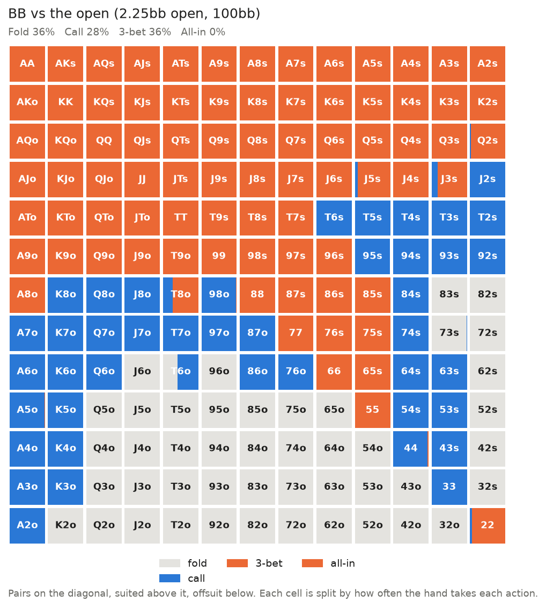
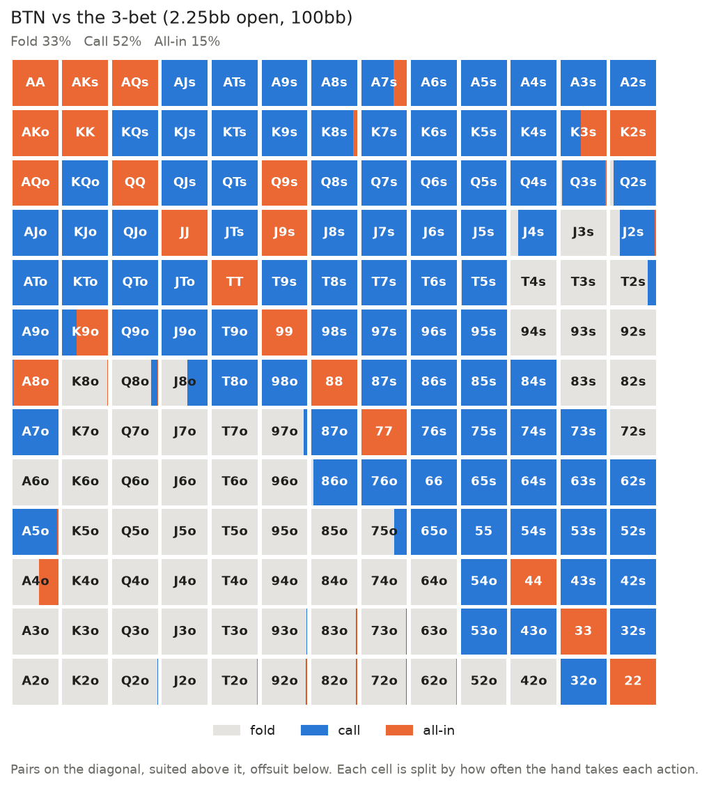
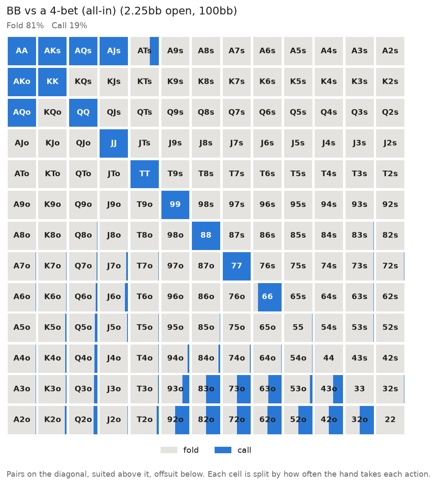
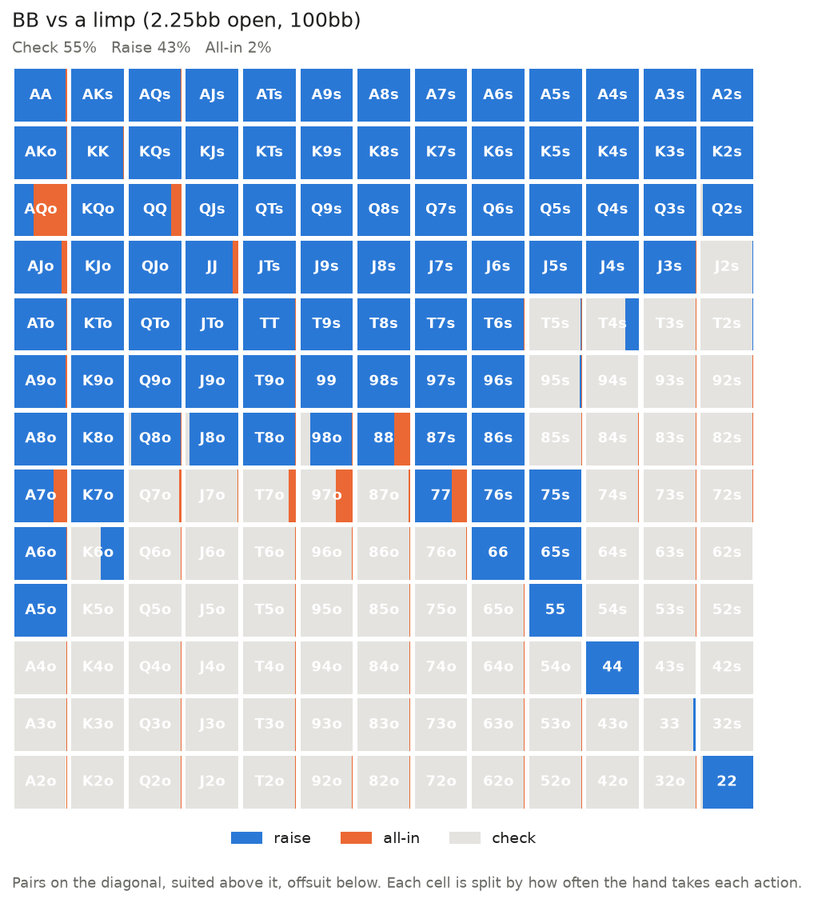
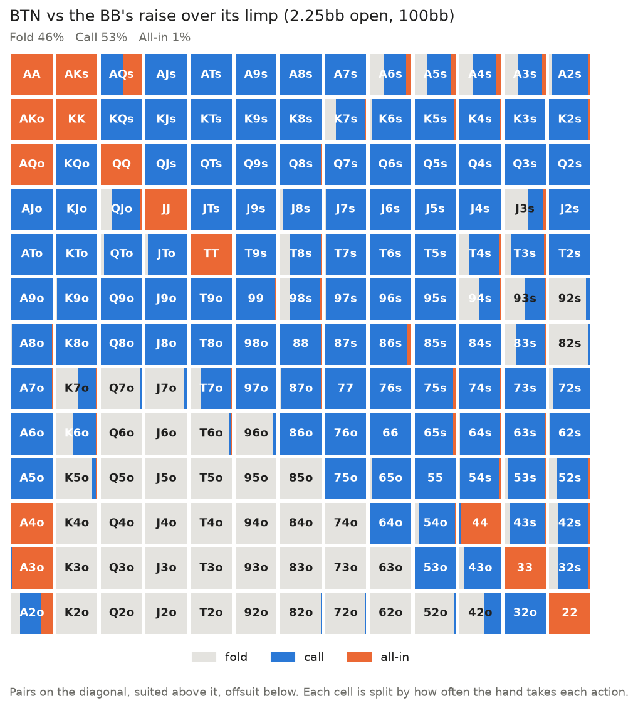
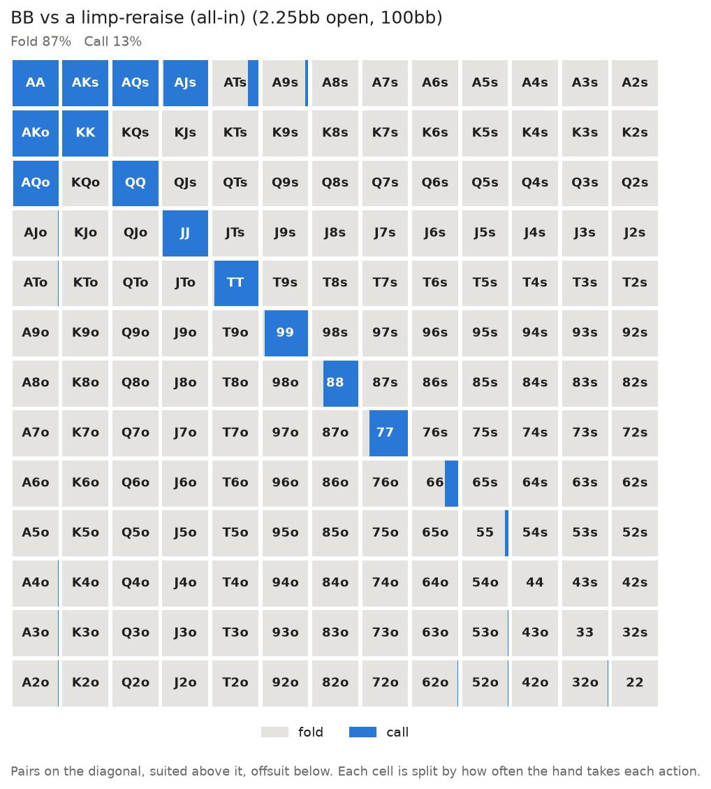
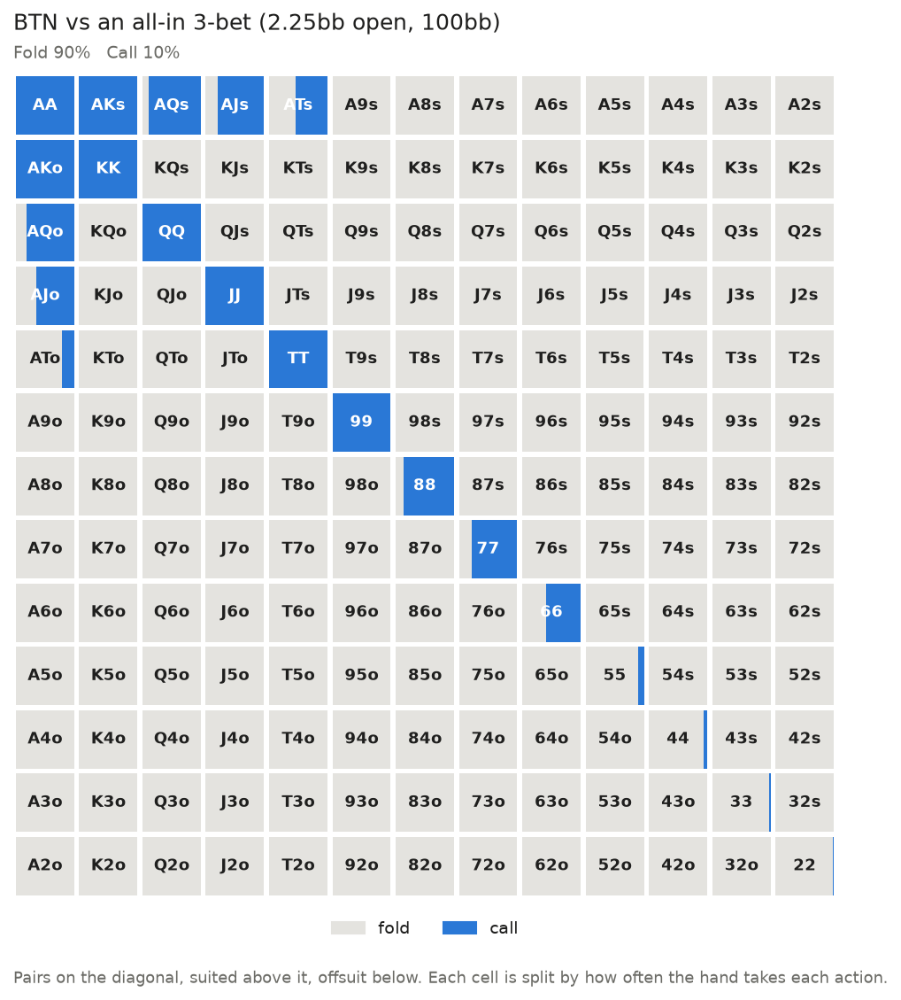
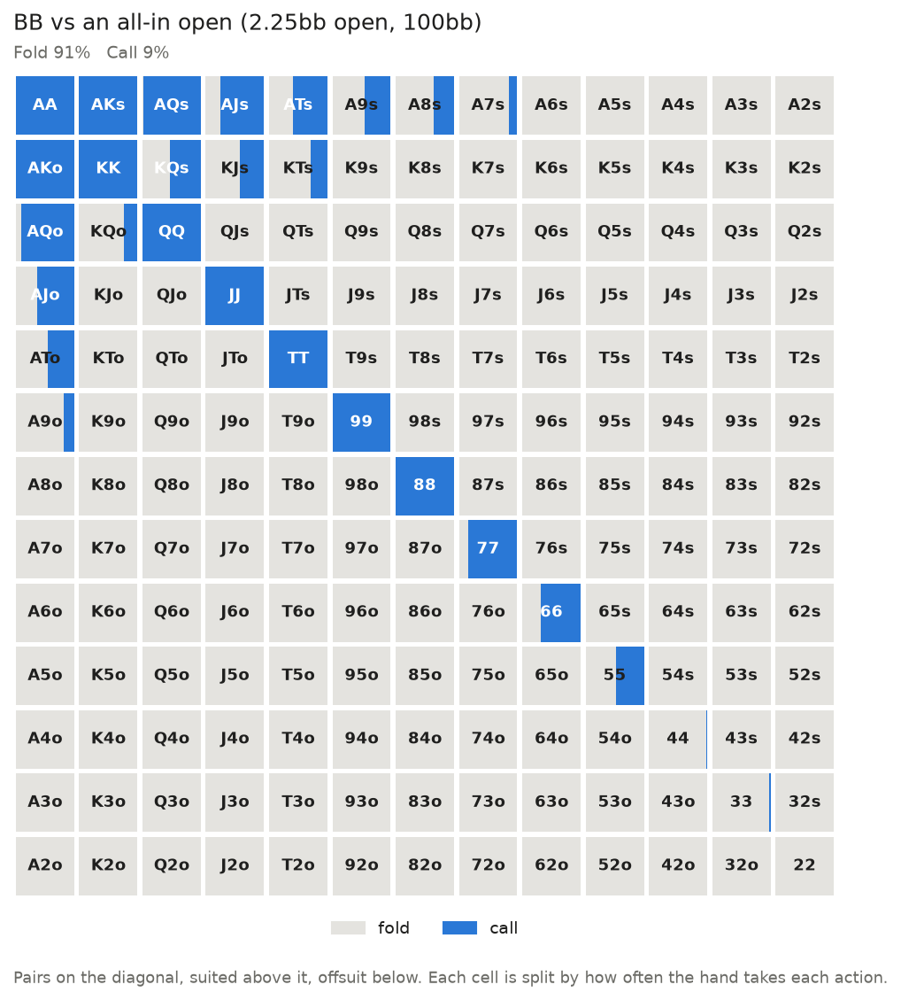

# 100bb heads-up strategy book

Generated by `scripts/match_strategy.py` (experiment 26). All frequencies are shares of the hands that reach the decision. Postflop tables are by hand strength (12 groups), averaged over boards.

## Preflop

**BTN opens 2.25bb.** The BB 3-bets to **6.75bb** and raises limps to **5bb**. A 4-bet is all-in.

Manual override:  (see `OVERRIDES`).

### BTN first action

**fold** 9%   **limp** 26%   **raise** 65%   **all-in** 0%

### BB vs the open

**fold** 36%   **call** 28%   **3-bet** 36%   **all-in** 0%

### BTN vs the 3-bet

**fold** 33%   **call** 52%   **all-in** 15%

### BB vs a 4-bet (all-in)

**fold** 81%   **call** 19%

### BB vs a limp

**check** 55%   **raise** 43%   **all-in** 2%

### BTN vs the BB's raise over its limp

**fold** 46%   **call** 53%   **all-in** 1%

### BB vs a limp-reraise (all-in) (off the equilibrium path: our answer if the opponent does this)

**fold** 87%   **call** 13%

### BTN vs an all-in 3-bet (off the equilibrium path: our answer if the opponent does this)

**fold** 90%   **call** 10%

### BB vs an all-in open (off the equilibrium path: our answer if the opponent does this)

**fold** 91%   **call** 9%

### The BB against other open sizes

| BTN opens to | BB folds | calls | 3-bets | to | BTN EV (mbb/hand) |
|---|---|---|---|---|---|
| 2bb | 30% | 31% | 39% | 6bb | +76 |
| 2.25bb | 36% | 28% | 36% | 6.75bb | +73 |
| 2.5bb | 43% | 21% | 36% | 6.25bb | +70 |
| 3bb | 50% | 18% | 31% | 7.5bb | +63 |
| 3.5bb | 54% | 21% | 25% | 10.5bb | +54 |
| 4bb | 55% | 24% | 22% | 10bb | +13 |

### The BTN against other 3-bet sizes

| BB 3-bets to | BTN folds | calls | 4-bets all-in |
|---|---|---|---|
| 5.625bb | 16% | 72% | 13% |
| 6.75bb | 33% | 52% | 15% |
| 7.875bb | 36% | 46% | 18% |
| 9bb | 43% | 38% | 19% |
| 10.125bb | 50% | 32% | 19% |
| 11.25bb | 53% | 29% | 18% |

## Single-raised pot (BTN raises, BB calls)

Pot 6bb, 97bb behind. BTN nets +1.04bb per pot.

### Flop

**BB acts first (check or lead)**

| hand | share | check | lead 1/3 | lead 3/4 |
|---|---|---|---|---|
| straight or better | 1% | 71% | 16% | 14% |
| set / trips | 2% | 71% | 19% | 10% |
| two pair | 2% | 85% | 6% | 8% |
| overpair | 0% | 29% | 51% | 20% |
| top pair, T+ kicker | 3% | 83% | 13% | 4% |
| top pair, weak kicker | 7% | 89% | 9% | 2% |
| middle pair | 11% | 88% | 9% | 3% |
| weak pair | 11% | 93% | 5% | 2% |
| strong draw | 6% | 77% | 15% | 8% |
| weak draw | 15% | 87% | 8% | 5% |
| overcards | 4% | 86% | 9% | 5% |
| air | 37% | 95% | 3% | 1% |
| **all hands** | 100% | 90% | 7% | 3% |

**BTN after the BB checks**

| hand | share | check | bet 1/3 | bet 2/3 | bet pot |
|---|---|---|---|---|---|
| straight or better | 1% | 3% | 28% | 39% | 30% |
| set / trips | 2% | 2% | 41% | 37% | 20% |
| two pair | 2% | 4% | 24% | 33% | 40% |
| overpair | 3% | 11% | 36% | 23% | 31% |
| top pair, T+ kicker | 6% | 9% | 33% | 30% | 28% |
| top pair, weak kicker | 7% | 36% | 41% | 15% | 7% |
| middle pair | 11% | 25% | 49% | 20% | 6% |
| weak pair | 8% | 68% | 16% | 8% | 7% |
| strong draw | 6% | 5% | 53% | 32% | 11% |
| weak draw | 17% | 24% | 32% | 25% | 19% |
| overcards | 8% | 53% | 21% | 16% | 10% |
| air | 29% | 7% | 48% | 28% | 18% |
| **all hands** | 100% | 22% | 38% | 24% | 16% |

**BB facing a BTN bet**

| hand | share | fold | call | raise |
|---|---|---|---|---|
| straight or better | 1% | 1% | 24% | 75% |
| set / trips | 2% | 0% | 19% | 81% |
| two pair | 2% | 1% | 13% | 86% |
| overpair | 0% | 12% | 42% | 46% |
| top pair, T+ kicker | 2% | 3% | 47% | 49% |
| top pair, weak kicker | 7% | 3% | 67% | 30% |
| middle pair | 11% | 4% | 63% | 33% |
| weak pair | 12% | 27% | 50% | 23% |
| strong draw | 5% | 4% | 33% | 63% |
| weak draw | 15% | 42% | 38% | 20% |
| overcards | 4% | 69% | 22% | 9% |
| air | 41% | 93% | 3% | 4% |
| **all hands** | 100% | 51% | 28% | 21% |

**BTN facing a check-raise**

| hand | share | fold | call |
|---|---|---|---|
| straight or better | 1% | 1% | 99% |
| set / trips | 3% | 1% | 99% |
| two pair | 2% | 2% | 98% |
| overpair | 4% | 1% | 99% |
| top pair, T+ kicker | 7% | 2% | 98% |
| top pair, weak kicker | 5% | 3% | 97% |
| middle pair | 12% | 2% | 98% |
| weak pair | 3% | 8% | 92% |
| strong draw | 8% | 2% | 98% |
| weak draw | 16% | 17% | 83% |
| overcards | 5% | 67% | 33% |
| air | 35% | 93% | 7% |
| **all hands** | 100% | 40% | 60% |

**BTN facing a BB lead**

| hand | share | fold | call | raise |
|---|---|---|---|---|
| straight or better | 1% | 1% | 32% | 67% |
| set / trips | 3% | 1% | 31% | 68% |
| two pair | 1% | 6% | 22% | 73% |
| overpair | 4% | 1% | 50% | 49% |
| top pair, T+ kicker | 5% | 3% | 39% | 59% |
| top pair, weak kicker | 5% | 5% | 56% | 39% |
| middle pair | 9% | 2% | 64% | 33% |
| weak pair | 6% | 9% | 49% | 42% |
| strong draw | 7% | 2% | 47% | 51% |
| weak draw | 18% | 15% | 45% | 40% |
| overcards | 13% | 26% | 50% | 24% |
| air | 27% | 55% | 24% | 21% |
| **all hands** | 100% | 22% | 42% | 36% |

**BB's lead got raised**

| hand | share | fold | call |
|---|---|---|---|
| straight or better | 2% | 1% | 99% |
| set / trips | 5% | 1% | 99% |
| two pair | 3% | 2% | 98% |
| overpair | 1% | 10% | 90% |
| top pair, T+ kicker | 5% | 4% | 96% |
| top pair, weak kicker | 8% | 7% | 93% |
| middle pair | 14% | 10% | 90% |
| weak pair | 8% | 72% | 28% |
| strong draw | 14% | 5% | 95% |
| weak draw | 19% | 77% | 23% |
| overcards | 6% | 85% | 15% |
| air | 16% | 97% | 3% |
| **all hands** | 100% | 44% | 56% |

**BTN after the BB checks, by board (all hands)**

| hand | check | bet 1/3 | bet 2/3 | bet pot |
|---|---|---|---|---|
| A-high | 24% | 45% | 18% | 14% |
| K-high | 16% | 49% | 21% | 13% |
| Q/J-high | 18% | 34% | 31% | 17% |
| T-high or lower | 29% | 31% | 23% | 17% |
| paired | 22% | 47% | 23% | 8% |
| monotone | 27% | 24% | 27% | 22% |
| connected | 31% | 25% | 24% | 20% |

### Turn

**BB acts first (check or lead) — no bet last street**

| hand | share | check | lead 1/2 | lead pot |
|---|---|---|---|---|
| straight or better | 4% | 64% | 8% | 28% |
| set / trips | 3% | 59% | 7% | 34% |
| two pair | 3% | 42% | 19% | 38% |
| overpair | 0% | 30% | 29% | 41% |
| top pair, T+ kicker | 2% | 22% | 47% | 31% |
| top pair, weak kicker | 7% | 64% | 26% | 11% |
| middle pair | 10% | 85% | 12% | 2% |
| weak pair | 18% | 98% | 1% | 1% |
| strong draw | 10% | 82% | 3% | 15% |
| weak draw | 14% | 76% | 15% | 9% |
| overcards | 2% | 58% | 9% | 33% |
| air | 27% | 93% | 2% | 5% |
| **all hands** | 100% | 81% | 9% | 10% |

**BB acts first (check or lead) — BTN bet last street**

| hand | share | check | lead 1/2 | lead pot |
|---|---|---|---|---|
| straight or better | 5% | 80% | 10% | 10% |
| set / trips | 4% | 78% | 14% | 9% |
| two pair | 4% | 87% | 5% | 8% |
| overpair | 0% | 31% | 48% | 21% |
| top pair, T+ kicker | 3% | 87% | 11% | 2% |
| top pair, weak kicker | 13% | 97% | 3% | 1% |
| middle pair | 17% | 99% | 1% | 0% |
| weak pair | 28% | 99% | 0% | 1% |
| strong draw | 9% | 81% | 10% | 9% |
| weak draw | 9% | 82% | 12% | 6% |
| overcards | 1% | 81% | 9% | 9% |
| air | 7% | 84% | 11% | 6% |
| **all hands** | 100% | 92% | 5% | 3% |

**BB acts first (check or lead) — BB bet last street**

| hand | share | check | lead 1/2 | lead pot |
|---|---|---|---|---|
| straight or better | 8% | 48% | 25% | 26% |
| set / trips | 7% | 69% | 10% | 21% |
| two pair | 7% | 42% | 14% | 44% |
| overpair | 0% | 43% | 38% | 19% |
| top pair, T+ kicker | 4% | 71% | 22% | 7% |
| top pair, weak kicker | 8% | 94% | 5% | 2% |
| middle pair | 13% | 93% | 6% | 1% |
| weak pair | 19% | 96% | 1% | 3% |
| strong draw | 14% | 51% | 18% | 32% |
| weak draw | 9% | 57% | 17% | 26% |
| overcards | 1% | 45% | 16% | 38% |
| air | 11% | 82% | 6% | 12% |
| **all hands** | 100% | 73% | 11% | 16% |

**BTN after the BB checks — no bet last street**

| hand | share | check | bet 1/2 | bet pot |
|---|---|---|---|---|
| straight or better | 2% | 0% | 14% | 86% |
| set / trips | 2% | 0% | 29% | 71% |
| two pair | 3% | 2% | 30% | 68% |
| overpair | 1% | 16% | 56% | 28% |
| top pair, T+ kicker | 4% | 14% | 42% | 44% |
| top pair, weak kicker | 11% | 62% | 23% | 14% |
| middle pair | 10% | 40% | 29% | 31% |
| weak pair | 27% | 89% | 6% | 4% |
| strong draw | 6% | 4% | 25% | 70% |
| weak draw | 11% | 32% | 48% | 20% |
| overcards | 10% | 88% | 3% | 9% |
| air | 13% | 8% | 37% | 55% |
| **all hands** | 100% | 49% | 23% | 28% |

**BTN after the BB checks — BTN bet last street**

| hand | share | check | bet 1/2 | bet pot |
|---|---|---|---|---|
| straight or better | 5% | 1% | 28% | 72% |
| set / trips | 3% | 9% | 25% | 66% |
| two pair | 3% | 15% | 13% | 72% |
| overpair | 3% | 49% | 27% | 24% |
| top pair, T+ kicker | 6% | 31% | 28% | 41% |
| top pair, weak kicker | 6% | 54% | 30% | 16% |
| middle pair | 11% | 84% | 14% | 3% |
| weak pair | 10% | 96% | 2% | 2% |
| strong draw | 12% | 24% | 11% | 65% |
| weak draw | 13% | 40% | 19% | 41% |
| overcards | 3% | 70% | 10% | 20% |
| air | 25% | 64% | 10% | 25% |
| **all hands** | 100% | 53% | 15% | 32% |

**BTN after the BB checks — BB bet last street**

| hand | share | check | bet 1/2 | bet pot |
|---|---|---|---|---|
| straight or better | 6% | 11% | 48% | 41% |
| set / trips | 5% | 14% | 43% | 42% |
| two pair | 3% | 15% | 29% | 56% |
| overpair | 4% | 54% | 18% | 28% |
| top pair, T+ kicker | 8% | 42% | 27% | 32% |
| top pair, weak kicker | 7% | 61% | 35% | 4% |
| middle pair | 15% | 92% | 6% | 1% |
| weak pair | 13% | 95% | 3% | 2% |
| strong draw | 13% | 41% | 20% | 39% |
| weak draw | 10% | 28% | 38% | 34% |
| overcards | 4% | 81% | 12% | 7% |
| air | 12% | 20% | 37% | 43% |
| **all hands** | 100% | 52% | 24% | 25% |

**BB facing a BTN bet — no bet last street**

| hand | share | fold | call | raise |
|---|---|---|---|---|
| straight or better | 3% | 0% | 14% | 86% |
| set / trips | 2% | 0% | 47% | 53% |
| two pair | 2% | 1% | 39% | 60% |
| overpair | 0% | 15% | 51% | 34% |
| top pair, T+ kicker | 1% | 4% | 47% | 49% |
| top pair, weak kicker | 5% | 2% | 59% | 39% |
| middle pair | 10% | 1% | 95% | 3% |
| weak pair | 21% | 32% | 68% | 1% |
| strong draw | 10% | 26% | 38% | 36% |
| weak draw | 12% | 83% | 8% | 9% |
| overcards | 2% | 54% | 21% | 25% |
| air | 33% | 97% | 0% | 3% |
| **all hands** | 100% | 52% | 34% | 14% |

**BB facing a BTN bet — BTN bet last street**

| hand | share | fold | call | raise |
|---|---|---|---|---|
| straight or better | 4% | 0% | 44% | 56% |
| set / trips | 3% | 0% | 60% | 40% |
| two pair | 4% | 3% | 41% | 56% |
| overpair | 0% | 21% | 39% | 41% |
| top pair, T+ kicker | 3% | 7% | 78% | 15% |
| top pair, weak kicker | 13% | 7% | 88% | 5% |
| middle pair | 19% | 29% | 68% | 3% |
| weak pair | 31% | 87% | 11% | 2% |
| strong draw | 8% | 47% | 11% | 41% |
| weak draw | 8% | 96% | 0% | 4% |
| overcards | 1% | 89% | 1% | 11% |
| air | 7% | 99% | 0% | 1% |
| **all hands** | 100% | 52% | 36% | 12% |

**BB facing a BTN bet — BB bet last street**

| hand | share | fold | call | raise |
|---|---|---|---|---|
| straight or better | 5% | 0% | 55% | 45% |
| set / trips | 6% | 0% | 52% | 48% |
| two pair | 4% | 8% | 34% | 59% |
| overpair | 0% | 32% | 31% | 37% |
| top pair, T+ kicker | 3% | 8% | 67% | 25% |
| top pair, weak kicker | 10% | 9% | 83% | 8% |
| middle pair | 16% | 17% | 77% | 6% |
| weak pair | 24% | 84% | 13% | 2% |
| strong draw | 10% | 37% | 31% | 32% |
| weak draw | 7% | 94% | 1% | 5% |
| overcards | 1% | 85% | 1% | 14% |
| air | 13% | 97% | 0% | 3% |
| **all hands** | 100% | 48% | 37% | 15% |

**BTN facing a check-raise — no bet last street**

| hand | share | fold | call |
|---|---|---|---|
| straight or better | 5% | 0% | 100% |
| set / trips | 3% | 1% | 99% |
| two pair | 5% | 2% | 98% |
| overpair | 2% | 5% | 95% |
| top pair, T+ kicker | 7% | 3% | 97% |
| top pair, weak kicker | 8% | 3% | 97% |
| middle pair | 12% | 10% | 90% |
| weak pair | 6% | 23% | 77% |
| strong draw | 11% | 7% | 93% |
| weak draw | 18% | 44% | 56% |
| overcards | 3% | 35% | 65% |
| air | 21% | 97% | 3% |
| **all hands** | 100% | 33% | 67% |

**BTN facing a check-raise — BTN bet last street**

| hand | share | fold | call |
|---|---|---|---|
| straight or better | 10% | 0% | 100% |
| set / trips | 6% | 1% | 99% |
| two pair | 6% | 2% | 98% |
| overpair | 3% | 16% | 84% |
| top pair, T+ kicker | 10% | 13% | 87% |
| top pair, weak kicker | 6% | 27% | 73% |
| middle pair | 5% | 13% | 87% |
| weak pair | 1% | 65% | 35% |
| strong draw | 16% | 25% | 75% |
| weak draw | 17% | 90% | 10% |
| overcards | 2% | 95% | 5% |
| air | 18% | 100% | 0% |
| **all hands** | 100% | 44% | 56% |

**BTN facing a check-raise — BB bet last street**

| hand | share | fold | call |
|---|---|---|---|
| straight or better | 10% | 0% | 100% |
| set / trips | 8% | 1% | 99% |
| two pair | 7% | 2% | 98% |
| overpair | 5% | 13% | 87% |
| top pair, T+ kicker | 10% | 14% | 86% |
| top pair, weak kicker | 5% | 19% | 81% |
| middle pair | 3% | 19% | 81% |
| weak pair | 2% | 84% | 16% |
| strong draw | 14% | 17% | 83% |
| weak draw | 17% | 88% | 12% |
| overcards | 2% | 95% | 5% |
| air | 18% | 99% | 1% |
| **all hands** | 100% | 42% | 58% |

**BTN facing a BB lead — no bet last street**

| hand | share | fold | call | raise |
|---|---|---|---|---|
| straight or better | 3% | 0% | 4% | 96% |
| set / trips | 2% | 0% | 41% | 59% |
| two pair | 3% | 4% | 53% | 42% |
| overpair | 1% | 2% | 28% | 70% |
| top pair, T+ kicker | 4% | 5% | 45% | 51% |
| top pair, weak kicker | 9% | 4% | 25% | 71% |
| middle pair | 9% | 9% | 61% | 29% |
| weak pair | 26% | 34% | 60% | 6% |
| strong draw | 6% | 3% | 44% | 54% |
| weak draw | 12% | 55% | 37% | 8% |
| overcards | 14% | 63% | 15% | 22% |
| air | 11% | 89% | 5% | 6% |
| **all hands** | 100% | 35% | 38% | 27% |

**BTN facing a BB lead — BTN bet last street**

| hand | share | fold | call | raise |
|---|---|---|---|---|
| straight or better | 6% | 0% | 43% | 57% |
| set / trips | 4% | 2% | 33% | 66% |
| two pair | 2% | 6% | 33% | 61% |
| overpair | 3% | 7% | 58% | 36% |
| top pair, T+ kicker | 6% | 7% | 61% | 32% |
| top pair, weak kicker | 6% | 10% | 63% | 27% |
| middle pair | 11% | 17% | 72% | 11% |
| weak pair | 8% | 54% | 40% | 7% |
| strong draw | 11% | 9% | 46% | 44% |
| weak draw | 11% | 61% | 31% | 8% |
| overcards | 4% | 70% | 15% | 15% |
| air | 27% | 94% | 1% | 5% |
| **all hands** | 100% | 44% | 34% | 22% |

**BTN facing a BB lead — BB bet last street**

| hand | share | fold | call | raise |
|---|---|---|---|---|
| straight or better | 6% | 0% | 64% | 36% |
| set / trips | 4% | 1% | 58% | 41% |
| two pair | 4% | 6% | 27% | 67% |
| overpair | 4% | 13% | 56% | 31% |
| top pair, T+ kicker | 8% | 8% | 63% | 29% |
| top pair, weak kicker | 7% | 10% | 74% | 16% |
| middle pair | 15% | 26% | 64% | 10% |
| weak pair | 13% | 76% | 20% | 4% |
| strong draw | 13% | 10% | 55% | 35% |
| weak draw | 10% | 85% | 10% | 5% |
| overcards | 5% | 85% | 6% | 9% |
| air | 10% | 97% | 1% | 2% |
| **all hands** | 100% | 40% | 41% | 19% |

**BB's lead got raised — no bet last street**

| hand | share | fold | call |
|---|---|---|---|
| straight or better | 9% | 0% | 100% |
| set / trips | 5% | 0% | 100% |
| two pair | 9% | 1% | 99% |
| overpair | 0% | 18% | 82% |
| top pair, T+ kicker | 10% | 2% | 98% |
| top pair, weak kicker | 15% | 2% | 98% |
| middle pair | 9% | 7% | 93% |
| weak pair | 2% | 74% | 26% |
| strong draw | 10% | 86% | 14% |
| weak draw | 19% | 99% | 1% |
| overcards | 5% | 55% | 45% |
| air | 10% | 100% | 0% |
| **all hands** | 100% | 41% | 59% |

**BB's lead got raised — BTN bet last street**

| hand | share | fold | call |
|---|---|---|---|
| straight or better | 12% | 0% | 100% |
| set / trips | 8% | 0% | 100% |
| two pair | 8% | 2% | 98% |
| overpair | 0% | 22% | 78% |
| top pair, T+ kicker | 6% | 7% | 93% |
| top pair, weak kicker | 5% | 15% | 85% |
| middle pair | 4% | 41% | 59% |
| weak pair | 3% | 89% | 11% |
| strong draw | 21% | 59% | 41% |
| weak draw | 19% | 99% | 1% |
| overcards | 2% | 94% | 6% |
| air | 12% | 100% | 0% |
| **all hands** | 100% | 51% | 49% |

**BB's lead got raised — BB bet last street**

| hand | share | fold | call |
|---|---|---|---|
| straight or better | 16% | 0% | 100% |
| set / trips | 6% | 0% | 100% |
| two pair | 17% | 1% | 99% |
| overpair | 0% | 21% | 79% |
| top pair, T+ kicker | 5% | 10% | 90% |
| top pair, weak kicker | 2% | 20% | 80% |
| middle pair | 4% | 45% | 55% |
| weak pair | 3% | 95% | 5% |
| strong draw | 25% | 62% | 38% |
| weak draw | 14% | 99% | 1% |
| overcards | 2% | 85% | 15% |
| air | 6% | 100% | 0% |
| **all hands** | 100% | 43% | 57% |

### River

**BB acts first (check or lead) — no bet last street**

| hand | share | check | lead 1/2 | lead pot |
|---|---|---|---|---|
| straight or better | 11% | 50% | 17% | 33% |
| set / trips | 4% | 54% | 20% | 26% |
| two pair | 5% | 13% | 53% | 34% |
| overpair | 0% | 37% | 50% | 14% |
| top pair, T+ kicker | 1% | 25% | 59% | 16% |
| top pair, weak kicker | 9% | 7% | 69% | 23% |
| middle pair | 11% | 83% | 16% | 1% |
| weak pair | 30% | 98% | 1% | 1% |
| missed strong draw | 6% | 69% | 18% | 14% |
| missed weak draw | 8% | 45% | 20% | 35% |
| overcards | 1% | 23% | 44% | 34% |
| air | 14% | 50% | 33% | 18% |
| **all hands** | 100% | 63% | 22% | 15% |

**BB acts first (check or lead) — BTN bet last street**

| hand | share | check | lead 1/2 | lead pot |
|---|---|---|---|---|
| straight or better | 13% | 79% | 11% | 10% |
| set / trips | 7% | 76% | 15% | 9% |
| two pair | 8% | 82% | 13% | 5% |
| overpair | 0% | 30% | 39% | 31% |
| top pair, T+ kicker | 3% | 91% | 6% | 3% |
| top pair, weak kicker | 16% | 96% | 3% | 0% |
| middle pair | 21% | 100% | 0% | 0% |
| weak pair | 26% | 100% | 0% | 0% |
| missed strong draw | 5% | 54% | 30% | 16% |
| missed weak draw | 1% | 81% | 17% | 2% |
| overcards | 0% | 81% | 13% | 6% |
| air | 0% | 78% | 19% | 3% |
| **all hands** | 100% | 91% | 6% | 3% |

**BB acts first (check or lead) — BB bet last street**

| hand | share | check | lead 1/2 | lead pot |
|---|---|---|---|---|
| straight or better | 23% | 22% | 26% | 52% |
| set / trips | 7% | 25% | 35% | 40% |
| two pair | 11% | 22% | 49% | 29% |
| overpair | 0% | 36% | 28% | 36% |
| top pair, T+ kicker | 4% | 42% | 44% | 13% |
| top pair, weak kicker | 8% | 49% | 47% | 4% |
| middle pair | 7% | 93% | 5% | 2% |
| weak pair | 7% | 84% | 6% | 10% |
| missed strong draw | 14% | 59% | 19% | 22% |
| missed weak draw | 10% | 29% | 30% | 41% |
| overcards | 1% | 63% | 25% | 12% |
| air | 7% | 85% | 7% | 8% |
| **all hands** | 100% | 46% | 27% | 28% |

**BTN after the BB checks — no bet last street**

| hand | share | check | bet 1/2 | bet pot | bet 1.5x |
|---|---|---|---|---|---|
| straight or better | 6% | 0% | 2% | 41% | 56% |
| set / trips | 2% | 0% | 33% | 50% | 17% |
| two pair | 3% | 0% | 60% | 28% | 11% |
| overpair | 2% | 13% | 53% | 24% | 11% |
| top pair, T+ kicker | 4% | 7% | 74% | 12% | 7% |
| top pair, weak kicker | 8% | 4% | 64% | 22% | 10% |
| middle pair | 13% | 66% | 31% | 1% | 1% |
| weak pair | 32% | 99% | 1% | 0% | 0% |
| missed strong draw | 3% | 21% | 47% | 20% | 12% |
| missed weak draw | 6% | 21% | 27% | 28% | 24% |
| overcards | 6% | 97% | 1% | 1% | 1% |
| air | 15% | 64% | 19% | 10% | 7% |
| **all hands** | 100% | 59% | 22% | 11% | 8% |

**BTN after the BB checks — BTN bet last street**

| hand | share | check | bet 1/2 | bet pot | bet 1.5x |
|---|---|---|---|---|---|
| straight or better | 16% | 0% | 3% | 32% | 65% |
| set / trips | 5% | 0% | 20% | 39% | 41% |
| two pair | 6% | 9% | 34% | 31% | 26% |
| overpair | 2% | 61% | 12% | 18% | 8% |
| top pair, T+ kicker | 8% | 53% | 19% | 20% | 8% |
| top pair, weak kicker | 8% | 72% | 18% | 8% | 2% |
| middle pair | 8% | 96% | 3% | 1% | 1% |
| weak pair | 7% | 88% | 1% | 4% | 6% |
| missed strong draw | 10% | 70% | 5% | 10% | 14% |
| missed weak draw | 11% | 18% | 9% | 28% | 45% |
| overcards | 2% | 85% | 2% | 5% | 8% |
| air | 16% | 74% | 6% | 9% | 10% |
| **all hands** | 100% | 49% | 9% | 18% | 24% |

**BTN after the BB checks — BB bet last street**

| hand | share | check | bet 1/2 | bet pot | bet 1.5x |
|---|---|---|---|---|---|
| straight or better | 16% | 0% | 8% | 41% | 50% |
| set / trips | 6% | 1% | 34% | 39% | 26% |
| two pair | 5% | 12% | 33% | 34% | 21% |
| overpair | 3% | 61% | 20% | 12% | 6% |
| top pair, T+ kicker | 8% | 62% | 29% | 7% | 2% |
| top pair, weak kicker | 9% | 82% | 14% | 3% | 1% |
| middle pair | 14% | 99% | 0% | 0% | 1% |
| weak pair | 18% | 95% | 0% | 2% | 3% |
| missed strong draw | 10% | 10% | 25% | 35% | 30% |
| missed weak draw | 6% | 40% | 19% | 16% | 25% |
| overcards | 2% | 79% | 3% | 10% | 7% |
| air | 1% | 24% | 29% | 27% | 20% |
| **all hands** | 100% | 51% | 14% | 18% | 17% |

**BB facing a BTN bet — no bet last street**

| hand | share | fold | call | raise |
|---|---|---|---|---|
| straight or better | 9% | 0% | 13% | 87% |
| set / trips | 4% | 0% | 33% | 67% |
| two pair | 1% | 1% | 43% | 56% |
| overpair | 0% | 23% | 29% | 49% |
| top pair, T+ kicker | 1% | 4% | 48% | 48% |
| top pair, weak kicker | 1% | 4% | 59% | 37% |
| middle pair | 15% | 10% | 87% | 3% |
| weak pair | 47% | 66% | 31% | 3% |
| missed strong draw | 7% | 95% | 0% | 5% |
| missed weak draw | 5% | 94% | 0% | 6% |
| overcards | 0% | 84% | 1% | 15% |
| air | 10% | 86% | 0% | 13% |
| **all hands** | 100% | 52% | 32% | 16% |

**BB facing a BTN bet — BTN bet last street**

| hand | share | fold | call | raise |
|---|---|---|---|---|
| straight or better | 13% | 0% | 39% | 61% |
| set / trips | 6% | 2% | 69% | 29% |
| two pair | 7% | 9% | 72% | 19% |
| overpair | 0% | 33% | 38% | 29% |
| top pair, T+ kicker | 3% | 40% | 48% | 12% |
| top pair, weak kicker | 16% | 42% | 52% | 7% |
| middle pair | 23% | 60% | 35% | 4% |
| weak pair | 28% | 84% | 13% | 3% |
| missed strong draw | 3% | 93% | 0% | 7% |
| missed weak draw | 1% | 93% | 0% | 7% |
| overcards | 0% | 86% | 0% | 13% |
| air | 0% | 93% | 0% | 7% |
| **all hands** | 100% | 50% | 36% | 14% |

**BB facing a BTN bet — BB bet last street**

| hand | share | fold | call | raise |
|---|---|---|---|---|
| straight or better | 12% | 0% | 34% | 66% |
| set / trips | 4% | 1% | 52% | 47% |
| two pair | 6% | 9% | 60% | 31% |
| overpair | 0% | 20% | 52% | 28% |
| top pair, T+ kicker | 3% | 22% | 63% | 15% |
| top pair, weak kicker | 8% | 25% | 64% | 10% |
| middle pair | 14% | 46% | 48% | 6% |
| weak pair | 13% | 84% | 13% | 3% |
| missed strong draw | 18% | 98% | 0% | 2% |
| missed weak draw | 5% | 96% | 0% | 4% |
| overcards | 2% | 90% | 1% | 9% |
| air | 14% | 98% | 0% | 1% |
| **all hands** | 100% | 59% | 25% | 15% |

**BTN facing a check-raise — no bet last street**

| hand | share | fold | call |
|---|---|---|---|
| straight or better | 14% | 0% | 100% |
| set / trips | 4% | 7% | 93% |
| two pair | 8% | 13% | 87% |
| overpair | 5% | 46% | 54% |
| top pair, T+ kicker | 11% | 26% | 74% |
| top pair, weak kicker | 17% | 20% | 80% |
| middle pair | 11% | 50% | 50% |
| weak pair | 1% | 83% | 17% |
| missed strong draw | 6% | 100% | 0% |
| missed weak draw | 10% | 100% | 0% |
| overcards | 0% | 98% | 2% |
| air | 13% | 100% | 0% |
| **all hands** | 100% | 46% | 54% |

**BTN facing a check-raise — BTN bet last street**

| hand | share | fold | call |
|---|---|---|---|
| straight or better | 36% | 0% | 100% |
| set / trips | 10% | 6% | 94% |
| two pair | 10% | 11% | 89% |
| overpair | 2% | 42% | 58% |
| top pair, T+ kicker | 7% | 33% | 67% |
| top pair, weak kicker | 5% | 43% | 57% |
| middle pair | 1% | 39% | 61% |
| weak pair | 2% | 47% | 53% |
| missed strong draw | 6% | 74% | 26% |
| missed weak draw | 11% | 78% | 22% |
| overcards | 1% | 78% | 22% |
| air | 8% | 86% | 14% |
| **all hands** | 100% | 30% | 70% |

**BTN facing a check-raise — BB bet last street**

| hand | share | fold | call |
|---|---|---|---|
| straight or better | 36% | 0% | 100% |
| set / trips | 14% | 6% | 94% |
| two pair | 10% | 15% | 85% |
| overpair | 3% | 21% | 79% |
| top pair, T+ kicker | 7% | 38% | 62% |
| top pair, weak kicker | 3% | 49% | 51% |
| middle pair | 0% | 18% | 82% |
| weak pair | 2% | 34% | 66% |
| missed strong draw | 19% | 64% | 36% |
| missed weak draw | 5% | 82% | 18% |
| overcards | 0% | 80% | 20% |
| air | 1% | 90% | 10% |
| **all hands** | 100% | 25% | 75% |

**BTN facing a BB lead — no bet last street**

| hand | share | fold | call | raise |
|---|---|---|---|---|
| straight or better | 6% | 0% | 0% | 100% |
| set / trips | 2% | 0% | 19% | 81% |
| two pair | 3% | 1% | 31% | 68% |
| overpair | 2% | 2% | 62% | 35% |
| top pair, T+ kicker | 4% | 2% | 73% | 25% |
| top pair, weak kicker | 8% | 2% | 92% | 6% |
| middle pair | 12% | 10% | 88% | 2% |
| weak pair | 32% | 53% | 44% | 3% |
| missed strong draw | 3% | 93% | 0% | 7% |
| missed weak draw | 6% | 93% | 0% | 7% |
| overcards | 7% | 66% | 25% | 9% |
| air | 15% | 88% | 0% | 12% |
| **all hands** | 100% | 45% | 39% | 16% |

**BTN facing a BB lead — BTN bet last street**

| hand | share | fold | call | raise |
|---|---|---|---|---|
| straight or better | 20% | 0% | 2% | 98% |
| set / trips | 5% | 1% | 31% | 68% |
| two pair | 5% | 1% | 56% | 42% |
| overpair | 3% | 27% | 63% | 9% |
| top pair, T+ kicker | 7% | 8% | 82% | 10% |
| top pair, weak kicker | 6% | 8% | 85% | 8% |
| middle pair | 7% | 27% | 68% | 6% |
| weak pair | 5% | 54% | 40% | 6% |
| missed strong draw | 13% | 88% | 1% | 12% |
| missed weak draw | 11% | 83% | 8% | 9% |
| overcards | 2% | 58% | 36% | 6% |
| air | 14% | 95% | 2% | 3% |
| **all hands** | 100% | 42% | 27% | 31% |

**BTN facing a BB lead — BB bet last street**

| hand | share | fold | call | raise |
|---|---|---|---|---|
| straight or better | 17% | 0% | 1% | 99% |
| set / trips | 6% | 1% | 53% | 45% |
| two pair | 7% | 4% | 70% | 27% |
| overpair | 3% | 36% | 57% | 7% |
| top pair, T+ kicker | 8% | 20% | 75% | 5% |
| top pair, weak kicker | 8% | 16% | 78% | 6% |
| middle pair | 14% | 48% | 47% | 5% |
| weak pair | 20% | 72% | 23% | 5% |
| missed strong draw | 9% | 92% | 0% | 8% |
| missed weak draw | 6% | 90% | 0% | 10% |
| overcards | 2% | 67% | 19% | 13% |
| air | 1% | 90% | 1% | 9% |
| **all hands** | 100% | 41% | 33% | 26% |

**BB's lead got raised — no bet last street**

| hand | share | fold | call |
|---|---|---|---|
| straight or better | 18% | 0% | 100% |
| set / trips | 4% | 3% | 97% |
| two pair | 12% | 12% | 88% |
| overpair | 0% | 30% | 70% |
| top pair, T+ kicker | 3% | 26% | 74% |
| top pair, weak kicker | 22% | 34% | 66% |
| middle pair | 6% | 51% | 49% |
| weak pair | 2% | 95% | 5% |
| missed strong draw | 5% | 100% | 0% |
| missed weak draw | 9% | 100% | 0% |
| overcards | 1% | 100% | 0% |
| air | 18% | 100% | 0% |
| **all hands** | 100% | 47% | 53% |

**BB's lead got raised — BTN bet last street**

| hand | share | fold | call |
|---|---|---|---|
| straight or better | 37% | 0% | 100% |
| set / trips | 15% | 10% | 90% |
| two pair | 15% | 14% | 86% |
| overpair | 0% | 37% | 63% |
| top pair, T+ kicker | 3% | 45% | 55% |
| top pair, weak kicker | 5% | 54% | 46% |
| middle pair | 1% | 42% | 58% |
| weak pair | 1% | 66% | 34% |
| missed strong draw | 22% | 99% | 1% |
| missed weak draw | 1% | 98% | 2% |
| overcards | 0% | 98% | 2% |
| air | 1% | 99% | 1% |
| **all hands** | 100% | 32% | 68% |

**BB's lead got raised — BB bet last street**

| hand | share | fold | call |
|---|---|---|---|
| straight or better | 43% | 0% | 100% |
| set / trips | 9% | 16% | 84% |
| two pair | 14% | 17% | 83% |
| overpair | 0% | 55% | 45% |
| top pair, T+ kicker | 3% | 39% | 61% |
| top pair, weak kicker | 6% | 56% | 44% |
| middle pair | 1% | 53% | 47% |
| weak pair | 2% | 71% | 29% |
| missed strong draw | 11% | 99% | 1% |
| missed weak draw | 8% | 99% | 1% |
| overcards | 1% | 99% | 1% |
| air | 2% | 99% | 1% |
| **all hands** | 100% | 32% | 68% |

## 3-bet pot (BB 3-bets, BTN calls)

Pot 18bb, 91bb behind. BTN nets -1.01bb per pot.

### Flop

**BB acts first (check or lead)**

| hand | share | check | lead 1/3 | lead 3/4 |
|---|---|---|---|---|
| straight or better | 1% | 67% | 29% | 4% |
| set / trips | 3% | 22% | 71% | 7% |
| two pair | 2% | 15% | 70% | 15% |
| overpair | 7% | 21% | 31% | 48% |
| top pair, T+ kicker | 11% | 18% | 19% | 63% |
| top pair, weak kicker | 4% | 36% | 23% | 41% |
| middle pair | 12% | 39% | 52% | 9% |
| weak pair | 5% | 65% | 17% | 18% |
| strong draw | 7% | 28% | 59% | 12% |
| weak draw | 20% | 29% | 36% | 34% |
| overcards | 15% | 42% | 17% | 40% |
| air | 14% | 35% | 38% | 27% |
| **all hands** | 100% | 33% | 35% | 32% |

**BTN after the BB checks**

| hand | share | check | bet 1/3 | bet 2/3 | bet pot |
|---|---|---|---|---|---|
| straight or better | 2% | 58% | 32% | 7% | 3% |
| set / trips | 3% | 37% | 45% | 10% | 7% |
| two pair | 2% | 26% | 42% | 16% | 16% |
| overpair | 1% | 39% | 31% | 20% | 9% |
| top pair, T+ kicker | 9% | 29% | 20% | 25% | 26% |
| top pair, weak kicker | 3% | 49% | 19% | 21% | 11% |
| middle pair | 12% | 86% | 9% | 4% | 1% |
| weak pair | 11% | 86% | 6% | 4% | 4% |
| strong draw | 9% | 51% | 37% | 8% | 4% |
| weak draw | 21% | 82% | 8% | 6% | 5% |
| overcards | 13% | 48% | 34% | 13% | 5% |
| air | 14% | 44% | 25% | 14% | 16% |
| **all hands** | 100% | 61% | 20% | 10% | 8% |

**BB facing a BTN bet**

| hand | share | fold | call | raise |
|---|---|---|---|---|
| straight or better | 1% | 0% | 65% | 34% |
| set / trips | 2% | 0% | 56% | 44% |
| two pair | 1% | 2% | 22% | 76% |
| overpair | 5% | 0% | 16% | 84% |
| top pair, T+ kicker | 6% | 1% | 30% | 69% |
| top pair, weak kicker | 4% | 8% | 51% | 41% |
| middle pair | 13% | 13% | 63% | 24% |
| weak pair | 9% | 32% | 51% | 17% |
| strong draw | 6% | 2% | 56% | 42% |
| weak draw | 19% | 47% | 23% | 31% |
| overcards | 20% | 75% | 14% | 12% |
| air | 15% | 92% | 1% | 7% |
| **all hands** | 100% | 43% | 30% | 27% |

**BTN facing a check-raise**

| hand | share | fold | call |
|---|---|---|---|
| straight or better | 3% | 1% | 99% |
| set / trips | 4% | 0% | 100% |
| two pair | 3% | 1% | 99% |
| overpair | 3% | 3% | 97% |
| top pair, T+ kicker | 14% | 1% | 99% |
| top pair, weak kicker | 4% | 4% | 96% |
| middle pair | 4% | 9% | 91% |
| weak pair | 4% | 63% | 37% |
| strong draw | 12% | 2% | 98% |
| weak draw | 11% | 51% | 49% |
| overcards | 21% | 70% | 30% |
| air | 17% | 94% | 6% |
| **all hands** | 100% | 40% | 60% |

**BTN facing a BB lead**

| hand | share | fold | call | raise |
|---|---|---|---|---|
| straight or better | 1% | 0% | 76% | 24% |
| set / trips | 3% | 0% | 73% | 27% |
| two pair | 2% | 0% | 59% | 40% |
| overpair | 1% | 1% | 42% | 57% |
| top pair, T+ kicker | 9% | 0% | 53% | 46% |
| top pair, weak kicker | 3% | 3% | 64% | 34% |
| middle pair | 13% | 2% | 84% | 14% |
| weak pair | 11% | 26% | 64% | 10% |
| strong draw | 9% | 1% | 71% | 29% |
| weak draw | 23% | 45% | 44% | 11% |
| overcards | 11% | 59% | 27% | 15% |
| air | 15% | 86% | 6% | 8% |
| **all hands** | 100% | 33% | 48% | 18% |

**BB's lead got raised**

| hand | share | fold | call |
|---|---|---|---|
| straight or better | 1% | 0% | 100% |
| set / trips | 4% | 0% | 100% |
| two pair | 2% | 1% | 99% |
| overpair | 9% | 0% | 100% |
| top pair, T+ kicker | 8% | 1% | 99% |
| top pair, weak kicker | 3% | 7% | 93% |
| middle pair | 13% | 11% | 89% |
| weak pair | 2% | 23% | 77% |
| strong draw | 9% | 2% | 98% |
| weak draw | 22% | 73% | 27% |
| overcards | 15% | 49% | 51% |
| air | 12% | 97% | 3% |
| **all hands** | 100% | 38% | 62% |

**BTN after the BB checks, by board (all hands)**

| hand | check | bet 1/3 | bet 2/3 | bet pot |
|---|---|---|---|---|
| A-high | 66% | 15% | 7% | 12% |
| K-high | 65% | 16% | 9% | 11% |
| Q/J-high | 61% | 17% | 14% | 8% |
| T-high or lower | 57% | 27% | 11% | 5% |
| paired | 62% | 24% | 8% | 5% |
| monotone | 83% | 10% | 4% | 3% |
| connected | 61% | 25% | 9% | 5% |

### Turn

**BB acts first (check or lead) — no bet last street**

| hand | share | check | lead 1/2 | lead pot |
|---|---|---|---|---|
| straight or better | 6% | 47% | 31% | 22% |
| set / trips | 3% | 31% | 41% | 28% |
| two pair | 2% | 25% | 15% | 60% |
| overpair | 3% | 42% | 30% | 27% |
| top pair, T+ kicker | 8% | 37% | 17% | 46% |
| top pair, weak kicker | 4% | 41% | 51% | 7% |
| middle pair | 13% | 67% | 33% | 1% |
| weak pair | 13% | 90% | 9% | 2% |
| strong draw | 10% | 21% | 22% | 57% |
| weak draw | 11% | 52% | 18% | 30% |
| overcards | 12% | 79% | 19% | 2% |
| air | 14% | 65% | 26% | 9% |
| **all hands** | 100% | 57% | 24% | 19% |

**BB acts first (check or lead) — BTN bet last street**

| hand | share | check | lead 1/2 | lead pot |
|---|---|---|---|---|
| straight or better | 7% | 96% | 3% | 1% |
| set / trips | 6% | 75% | 17% | 7% |
| two pair | 4% | 32% | 22% | 46% |
| overpair | 8% | 11% | 32% | 56% |
| top pair, T+ kicker | 11% | 28% | 18% | 54% |
| top pair, weak kicker | 4% | 49% | 22% | 28% |
| middle pair | 19% | 90% | 4% | 6% |
| weak pair | 12% | 97% | 2% | 1% |
| strong draw | 12% | 44% | 12% | 44% |
| weak draw | 5% | 89% | 7% | 5% |
| overcards | 8% | 49% | 11% | 39% |
| air | 4% | 65% | 33% | 2% |
| **all hands** | 100% | 63% | 13% | 24% |

**BB acts first (check or lead) — BB bet last street**

| hand | share | check | lead 1/2 | lead pot |
|---|---|---|---|---|
| straight or better | 5% | 66% | 32% | 2% |
| set / trips | 4% | 67% | 28% | 5% |
| two pair | 3% | 26% | 62% | 12% |
| overpair | 7% | 29% | 15% | 56% |
| top pair, T+ kicker | 13% | 17% | 35% | 48% |
| top pair, weak kicker | 3% | 60% | 28% | 12% |
| middle pair | 13% | 87% | 9% | 4% |
| weak pair | 7% | 94% | 4% | 2% |
| strong draw | 12% | 33% | 48% | 19% |
| weak draw | 11% | 67% | 21% | 12% |
| overcards | 8% | 49% | 5% | 46% |
| air | 14% | 86% | 7% | 7% |
| **all hands** | 100% | 58% | 22% | 20% |

**BTN after the BB checks — no bet last street**

| hand | share | check | bet 1/2 | bet pot |
|---|---|---|---|---|
| straight or better | 7% | 3% | 47% | 50% |
| set / trips | 3% | 15% | 23% | 62% |
| two pair | 2% | 31% | 8% | 62% |
| overpair | 0% | 12% | 77% | 10% |
| top pair, T+ kicker | 6% | 49% | 20% | 32% |
| top pair, weak kicker | 2% | 55% | 32% | 13% |
| middle pair | 12% | 69% | 24% | 7% |
| weak pair | 21% | 89% | 4% | 7% |
| strong draw | 12% | 62% | 18% | 20% |
| weak draw | 13% | 70% | 13% | 16% |
| overcards | 8% | 27% | 42% | 31% |
| air | 14% | 52% | 16% | 32% |
| **all hands** | 100% | 58% | 19% | 22% |

**BTN after the BB checks — BTN bet last street**

| hand | share | check | bet 1/2 | bet pot |
|---|---|---|---|---|
| straight or better | 7% | 40% | 51% | 9% |
| set / trips | 5% | 24% | 60% | 16% |
| two pair | 5% | 28% | 52% | 21% |
| overpair | 1% | 40% | 17% | 43% |
| top pair, T+ kicker | 17% | 22% | 52% | 26% |
| top pair, weak kicker | 3% | 33% | 33% | 34% |
| middle pair | 10% | 83% | 9% | 7% |
| weak pair | 10% | 83% | 13% | 4% |
| strong draw | 13% | 76% | 15% | 10% |
| weak draw | 8% | 70% | 21% | 9% |
| overcards | 6% | 41% | 37% | 22% |
| air | 14% | 48% | 37% | 14% |
| **all hands** | 100% | 52% | 33% | 15% |

**BTN after the BB checks — BB bet last street**

| hand | share | check | bet 1/2 | bet pot |
|---|---|---|---|---|
| straight or better | 8% | 38% | 55% | 7% |
| set / trips | 5% | 17% | 71% | 13% |
| two pair | 4% | 23% | 55% | 23% |
| overpair | 0% | 50% | 33% | 17% |
| top pair, T+ kicker | 11% | 35% | 29% | 36% |
| top pair, weak kicker | 3% | 46% | 24% | 30% |
| middle pair | 15% | 93% | 5% | 2% |
| weak pair | 21% | 93% | 5% | 3% |
| strong draw | 13% | 51% | 36% | 13% |
| weak draw | 8% | 20% | 71% | 9% |
| overcards | 5% | 40% | 46% | 14% |
| air | 7% | 3% | 59% | 38% |
| **all hands** | 100% | 54% | 32% | 13% |

**BB facing a BTN bet — no bet last street**

| hand | share | fold | call | raise |
|---|---|---|---|---|
| straight or better | 6% | 0% | 75% | 25% |
| set / trips | 2% | 0% | 69% | 31% |
| two pair | 1% | 16% | 49% | 35% |
| overpair | 3% | 5% | 57% | 37% |
| top pair, T+ kicker | 5% | 16% | 64% | 20% |
| top pair, weak kicker | 3% | 23% | 67% | 10% |
| middle pair | 14% | 6% | 91% | 3% |
| weak pair | 19% | 45% | 52% | 3% |
| strong draw | 4% | 11% | 40% | 49% |
| weak draw | 10% | 86% | 10% | 4% |
| overcards | 19% | 67% | 26% | 7% |
| air | 16% | 98% | 0% | 2% |
| **all hands** | 100% | 48% | 43% | 9% |

**BB facing a BTN bet — BTN bet last street**

| hand | share | fold | call | raise |
|---|---|---|---|---|
| straight or better | 8% | 0% | 30% | 70% |
| set / trips | 7% | 0% | 15% | 85% |
| two pair | 2% | 1% | 8% | 92% |
| overpair | 2% | 1% | 22% | 77% |
| top pair, T+ kicker | 4% | 1% | 27% | 72% |
| top pair, weak kicker | 3% | 13% | 53% | 34% |
| middle pair | 27% | 36% | 49% | 15% |
| weak pair | 20% | 73% | 21% | 6% |
| strong draw | 8% | 11% | 35% | 54% |
| weak draw | 7% | 94% | 1% | 4% |
| overcards | 7% | 76% | 15% | 9% |
| air | 4% | 95% | 0% | 5% |
| **all hands** | 100% | 42% | 28% | 29% |

**BB facing a BTN bet — BB bet last street**

| hand | share | fold | call | raise |
|---|---|---|---|---|
| straight or better | 5% | 0% | 63% | 37% |
| set / trips | 5% | 0% | 50% | 50% |
| two pair | 1% | 15% | 21% | 64% |
| overpair | 3% | 2% | 6% | 92% |
| top pair, T+ kicker | 3% | 7% | 44% | 49% |
| top pair, weak kicker | 4% | 11% | 48% | 41% |
| middle pair | 19% | 16% | 71% | 12% |
| weak pair | 11% | 58% | 37% | 5% |
| strong draw | 7% | 8% | 67% | 24% |
| weak draw | 13% | 94% | 3% | 3% |
| overcards | 8% | 76% | 2% | 22% |
| air | 23% | 98% | 0% | 2% |
| **all hands** | 100% | 51% | 31% | 18% |

**BTN facing a check-raise — no bet last street**

| hand | share | fold | call |
|---|---|---|---|
| straight or better | 15% | 0% | 100% |
| set / trips | 6% | 1% | 99% |
| two pair | 3% | 2% | 98% |
| overpair | 1% | 11% | 89% |
| top pair, T+ kicker | 6% | 5% | 95% |
| top pair, weak kicker | 3% | 9% | 91% |
| middle pair | 11% | 14% | 86% |
| weak pair | 4% | 42% | 58% |
| strong draw | 11% | 30% | 70% |
| weak draw | 10% | 91% | 9% |
| overcards | 15% | 84% | 16% |
| air | 14% | 98% | 2% |
| **all hands** | 100% | 43% | 57% |

**BTN facing a check-raise — BTN bet last street**

| hand | share | fold | call |
|---|---|---|---|
| straight or better | 8% | 0% | 100% |
| set / trips | 8% | 0% | 100% |
| two pair | 8% | 1% | 99% |
| overpair | 1% | 2% | 98% |
| top pair, T+ kicker | 30% | 1% | 99% |
| top pair, weak kicker | 5% | 2% | 98% |
| middle pair | 4% | 6% | 94% |
| weak pair | 2% | 55% | 45% |
| strong draw | 7% | 5% | 95% |
| weak draw | 5% | 69% | 31% |
| overcards | 7% | 31% | 69% |
| air | 16% | 96% | 4% |
| **all hands** | 100% | 23% | 77% |

**BTN facing a check-raise — BB bet last street**

| hand | share | fold | call |
|---|---|---|---|
| straight or better | 10% | 0% | 100% |
| set / trips | 9% | 0% | 100% |
| two pair | 7% | 1% | 99% |
| overpair | 1% | 3% | 97% |
| top pair, T+ kicker | 17% | 1% | 99% |
| top pair, weak kicker | 4% | 1% | 99% |
| middle pair | 3% | 6% | 94% |
| weak pair | 4% | 68% | 32% |
| strong draw | 14% | 11% | 89% |
| weak draw | 11% | 88% | 12% |
| overcards | 8% | 49% | 51% |
| air | 14% | 97% | 3% |
| **all hands** | 100% | 31% | 69% |

**BTN facing a BB lead — no bet last street**

| hand | share | fold | call | raise |
|---|---|---|---|---|
| straight or better | 6% | 0% | 47% | 53% |
| set / trips | 3% | 0% | 38% | 61% |
| two pair | 2% | 2% | 41% | 57% |
| overpair | 0% | 6% | 70% | 24% |
| top pair, T+ kicker | 5% | 1% | 70% | 30% |
| top pair, weak kicker | 2% | 4% | 65% | 30% |
| middle pair | 12% | 2% | 81% | 17% |
| weak pair | 22% | 49% | 44% | 6% |
| strong draw | 12% | 7% | 63% | 29% |
| weak draw | 13% | 89% | 6% | 5% |
| overcards | 7% | 58% | 28% | 14% |
| air | 14% | 98% | 0% | 2% |
| **all hands** | 100% | 42% | 40% | 17% |

**BTN facing a BB lead — BTN bet last street**

| hand | share | fold | call | raise |
|---|---|---|---|---|
| straight or better | 6% | 0% | 24% | 76% |
| set / trips | 5% | 0% | 20% | 80% |
| two pair | 5% | 0% | 8% | 92% |
| overpair | 2% | 2% | 15% | 83% |
| top pair, T+ kicker | 18% | 1% | 8% | 91% |
| top pair, weak kicker | 4% | 7% | 14% | 79% |
| middle pair | 13% | 21% | 21% | 58% |
| weak pair | 10% | 94% | 4% | 2% |
| strong draw | 13% | 30% | 61% | 8% |
| weak draw | 7% | 98% | 1% | 1% |
| overcards | 8% | 60% | 27% | 13% |
| air | 9% | 99% | 0% | 1% |
| **all hands** | 100% | 37% | 19% | 44% |

**BTN facing a BB lead — BB bet last street**

| hand | share | fold | call | raise |
|---|---|---|---|---|
| straight or better | 6% | 0% | 80% | 20% |
| set / trips | 5% | 0% | 64% | 36% |
| two pair | 4% | 1% | 29% | 70% |
| overpair | 1% | 3% | 26% | 71% |
| top pair, T+ kicker | 10% | 2% | 26% | 72% |
| top pair, weak kicker | 3% | 7% | 43% | 51% |
| middle pair | 16% | 22% | 64% | 14% |
| weak pair | 22% | 79% | 19% | 2% |
| strong draw | 14% | 22% | 62% | 16% |
| weak draw | 8% | 98% | 0% | 2% |
| overcards | 6% | 81% | 2% | 17% |
| air | 6% | 99% | 0% | 1% |
| **all hands** | 100% | 43% | 36% | 21% |

**BB's lead got raised — no bet last street**

| hand | share | fold | call |
|---|---|---|---|
| straight or better | 9% | 0% | 100% |
| set / trips | 5% | 0% | 100% |
| two pair | 3% | 2% | 98% |
| overpair | 4% | 2% | 98% |
| top pair, T+ kicker | 9% | 3% | 97% |
| top pair, weak kicker | 6% | 13% | 87% |
| middle pair | 12% | 15% | 85% |
| weak pair | 4% | 66% | 34% |
| strong draw | 16% | 7% | 93% |
| weak draw | 12% | 97% | 3% |
| overcards | 7% | 96% | 4% |
| air | 12% | 99% | 1% |
| **all hands** | 100% | 37% | 63% |

**BB's lead got raised — BTN bet last street**

| hand | share | fold | call |
|---|---|---|---|
| straight or better | 1% | 0% | 100% |
| set / trips | 3% | 0% | 100% |
| two pair | 7% | 0% | 100% |
| overpair | 21% | 0% | 100% |
| top pair, T+ kicker | 21% | 0% | 100% |
| top pair, weak kicker | 5% | 2% | 98% |
| middle pair | 6% | 3% | 97% |
| weak pair | 1% | 59% | 41% |
| strong draw | 19% | 1% | 99% |
| weak draw | 1% | 47% | 53% |
| overcards | 13% | 6% | 94% |
| air | 3% | 99% | 1% |
| **all hands** | 100% | 5% | 95% |

**BB's lead got raised — BB bet last street**

| hand | share | fold | call |
|---|---|---|---|
| straight or better | 3% | 0% | 100% |
| set / trips | 3% | 0% | 100% |
| two pair | 5% | 0% | 100% |
| overpair | 12% | 0% | 100% |
| top pair, T+ kicker | 28% | 0% | 100% |
| top pair, weak kicker | 3% | 6% | 94% |
| middle pair | 4% | 37% | 63% |
| weak pair | 1% | 82% | 18% |
| strong draw | 17% | 6% | 94% |
| weak draw | 9% | 97% | 3% |
| overcards | 10% | 30% | 70% |
| air | 4% | 99% | 1% |
| **all hands** | 100% | 20% | 80% |

### River

**BB acts first (check or lead) — no bet last street**

| hand | share | check | lead 1/2 | lead pot |
|---|---|---|---|---|
| straight or better | 13% | 64% | 10% | 26% |
| set / trips | 5% | 17% | 65% | 19% |
| two pair | 3% | 10% | 73% | 16% |
| overpair | 2% | 46% | 44% | 10% |
| top pair, T+ kicker | 6% | 14% | 56% | 30% |
| top pair, weak kicker | 3% | 18% | 63% | 19% |
| middle pair | 16% | 53% | 45% | 2% |
| weak pair | 18% | 86% | 13% | 0% |
| missed strong draw | 4% | 56% | 26% | 18% |
| missed weak draw | 8% | 51% | 29% | 20% |
| overcards | 7% | 92% | 4% | 4% |
| air | 15% | 62% | 28% | 10% |
| **all hands** | 100% | 58% | 30% | 12% |

**BB acts first (check or lead) — BTN bet last street**

| hand | share | check | lead 1/2 | lead pot |
|---|---|---|---|---|
| straight or better | 18% | 77% | 4% | 19% |
| set / trips | 6% | 84% | 4% | 12% |
| two pair | 4% | 68% | 6% | 25% |
| overpair | 3% | 12% | 19% | 69% |
| top pair, T+ kicker | 9% | 90% | 7% | 3% |
| top pair, weak kicker | 5% | 87% | 10% | 3% |
| middle pair | 23% | 98% | 1% | 1% |
| weak pair | 17% | 99% | 0% | 1% |
| missed strong draw | 9% | 84% | 4% | 11% |
| missed weak draw | 1% | 88% | 5% | 7% |
| overcards | 3% | 68% | 7% | 26% |
| air | 1% | 69% | 16% | 15% |
| **all hands** | 100% | 86% | 4% | 10% |

**BB acts first (check or lead) — BB bet last street**

| hand | share | check | lead 1/2 | lead pot |
|---|---|---|---|---|
| straight or better | 14% | 41% | 8% | 51% |
| set / trips | 5% | 40% | 25% | 35% |
| two pair | 6% | 37% | 26% | 37% |
| overpair | 7% | 15% | 18% | 67% |
| top pair, T+ kicker | 17% | 25% | 24% | 50% |
| top pair, weak kicker | 5% | 36% | 48% | 15% |
| middle pair | 10% | 79% | 17% | 4% |
| weak pair | 5% | 97% | 2% | 1% |
| missed strong draw | 12% | 68% | 13% | 19% |
| missed weak draw | 7% | 58% | 18% | 24% |
| overcards | 6% | 54% | 6% | 40% |
| air | 7% | 68% | 14% | 18% |
| **all hands** | 100% | 50% | 17% | 33% |

**BTN after the BB checks — no bet last street**

| hand | share | check | bet 1/2 | bet pot | bet 1.5x |
|---|---|---|---|---|---|
| straight or better | 13% | 0% | 9% | 50% | 40% |
| set / trips | 3% | 0% | 45% | 38% | 17% |
| two pair | 3% | 9% | 42% | 34% | 15% |
| overpair | 0% | 45% | 36% | 16% | 4% |
| top pair, T+ kicker | 6% | 11% | 46% | 32% | 11% |
| top pair, weak kicker | 2% | 20% | 38% | 31% | 11% |
| middle pair | 15% | 76% | 20% | 3% | 1% |
| weak pair | 33% | 99% | 0% | 0% | 0% |
| missed strong draw | 9% | 19% | 24% | 36% | 21% |
| missed weak draw | 6% | 57% | 11% | 18% | 13% |
| overcards | 3% | 48% | 7% | 22% | 22% |
| air | 6% | 72% | 12% | 10% | 6% |
| **all hands** | 100% | 57% | 14% | 18% | 11% |

**BTN after the BB checks — BTN bet last street**

| hand | share | check | bet 1/2 | bet pot | bet 1.5x |
|---|---|---|---|---|---|
| straight or better | 20% | 0% | 4% | 34% | 62% |
| set / trips | 7% | 0% | 6% | 41% | 53% |
| two pair | 7% | 3% | 7% | 46% | 44% |
| overpair | 0% | 50% | 27% | 17% | 6% |
| top pair, T+ kicker | 14% | 26% | 8% | 35% | 31% |
| top pair, weak kicker | 3% | 66% | 9% | 12% | 12% |
| middle pair | 8% | 96% | 1% | 1% | 2% |
| weak pair | 8% | 85% | 1% | 8% | 6% |
| missed strong draw | 9% | 34% | 4% | 23% | 39% |
| missed weak draw | 8% | 56% | 4% | 19% | 22% |
| overcards | 4% | 52% | 4% | 16% | 27% |
| air | 11% | 72% | 2% | 13% | 12% |
| **all hands** | 100% | 38% | 4% | 25% | 33% |

**BTN after the BB checks — BB bet last street**

| hand | share | check | bet 1/2 | bet pot | bet 1.5x |
|---|---|---|---|---|---|
| straight or better | 23% | 0% | 7% | 32% | 61% |
| set / trips | 7% | 0% | 9% | 35% | 56% |
| two pair | 4% | 2% | 13% | 33% | 53% |
| overpair | 0% | 21% | 37% | 18% | 24% |
| top pair, T+ kicker | 8% | 25% | 26% | 23% | 26% |
| top pair, weak kicker | 3% | 43% | 17% | 20% | 20% |
| middle pair | 16% | 95% | 2% | 1% | 2% |
| weak pair | 20% | 91% | 1% | 2% | 6% |
| missed strong draw | 15% | 6% | 12% | 33% | 49% |
| missed weak draw | 1% | 34% | 22% | 22% | 22% |
| overcards | 2% | 54% | 9% | 17% | 19% |
| air | 1% | 34% | 18% | 22% | 26% |
| **all hands** | 100% | 40% | 8% | 20% | 32% |

**BB facing a BTN bet — no bet last street**

| hand | share | fold | call | raise |
|---|---|---|---|---|
| straight or better | 16% | 0% | 5% | 95% |
| set / trips | 1% | 1% | 42% | 57% |
| two pair | 1% | 28% | 43% | 29% |
| overpair | 2% | 2% | 51% | 48% |
| top pair, T+ kicker | 2% | 4% | 73% | 23% |
| top pair, weak kicker | 1% | 42% | 46% | 12% |
| middle pair | 14% | 26% | 67% | 7% |
| weak pair | 25% | 57% | 40% | 3% |
| missed strong draw | 4% | 94% | 0% | 6% |
| missed weak draw | 7% | 92% | 1% | 7% |
| overcards | 12% | 64% | 26% | 10% |
| air | 16% | 94% | 1% | 5% |
| **all hands** | 100% | 51% | 27% | 22% |

**BB facing a BTN bet — BTN bet last street**

| hand | share | fold | call | raise |
|---|---|---|---|---|
| straight or better | 16% | 0% | 23% | 77% |
| set / trips | 6% | 0% | 32% | 67% |
| two pair | 4% | 3% | 45% | 52% |
| overpair | 0% | 2% | 62% | 36% |
| top pair, T+ kicker | 10% | 3% | 58% | 39% |
| top pair, weak kicker | 5% | 21% | 48% | 31% |
| middle pair | 27% | 46% | 34% | 21% |
| weak pair | 19% | 71% | 17% | 12% |
| missed strong draw | 9% | 92% | 1% | 7% |
| missed weak draw | 1% | 90% | 2% | 8% |
| overcards | 2% | 72% | 12% | 16% |
| air | 0% | 95% | 1% | 5% |
| **all hands** | 100% | 39% | 29% | 33% |

**BB facing a BTN bet — BB bet last street**

| hand | share | fold | call | raise |
|---|---|---|---|---|
| straight or better | 13% | 0% | 22% | 78% |
| set / trips | 5% | 0% | 35% | 65% |
| two pair | 5% | 3% | 47% | 50% |
| overpair | 2% | 1% | 47% | 52% |
| top pair, T+ kicker | 9% | 7% | 50% | 43% |
| top pair, weak kicker | 3% | 28% | 49% | 22% |
| middle pair | 14% | 17% | 55% | 28% |
| weak pair | 8% | 39% | 43% | 17% |
| missed strong draw | 16% | 95% | 2% | 3% |
| missed weak draw | 8% | 87% | 7% | 6% |
| overcards | 7% | 46% | 33% | 21% |
| air | 9% | 96% | 2% | 3% |
| **all hands** | 100% | 42% | 28% | 29% |

**BTN facing a check-raise — no bet last street**

| hand | share | fold | call |
|---|---|---|---|
| straight or better | 34% | 0% | 100% |
| set / trips | 7% | 13% | 87% |
| two pair | 7% | 39% | 61% |
| overpair | 0% | 19% | 81% |
| top pair, T+ kicker | 12% | 16% | 84% |
| top pair, weak kicker | 3% | 24% | 76% |
| middle pair | 7% | 27% | 73% |
| weak pair | 1% | 54% | 46% |
| missed strong draw | 16% | 87% | 13% |
| missed weak draw | 6% | 85% | 15% |
| overcards | 3% | 66% | 34% |
| air | 4% | 86% | 14% |
| **all hands** | 100% | 33% | 67% |

**BTN facing a check-raise — BTN bet last street**

| hand | share | fold | call |
|---|---|---|---|
| straight or better | 35% | 0% | 100% |
| set / trips | 12% | 0% | 100% |
| two pair | 11% | 1% | 99% |
| overpair | 0% | 5% | 95% |
| top pair, T+ kicker | 15% | 1% | 99% |
| top pair, weak kicker | 1% | 9% | 91% |
| middle pair | 0% | 3% | 97% |
| weak pair | 2% | 18% | 82% |
| missed strong draw | 9% | 26% | 74% |
| missed weak draw | 5% | 32% | 68% |
| overcards | 3% | 23% | 77% |
| air | 5% | 44% | 56% |
| **all hands** | 100% | 8% | 92% |

**BTN facing a check-raise — BB bet last street**

| hand | share | fold | call |
|---|---|---|---|
| straight or better | 41% | 0% | 100% |
| set / trips | 11% | 1% | 99% |
| two pair | 7% | 5% | 95% |
| overpair | 0% | 4% | 96% |
| top pair, T+ kicker | 9% | 5% | 95% |
| top pair, weak kicker | 2% | 7% | 93% |
| middle pair | 1% | 9% | 91% |
| weak pair | 3% | 11% | 89% |
| missed strong draw | 23% | 20% | 80% |
| missed weak draw | 0% | 65% | 35% |
| overcards | 1% | 32% | 68% |
| air | 0% | 44% | 56% |
| **all hands** | 100% | 7% | 93% |

**BTN facing a BB lead — no bet last street**

| hand | share | fold | call | raise |
|---|---|---|---|---|
| straight or better | 11% | 0% | 7% | 93% |
| set / trips | 3% | 0% | 21% | 79% |
| two pair | 4% | 2% | 31% | 67% |
| overpair | 0% | 5% | 76% | 19% |
| top pair, T+ kicker | 6% | 1% | 66% | 33% |
| top pair, weak kicker | 2% | 3% | 70% | 26% |
| middle pair | 14% | 3% | 94% | 3% |
| weak pair | 37% | 53% | 45% | 3% |
| missed strong draw | 9% | 89% | 0% | 11% |
| missed weak draw | 7% | 92% | 0% | 7% |
| overcards | 2% | 53% | 6% | 41% |
| air | 6% | 87% | 0% | 13% |
| **all hands** | 100% | 41% | 38% | 22% |

**BTN facing a BB lead — BTN bet last street**

| hand | share | fold | call | raise |
|---|---|---|---|---|
| straight or better | 21% | 0% | 12% | 87% |
| set / trips | 8% | 0% | 35% | 64% |
| two pair | 8% | 1% | 53% | 46% |
| overpair | 1% | 6% | 57% | 38% |
| top pair, T+ kicker | 14% | 4% | 59% | 38% |
| top pair, weak kicker | 3% | 10% | 57% | 32% |
| middle pair | 10% | 12% | 66% | 22% |
| weak pair | 8% | 74% | 20% | 5% |
| missed strong draw | 8% | 96% | 0% | 3% |
| missed weak draw | 5% | 98% | 0% | 2% |
| overcards | 7% | 34% | 36% | 30% |
| air | 8% | 97% | 0% | 3% |
| **all hands** | 100% | 30% | 30% | 39% |

**BTN facing a BB lead — BB bet last street**

| hand | share | fold | call | raise |
|---|---|---|---|---|
| straight or better | 20% | 0% | 4% | 96% |
| set / trips | 8% | 0% | 13% | 87% |
| two pair | 5% | 0% | 23% | 77% |
| overpair | 0% | 3% | 52% | 46% |
| top pair, T+ kicker | 8% | 1% | 70% | 29% |
| top pair, weak kicker | 3% | 3% | 82% | 15% |
| middle pair | 17% | 12% | 77% | 11% |
| weak pair | 21% | 71% | 25% | 4% |
| missed strong draw | 15% | 94% | 0% | 6% |
| missed weak draw | 1% | 91% | 0% | 9% |
| overcards | 2% | 43% | 7% | 49% |
| air | 1% | 85% | 0% | 15% |
| **all hands** | 100% | 33% | 30% | 37% |

**BB's lead got raised — no bet last street**

| hand | share | fold | call |
|---|---|---|---|
| straight or better | 12% | 0% | 100% |
| set / trips | 9% | 4% | 96% |
| two pair | 7% | 14% | 86% |
| overpair | 3% | 4% | 96% |
| top pair, T+ kicker | 13% | 13% | 87% |
| top pair, weak kicker | 7% | 35% | 65% |
| middle pair | 17% | 37% | 63% |
| weak pair | 5% | 82% | 18% |
| missed strong draw | 4% | 98% | 2% |
| missed weak draw | 8% | 98% | 2% |
| overcards | 1% | 77% | 23% |
| air | 13% | 99% | 1% |
| **all hands** | 100% | 43% | 57% |

**BB's lead got raised — BTN bet last street**

| hand | share | fold | call |
|---|---|---|---|
| straight or better | 27% | 0% | 100% |
| set / trips | 7% | 0% | 100% |
| two pair | 11% | 1% | 99% |
| overpair | 21% | 0% | 100% |
| top pair, T+ kicker | 6% | 1% | 99% |
| top pair, weak kicker | 4% | 4% | 96% |
| middle pair | 3% | 13% | 87% |
| weak pair | 1% | 20% | 80% |
| missed strong draw | 10% | 49% | 51% |
| missed weak draw | 1% | 53% | 47% |
| overcards | 7% | 9% | 91% |
| air | 1% | 74% | 26% |
| **all hands** | 100% | 8% | 92% |

**BB's lead got raised — BB bet last street**

| hand | share | fold | call |
|---|---|---|---|
| straight or better | 18% | 0% | 100% |
| set / trips | 6% | 1% | 99% |
| two pair | 7% | 2% | 98% |
| overpair | 14% | 0% | 100% |
| top pair, T+ kicker | 24% | 1% | 99% |
| top pair, weak kicker | 4% | 18% | 82% |
| middle pair | 3% | 31% | 69% |
| weak pair | 0% | 39% | 61% |
| missed strong draw | 7% | 74% | 26% |
| missed weak draw | 5% | 88% | 12% |
| overcards | 7% | 6% | 94% |
| air | 4% | 87% | 13% |
| **all hands** | 100% | 16% | 84% |

## Limped pot (BTN limps, BB checks)

Pot 2bb, 99bb behind. BTN nets +0.47bb per pot.

### Flop

**BB acts first (check or lead)**

| hand | share | check | lead 1/3 | lead 3/4 |
|---|---|---|---|---|
| straight or better | 1% | 75% | 12% | 13% |
| set / trips | 1% | 66% | 16% | 18% |
| two pair | 2% | 87% | 8% | 5% |
| top pair, T+ kicker | 0% | 67% | 19% | 14% |
| top pair, weak kicker | 5% | 89% | 9% | 3% |
| middle pair | 10% | 92% | 7% | 2% |
| weak pair | 13% | 96% | 3% | 1% |
| strong draw | 5% | 86% | 8% | 6% |
| weak draw | 11% | 91% | 6% | 4% |
| overcards | 1% | 67% | 8% | 25% |
| air | 51% | 96% | 2% | 2% |
| **all hands** | 100% | 93% | 4% | 3% |

**BTN after the BB checks**

| hand | share | check | bet 1/3 | bet 2/3 | bet pot |
|---|---|---|---|---|---|
| straight or better | 1% | 4% | 8% | 26% | 62% |
| set / trips | 2% | 3% | 41% | 34% | 23% |
| two pair | 2% | 3% | 21% | 34% | 43% |
| overpair | 0% | 6% | 35% | 29% | 29% |
| top pair, T+ kicker | 3% | 7% | 22% | 23% | 48% |
| top pair, weak kicker | 6% | 10% | 38% | 25% | 27% |
| middle pair | 12% | 14% | 57% | 20% | 9% |
| weak pair | 10% | 48% | 35% | 10% | 8% |
| strong draw | 7% | 3% | 28% | 38% | 31% |
| weak draw | 15% | 12% | 15% | 34% | 39% |
| overcards | 4% | 47% | 13% | 17% | 23% |
| air | 38% | 7% | 43% | 25% | 25% |
| **all hands** | 100% | 14% | 36% | 25% | 25% |

**BB facing a BTN bet**

| hand | share | fold | call | raise |
|---|---|---|---|---|
| straight or better | 0% | 1% | 13% | 86% |
| set / trips | 1% | 0% | 19% | 81% |
| two pair | 2% | 1% | 31% | 69% |
| top pair, T+ kicker | 0% | 7% | 57% | 36% |
| top pair, weak kicker | 5% | 3% | 58% | 39% |
| middle pair | 10% | 7% | 65% | 28% |
| weak pair | 14% | 17% | 44% | 39% |
| strong draw | 4% | 13% | 39% | 48% |
| weak draw | 10% | 40% | 37% | 23% |
| overcards | 0% | 68% | 11% | 21% |
| air | 53% | 93% | 2% | 4% |
| **all hands** | 100% | 57% | 23% | 20% |

**BTN facing a check-raise**

| hand | share | fold | call |
|---|---|---|---|
| straight or better | 1% | 2% | 98% |
| set / trips | 2% | 1% | 99% |
| two pair | 2% | 2% | 98% |
| overpair | 0% | 7% | 93% |
| top pair, T+ kicker | 3% | 4% | 96% |
| top pair, weak kicker | 6% | 2% | 98% |
| middle pair | 14% | 1% | 99% |
| weak pair | 7% | 3% | 97% |
| strong draw | 6% | 2% | 98% |
| weak draw | 12% | 8% | 92% |
| overcards | 3% | 72% | 28% |
| air | 45% | 81% | 19% |
| **all hands** | 100% | 40% | 60% |

**BTN facing a BB lead**

| hand | share | fold | call | raise |
|---|---|---|---|---|
| straight or better | 1% | 1% | 25% | 74% |
| set / trips | 4% | 1% | 46% | 54% |
| two pair | 1% | 3% | 19% | 78% |
| overpair | 1% | 3% | 49% | 47% |
| top pair, T+ kicker | 3% | 3% | 51% | 46% |
| top pair, weak kicker | 5% | 4% | 50% | 46% |
| middle pair | 9% | 3% | 60% | 37% |
| weak pair | 7% | 10% | 53% | 38% |
| strong draw | 7% | 3% | 39% | 58% |
| weak draw | 15% | 14% | 49% | 37% |
| overcards | 11% | 34% | 40% | 26% |
| air | 37% | 42% | 35% | 23% |
| **all hands** | 100% | 23% | 43% | 34% |

**BB's lead got raised**

| hand | share | fold | call |
|---|---|---|---|
| straight or better | 2% | 2% | 98% |
| set / trips | 4% | 0% | 100% |
| two pair | 4% | 2% | 98% |
| top pair, T+ kicker | 2% | 10% | 90% |
| top pair, weak kicker | 9% | 9% | 91% |
| middle pair | 14% | 32% | 68% |
| weak pair | 10% | 48% | 52% |
| strong draw | 12% | 15% | 85% |
| weak draw | 17% | 79% | 21% |
| overcards | 2% | 68% | 32% |
| air | 22% | 95% | 5% |
| **all hands** | 100% | 48% | 52% |

**BTN after the BB checks, by board (all hands)**

| hand | check | bet 1/3 | bet 2/3 | bet pot |
|---|---|---|---|---|
| A-high | 11% | 39% | 24% | 26% |
| K-high | 11% | 38% | 27% | 23% |
| Q/J-high | 11% | 42% | 24% | 22% |
| T-high or lower | 22% | 25% | 25% | 28% |
| paired | 24% | 43% | 25% | 8% |
| monotone | 6% | 13% | 32% | 49% |
| connected | 20% | 15% | 29% | 36% |

### Turn

**BB acts first (check or lead) — no bet last street**

| hand | share | check | lead 1/2 | lead pot |
|---|---|---|---|---|
| straight or better | 3% | 74% | 8% | 18% |
| set / trips | 3% | 76% | 8% | 16% |
| two pair | 3% | 40% | 12% | 49% |
| top pair, T+ kicker | 0% | 30% | 41% | 29% |
| top pair, weak kicker | 5% | 66% | 16% | 18% |
| middle pair | 8% | 69% | 18% | 13% |
| weak pair | 20% | 99% | 1% | 1% |
| strong draw | 10% | 89% | 5% | 7% |
| weak draw | 15% | 69% | 13% | 19% |
| overcards | 0% | 42% | 5% | 52% |
| air | 34% | 97% | 1% | 2% |
| **all hands** | 100% | 85% | 6% | 9% |

**BB acts first (check or lead) — BTN bet last street**

| hand | share | check | lead 1/2 | lead pot |
|---|---|---|---|---|
| straight or better | 4% | 92% | 3% | 4% |
| set / trips | 4% | 64% | 26% | 10% |
| two pair | 6% | 95% | 4% | 2% |
| top pair, T+ kicker | 0% | 61% | 35% | 4% |
| top pair, weak kicker | 8% | 93% | 6% | 1% |
| middle pair | 16% | 98% | 1% | 0% |
| weak pair | 38% | 100% | 0% | 0% |
| strong draw | 8% | 90% | 7% | 4% |
| weak draw | 10% | 79% | 15% | 6% |
| overcards | 0% | 42% | 32% | 26% |
| air | 5% | 80% | 10% | 10% |
| **all hands** | 100% | 93% | 5% | 2% |

**BB acts first (check or lead) — BB bet last street**

| hand | share | check | lead 1/2 | lead pot |
|---|---|---|---|---|
| straight or better | 6% | 74% | 9% | 16% |
| set / trips | 6% | 78% | 12% | 10% |
| two pair | 7% | 81% | 11% | 8% |
| top pair, T+ kicker | 0% | 55% | 33% | 12% |
| top pair, weak kicker | 8% | 86% | 9% | 5% |
| middle pair | 10% | 95% | 5% | 1% |
| weak pair | 30% | 99% | 1% | 1% |
| strong draw | 11% | 86% | 6% | 8% |
| weak draw | 9% | 60% | 21% | 19% |
| overcards | 0% | 85% | 9% | 5% |
| air | 13% | 89% | 5% | 6% |
| **all hands** | 100% | 87% | 7% | 6% |

**BTN after the BB checks — no bet last street**

| hand | share | check | bet 1/2 | bet pot |
|---|---|---|---|---|
| straight or better | 2% | 0% | 13% | 87% |
| set / trips | 2% | 2% | 46% | 52% |
| two pair | 3% | 1% | 45% | 54% |
| overpair | 0% | 36% | 40% | 24% |
| top pair, T+ kicker | 3% | 7% | 49% | 44% |
| top pair, weak kicker | 4% | 12% | 57% | 31% |
| middle pair | 9% | 22% | 37% | 42% |
| weak pair | 36% | 73% | 21% | 6% |
| strong draw | 6% | 2% | 32% | 66% |
| weak draw | 9% | 2% | 25% | 74% |
| overcards | 6% | 95% | 3% | 1% |
| air | 20% | 11% | 56% | 33% |
| **all hands** | 100% | 38% | 33% | 30% |

**BTN after the BB checks — BTN bet last street**

| hand | share | check | bet 1/2 | bet pot |
|---|---|---|---|---|
| straight or better | 5% | 0% | 23% | 76% |
| set / trips | 2% | 4% | 44% | 52% |
| two pair | 4% | 13% | 38% | 49% |
| overpair | 0% | 64% | 15% | 22% |
| top pair, T+ kicker | 3% | 12% | 31% | 57% |
| top pair, weak kicker | 6% | 9% | 40% | 51% |
| middle pair | 11% | 50% | 40% | 10% |
| weak pair | 14% | 92% | 5% | 4% |
| strong draw | 13% | 19% | 10% | 70% |
| weak draw | 15% | 50% | 29% | 21% |
| overcards | 2% | 92% | 3% | 5% |
| air | 25% | 48% | 17% | 35% |
| **all hands** | 100% | 43% | 22% | 35% |

**BTN after the BB checks — BB bet last street**

| hand | share | check | bet 1/2 | bet pot |
|---|---|---|---|---|
| straight or better | 5% | 1% | 41% | 58% |
| set / trips | 4% | 17% | 60% | 23% |
| two pair | 4% | 14% | 43% | 42% |
| overpair | 0% | 79% | 11% | 10% |
| top pair, T+ kicker | 3% | 40% | 30% | 30% |
| top pair, weak kicker | 7% | 26% | 47% | 27% |
| middle pair | 16% | 66% | 31% | 3% |
| weak pair | 22% | 93% | 5% | 2% |
| strong draw | 11% | 34% | 5% | 60% |
| weak draw | 10% | 30% | 34% | 36% |
| overcards | 1% | 95% | 3% | 2% |
| air | 16% | 39% | 37% | 25% |
| **all hands** | 100% | 50% | 26% | 24% |

**BB facing a BTN bet — no bet last street**

| hand | share | fold | call | raise |
|---|---|---|---|---|
| straight or better | 3% | 0% | 14% | 86% |
| set / trips | 3% | 0% | 13% | 87% |
| two pair | 1% | 1% | 24% | 75% |
| top pair, T+ kicker | 0% | 23% | 24% | 53% |
| top pair, weak kicker | 3% | 3% | 31% | 66% |
| middle pair | 6% | 1% | 53% | 46% |
| weak pair | 22% | 7% | 90% | 3% |
| strong draw | 9% | 44% | 37% | 19% |
| weak draw | 11% | 79% | 10% | 11% |
| overcards | 0% | 14% | 5% | 81% |
| air | 41% | 87% | 7% | 6% |
| **all hands** | 100% | 51% | 32% | 17% |

**BB facing a BTN bet — BTN bet last street**

| hand | share | fold | call | raise |
|---|---|---|---|---|
| straight or better | 4% | 0% | 53% | 47% |
| set / trips | 2% | 0% | 75% | 25% |
| two pair | 7% | 0% | 59% | 40% |
| top pair, T+ kicker | 0% | 69% | 19% | 12% |
| top pair, weak kicker | 8% | 2% | 83% | 15% |
| middle pair | 17% | 9% | 88% | 3% |
| weak pair | 42% | 70% | 27% | 3% |
| strong draw | 8% | 63% | 15% | 22% |
| weak draw | 8% | 95% | 0% | 5% |
| overcards | 0% | 92% | 2% | 6% |
| air | 4% | 98% | 0% | 2% |
| **all hands** | 100% | 47% | 42% | 11% |

**BB facing a BTN bet — BB bet last street**

| hand | share | fold | call | raise |
|---|---|---|---|---|
| straight or better | 6% | 1% | 55% | 44% |
| set / trips | 5% | 0% | 60% | 40% |
| two pair | 7% | 1% | 64% | 35% |
| top pair, T+ kicker | 0% | 64% | 23% | 12% |
| top pair, weak kicker | 7% | 3% | 84% | 12% |
| middle pair | 10% | 6% | 89% | 5% |
| weak pair | 33% | 59% | 34% | 7% |
| strong draw | 11% | 67% | 23% | 10% |
| weak draw | 6% | 93% | 1% | 6% |
| overcards | 0% | 93% | 2% | 6% |
| air | 14% | 92% | 0% | 8% |
| **all hands** | 100% | 47% | 40% | 14% |

**BTN facing a check-raise — no bet last street**

| hand | share | fold | call |
|---|---|---|---|
| straight or better | 3% | 0% | 100% |
| set / trips | 3% | 0% | 100% |
| two pair | 5% | 1% | 99% |
| overpair | 0% | 12% | 88% |
| top pair, T+ kicker | 4% | 2% | 98% |
| top pair, weak kicker | 6% | 5% | 95% |
| middle pair | 11% | 7% | 93% |
| weak pair | 17% | 10% | 90% |
| strong draw | 8% | 4% | 96% |
| weak draw | 12% | 42% | 58% |
| overcards | 1% | 77% | 23% |
| air | 30% | 85% | 15% |
| **all hands** | 100% | 34% | 66% |

**BTN facing a check-raise — BTN bet last street**

| hand | share | fold | call |
|---|---|---|---|
| straight or better | 8% | 0% | 100% |
| set / trips | 3% | 2% | 98% |
| two pair | 7% | 2% | 98% |
| overpair | 0% | 34% | 66% |
| top pair, T+ kicker | 5% | 19% | 81% |
| top pair, weak kicker | 10% | 11% | 89% |
| middle pair | 14% | 25% | 75% |
| weak pair | 2% | 69% | 31% |
| strong draw | 13% | 19% | 81% |
| weak draw | 16% | 75% | 25% |
| overcards | 0% | 95% | 5% |
| air | 20% | 99% | 1% |
| **all hands** | 100% | 43% | 57% |

**BTN facing a check-raise — BB bet last street**

| hand | share | fold | call |
|---|---|---|---|
| straight or better | 9% | 0% | 100% |
| set / trips | 6% | 1% | 99% |
| two pair | 8% | 2% | 98% |
| overpair | 0% | 41% | 59% |
| top pair, T+ kicker | 4% | 16% | 84% |
| top pair, weak kicker | 11% | 9% | 91% |
| middle pair | 13% | 16% | 84% |
| weak pair | 3% | 77% | 23% |
| strong draw | 9% | 22% | 78% |
| weak draw | 15% | 81% | 19% |
| overcards | 0% | 95% | 5% |
| air | 21% | 91% | 9% |
| **all hands** | 100% | 40% | 60% |

**BTN facing a BB lead — no bet last street**

| hand | share | fold | call | raise |
|---|---|---|---|---|
| straight or better | 2% | 0% | 2% | 98% |
| set / trips | 2% | 0% | 33% | 67% |
| two pair | 3% | 1% | 38% | 61% |
| overpair | 0% | 18% | 30% | 52% |
| top pair, T+ kicker | 2% | 2% | 35% | 63% |
| top pair, weak kicker | 3% | 3% | 32% | 65% |
| middle pair | 8% | 4% | 43% | 53% |
| weak pair | 41% | 10% | 71% | 19% |
| strong draw | 6% | 3% | 36% | 61% |
| weak draw | 10% | 53% | 32% | 14% |
| overcards | 8% | 82% | 7% | 11% |
| air | 14% | 83% | 7% | 10% |
| **all hands** | 100% | 28% | 43% | 29% |

**BTN facing a BB lead — BTN bet last street**

| hand | share | fold | call | raise |
|---|---|---|---|---|
| straight or better | 4% | 0% | 46% | 54% |
| set / trips | 4% | 0% | 69% | 31% |
| two pair | 1% | 1% | 46% | 52% |
| overpair | 0% | 18% | 45% | 37% |
| top pair, T+ kicker | 3% | 6% | 77% | 17% |
| top pair, weak kicker | 6% | 7% | 74% | 19% |
| middle pair | 10% | 3% | 79% | 18% |
| weak pair | 8% | 26% | 61% | 13% |
| strong draw | 11% | 6% | 60% | 34% |
| weak draw | 12% | 52% | 42% | 7% |
| overcards | 3% | 77% | 2% | 21% |
| air | 37% | 96% | 1% | 4% |
| **all hands** | 100% | 48% | 37% | 15% |

**BTN facing a BB lead — BB bet last street**

| hand | share | fold | call | raise |
|---|---|---|---|---|
| straight or better | 5% | 0% | 35% | 65% |
| set / trips | 5% | 0% | 77% | 23% |
| two pair | 3% | 1% | 45% | 54% |
| overpair | 0% | 27% | 45% | 28% |
| top pair, T+ kicker | 3% | 8% | 69% | 23% |
| top pair, weak kicker | 6% | 5% | 83% | 13% |
| middle pair | 16% | 9% | 82% | 9% |
| weak pair | 18% | 33% | 58% | 8% |
| strong draw | 11% | 13% | 45% | 42% |
| weak draw | 12% | 65% | 23% | 12% |
| overcards | 2% | 72% | 5% | 23% |
| air | 18% | 91% | 2% | 6% |
| **all hands** | 100% | 35% | 46% | 19% |

**BB's lead got raised — no bet last street**

| hand | share | fold | call |
|---|---|---|---|
| straight or better | 6% | 0% | 100% |
| set / trips | 3% | 1% | 99% |
| two pair | 11% | 2% | 98% |
| top pair, T+ kicker | 1% | 17% | 83% |
| top pair, weak kicker | 12% | 3% | 97% |
| middle pair | 19% | 2% | 98% |
| weak pair | 2% | 40% | 60% |
| strong draw | 7% | 87% | 13% |
| weak draw | 33% | 99% | 1% |
| overcards | 1% | 56% | 44% |
| air | 5% | 99% | 1% |
| **all hands** | 100% | 46% | 54% |

**BB's lead got raised — BTN bet last street**

| hand | share | fold | call |
|---|---|---|---|
| straight or better | 7% | 0% | 100% |
| set / trips | 13% | 0% | 100% |
| two pair | 9% | 0% | 100% |
| top pair, T+ kicker | 1% | 20% | 80% |
| top pair, weak kicker | 9% | 3% | 97% |
| middle pair | 5% | 23% | 77% |
| weak pair | 4% | 68% | 32% |
| strong draw | 14% | 66% | 34% |
| weak draw | 26% | 98% | 2% |
| overcards | 0% | 85% | 15% |
| air | 11% | 99% | 1% |
| **all hands** | 100% | 51% | 49% |

**BB's lead got raised — BB bet last street**

| hand | share | fold | call |
|---|---|---|---|
| straight or better | 16% | 0% | 100% |
| set / trips | 6% | 0% | 100% |
| two pair | 14% | 1% | 99% |
| top pair, T+ kicker | 1% | 46% | 54% |
| top pair, weak kicker | 9% | 2% | 98% |
| middle pair | 5% | 14% | 86% |
| weak pair | 3% | 80% | 20% |
| strong draw | 12% | 61% | 39% |
| weak draw | 26% | 98% | 2% |
| overcards | 0% | 79% | 21% |
| air | 9% | 99% | 1% |
| **all hands** | 100% | 45% | 55% |

### River

**BB acts first (check or lead) — no bet last street**

| hand | share | check | lead 1/2 | lead pot |
|---|---|---|---|---|
| straight or better | 10% | 45% | 19% | 36% |
| set / trips | 4% | 53% | 15% | 32% |
| two pair | 7% | 17% | 40% | 44% |
| top pair, T+ kicker | 0% | 62% | 23% | 15% |
| top pair, weak kicker | 5% | 25% | 33% | 42% |
| middle pair | 9% | 11% | 83% | 7% |
| weak pair | 38% | 98% | 1% | 1% |
| missed strong draw | 6% | 69% | 15% | 15% |
| missed weak draw | 7% | 52% | 14% | 34% |
| overcards | 0% | 9% | 54% | 37% |
| air | 13% | 41% | 32% | 27% |
| **all hands** | 100% | 61% | 21% | 18% |

**BB acts first (check or lead) — BTN bet last street**

| hand | share | check | lead 1/2 | lead pot |
|---|---|---|---|---|
| straight or better | 12% | 83% | 15% | 2% |
| set / trips | 6% | 66% | 33% | 1% |
| two pair | 10% | 87% | 13% | 0% |
| top pair, T+ kicker | 0% | 90% | 8% | 2% |
| top pair, weak kicker | 9% | 92% | 8% | 0% |
| middle pair | 17% | 99% | 1% | 0% |
| weak pair | 40% | 99% | 1% | 0% |
| missed strong draw | 4% | 46% | 52% | 3% |
| missed weak draw | 1% | 42% | 55% | 3% |
| overcards | 0% | 49% | 46% | 5% |
| air | 2% | 62% | 36% | 1% |
| **all hands** | 100% | 90% | 9% | 0% |

**BB acts first (check or lead) — BB bet last street**

| hand | share | check | lead 1/2 | lead pot |
|---|---|---|---|---|
| straight or better | 20% | 29% | 43% | 28% |
| set / trips | 9% | 29% | 49% | 22% |
| two pair | 12% | 28% | 60% | 12% |
| top pair, T+ kicker | 0% | 44% | 48% | 8% |
| top pair, weak kicker | 8% | 33% | 60% | 7% |
| middle pair | 9% | 94% | 6% | 0% |
| weak pair | 13% | 94% | 4% | 2% |
| missed strong draw | 8% | 36% | 49% | 15% |
| missed weak draw | 14% | 28% | 41% | 31% |
| overcards | 0% | 63% | 32% | 5% |
| air | 8% | 93% | 5% | 3% |
| **all hands** | 100% | 49% | 36% | 15% |

**BTN after the BB checks — no bet last street**

| hand | share | check | bet 1/2 | bet pot | bet 1.5x |
|---|---|---|---|---|---|
| straight or better | 5% | 0% | 3% | 42% | 55% |
| set / trips | 2% | 0% | 36% | 46% | 18% |
| two pair | 3% | 0% | 45% | 40% | 14% |
| overpair | 0% | 78% | 7% | 8% | 8% |
| top pair, T+ kicker | 2% | 17% | 67% | 11% | 5% |
| top pair, weak kicker | 2% | 5% | 71% | 18% | 6% |
| middle pair | 9% | 12% | 73% | 13% | 3% |
| weak pair | 44% | 87% | 6% | 4% | 2% |
| missed strong draw | 3% | 47% | 30% | 12% | 10% |
| missed weak draw | 7% | 40% | 22% | 20% | 18% |
| overcards | 4% | 99% | 1% | 0% | 0% |
| air | 17% | 87% | 6% | 5% | 2% |
| **all hands** | 100% | 63% | 19% | 11% | 7% |

**BTN after the BB checks — BTN bet last street**

| hand | share | check | bet 1/2 | bet pot | bet 1.5x |
|---|---|---|---|---|---|
| straight or better | 15% | 0% | 3% | 29% | 68% |
| set / trips | 4% | 2% | 18% | 40% | 40% |
| two pair | 7% | 5% | 29% | 29% | 36% |
| overpair | 0% | 75% | 7% | 14% | 4% |
| top pair, T+ kicker | 3% | 69% | 13% | 16% | 2% |
| top pair, weak kicker | 7% | 85% | 9% | 4% | 2% |
| middle pair | 11% | 97% | 1% | 1% | 1% |
| weak pair | 13% | 90% | 1% | 2% | 7% |
| missed strong draw | 10% | 64% | 4% | 11% | 21% |
| missed weak draw | 11% | 18% | 6% | 22% | 54% |
| overcards | 0% | 95% | 1% | 1% | 3% |
| air | 18% | 73% | 3% | 9% | 14% |
| **all hands** | 100% | 54% | 6% | 14% | 26% |

**BTN after the BB checks — BB bet last street**

| hand | share | check | bet 1/2 | bet pot | bet 1.5x |
|---|---|---|---|---|---|
| straight or better | 16% | 0% | 11% | 33% | 56% |
| set / trips | 7% | 7% | 46% | 33% | 13% |
| two pair | 7% | 33% | 32% | 18% | 17% |
| overpair | 0% | 75% | 12% | 7% | 6% |
| top pair, T+ kicker | 4% | 76% | 15% | 8% | 1% |
| top pair, weak kicker | 8% | 75% | 16% | 7% | 1% |
| middle pair | 14% | 98% | 1% | 0% | 0% |
| weak pair | 27% | 94% | 1% | 1% | 3% |
| missed strong draw | 9% | 26% | 21% | 25% | 28% |
| missed weak draw | 6% | 23% | 17% | 26% | 34% |
| overcards | 0% | 78% | 12% | 6% | 3% |
| air | 3% | 26% | 31% | 22% | 20% |
| **all hands** | 100% | 55% | 13% | 15% | 17% |

**BB facing a BTN bet — no bet last street**

| hand | share | fold | call | raise |
|---|---|---|---|---|
| straight or better | 9% | 0% | 14% | 86% |
| set / trips | 4% | 0% | 24% | 76% |
| two pair | 2% | 0% | 48% | 52% |
| top pair, T+ kicker | 0% | 32% | 22% | 47% |
| top pair, weak kicker | 2% | 2% | 48% | 50% |
| middle pair | 2% | 4% | 93% | 3% |
| weak pair | 61% | 51% | 44% | 5% |
| missed strong draw | 7% | 92% | 0% | 8% |
| missed weak draw | 5% | 91% | 0% | 9% |
| overcards | 0% | 89% | 2% | 9% |
| air | 8% | 93% | 0% | 7% |
| **all hands** | 100% | 50% | 33% | 17% |

**BB facing a BTN bet — BTN bet last street**

| hand | share | fold | call | raise |
|---|---|---|---|---|
| straight or better | 13% | 0% | 72% | 28% |
| set / trips | 4% | 5% | 89% | 7% |
| two pair | 10% | 13% | 85% | 2% |
| top pair, T+ kicker | 0% | 92% | 6% | 2% |
| top pair, weak kicker | 10% | 54% | 45% | 1% |
| middle pair | 19% | 62% | 37% | 1% |
| weak pair | 42% | 80% | 18% | 2% |
| missed strong draw | 2% | 95% | 0% | 5% |
| missed weak draw | 0% | 95% | 0% | 5% |
| overcards | 0% | 95% | 1% | 3% |
| air | 1% | 97% | 0% | 3% |
| **all hands** | 100% | 54% | 40% | 6% |

**BB facing a BTN bet — BB bet last street**

| hand | share | fold | call | raise |
|---|---|---|---|---|
| straight or better | 13% | 0% | 67% | 33% |
| set / trips | 5% | 5% | 72% | 23% |
| two pair | 6% | 35% | 59% | 5% |
| top pair, T+ kicker | 0% | 78% | 11% | 11% |
| top pair, weak kicker | 5% | 52% | 47% | 2% |
| middle pair | 16% | 44% | 54% | 2% |
| weak pair | 24% | 82% | 16% | 2% |
| missed strong draw | 5% | 95% | 0% | 5% |
| missed weak draw | 7% | 98% | 0% | 2% |
| overcards | 0% | 92% | 2% | 6% |
| air | 17% | 99% | 0% | 1% |
| **all hands** | 100% | 61% | 32% | 8% |

**BTN facing a check-raise — no bet last street**

| hand | share | fold | call |
|---|---|---|---|
| straight or better | 12% | 0% | 100% |
| set / trips | 5% | 5% | 95% |
| two pair | 9% | 6% | 94% |
| overpair | 0% | 64% | 36% |
| top pair, T+ kicker | 5% | 20% | 80% |
| top pair, weak kicker | 8% | 18% | 82% |
| middle pair | 27% | 25% | 75% |
| weak pair | 13% | 85% | 15% |
| missed strong draw | 5% | 100% | 0% |
| missed weak draw | 10% | 99% | 1% |
| overcards | 0% | 99% | 1% |
| air | 6% | 99% | 1% |
| **all hands** | 100% | 43% | 57% |

**BTN facing a check-raise — BTN bet last street**

| hand | share | fold | call |
|---|---|---|---|
| straight or better | 35% | 0% | 100% |
| set / trips | 9% | 14% | 86% |
| two pair | 18% | 24% | 76% |
| overpair | 0% | 86% | 14% |
| top pair, T+ kicker | 4% | 66% | 34% |
| top pair, weak kicker | 5% | 56% | 44% |
| middle pair | 1% | 44% | 56% |
| weak pair | 2% | 92% | 8% |
| missed strong draw | 6% | 99% | 1% |
| missed weak draw | 10% | 100% | 0% |
| overcards | 0% | 98% | 2% |
| air | 11% | 100% | 0% |
| **all hands** | 100% | 39% | 61% |

**BTN facing a check-raise — BB bet last street**

| hand | share | fold | call |
|---|---|---|---|
| straight or better | 24% | 0% | 100% |
| set / trips | 14% | 11% | 89% |
| two pair | 16% | 27% | 73% |
| overpair | 0% | 79% | 21% |
| top pair, T+ kicker | 4% | 85% | 15% |
| top pair, weak kicker | 10% | 66% | 34% |
| middle pair | 1% | 67% | 33% |
| weak pair | 3% | 87% | 13% |
| missed strong draw | 15% | 94% | 6% |
| missed weak draw | 9% | 96% | 4% |
| overcards | 0% | 99% | 1% |
| air | 5% | 100% | 0% |
| **all hands** | 100% | 46% | 54% |

**BTN facing a BB lead — no bet last street**

| hand | share | fold | call | raise |
|---|---|---|---|---|
| straight or better | 6% | 0% | 0% | 100% |
| set / trips | 3% | 0% | 22% | 78% |
| two pair | 3% | 0% | 36% | 64% |
| overpair | 0% | 21% | 44% | 35% |
| top pair, T+ kicker | 2% | 2% | 70% | 28% |
| top pair, weak kicker | 2% | 1% | 61% | 38% |
| middle pair | 9% | 4% | 93% | 3% |
| weak pair | 43% | 36% | 62% | 2% |
| missed strong draw | 3% | 94% | 0% | 6% |
| missed weak draw | 8% | 94% | 0% | 6% |
| overcards | 4% | 92% | 3% | 4% |
| air | 17% | 86% | 2% | 13% |
| **all hands** | 100% | 44% | 40% | 16% |

**BTN facing a BB lead — BTN bet last street**

| hand | share | fold | call | raise |
|---|---|---|---|---|
| straight or better | 17% | 0% | 1% | 98% |
| set / trips | 4% | 0% | 26% | 74% |
| two pair | 4% | 1% | 54% | 45% |
| overpair | 0% | 30% | 66% | 4% |
| top pair, T+ kicker | 4% | 9% | 88% | 3% |
| top pair, weak kicker | 7% | 5% | 92% | 4% |
| middle pair | 10% | 9% | 85% | 6% |
| weak pair | 11% | 23% | 67% | 10% |
| missed strong draw | 12% | 82% | 4% | 14% |
| missed weak draw | 10% | 89% | 1% | 10% |
| overcards | 0% | 87% | 8% | 4% |
| air | 20% | 93% | 2% | 6% |
| **all hands** | 100% | 42% | 31% | 27% |

**BTN facing a BB lead — BB bet last street**

| hand | share | fold | call | raise |
|---|---|---|---|---|
| straight or better | 13% | 0% | 0% | 100% |
| set / trips | 5% | 0% | 73% | 27% |
| two pair | 8% | 3% | 75% | 23% |
| overpair | 0% | 44% | 53% | 3% |
| top pair, T+ kicker | 3% | 32% | 67% | 2% |
| top pair, weak kicker | 8% | 14% | 84% | 3% |
| middle pair | 14% | 32% | 65% | 3% |
| weak pair | 33% | 64% | 31% | 5% |
| missed strong draw | 8% | 88% | 0% | 12% |
| missed weak draw | 6% | 90% | 0% | 9% |
| overcards | 0% | 96% | 0% | 4% |
| air | 2% | 93% | 0% | 6% |
| **all hands** | 100% | 42% | 37% | 21% |

**BB's lead got raised — no bet last street**

| hand | share | fold | call |
|---|---|---|---|
| straight or better | 19% | 0% | 100% |
| set / trips | 4% | 1% | 99% |
| two pair | 12% | 12% | 88% |
| top pair, T+ kicker | 0% | 71% | 29% |
| top pair, weak kicker | 9% | 44% | 56% |
| middle pair | 24% | 36% | 64% |
| weak pair | 2% | 87% | 13% |
| missed strong draw | 4% | 100% | 0% |
| missed weak draw | 6% | 100% | 0% |
| overcards | 0% | 97% | 3% |
| air | 20% | 100% | 0% |
| **all hands** | 100% | 46% | 54% |

**BB's lead got raised — BTN bet last street**

| hand | share | fold | call |
|---|---|---|---|
| straight or better | 29% | 0% | 100% |
| set / trips | 16% | 17% | 83% |
| two pair | 14% | 22% | 78% |
| top pair, T+ kicker | 0% | 95% | 5% |
| top pair, weak kicker | 8% | 88% | 12% |
| middle pair | 2% | 86% | 14% |
| weak pair | 2% | 90% | 10% |
| missed strong draw | 20% | 100% | 0% |
| missed weak draw | 3% | 100% | 0% |
| overcards | 0% | 97% | 3% |
| air | 5% | 100% | 0% |
| **all hands** | 100% | 45% | 55% |

**BB's lead got raised — BB bet last street**

| hand | share | fold | call |
|---|---|---|---|
| straight or better | 38% | 0% | 100% |
| set / trips | 10% | 36% | 64% |
| two pair | 15% | 26% | 74% |
| top pair, T+ kicker | 0% | 96% | 4% |
| top pair, weak kicker | 10% | 92% | 8% |
| middle pair | 1% | 94% | 6% |
| weak pair | 1% | 97% | 3% |
| missed strong draw | 9% | 100% | 0% |
| missed weak draw | 14% | 100% | 0% |
| overcards | 0% | 98% | 2% |
| air | 1% | 100% | 0% |
| **all hands** | 100% | 43% | 57% |

## Iso-raised pot (BTN limps, BB raises, BTN calls)

Pot 8bb, 96bb behind. BTN nets -0.20bb per pot.

### Flop

**BB acts first (check or lead)**

| hand | share | check | lead 1/3 | lead 3/4 |
|---|---|---|---|---|
| straight or better | 1% | 48% | 27% | 26% |
| set / trips | 2% | 35% | 38% | 27% |
| two pair | 2% | 27% | 21% | 52% |
| overpair | 3% | 63% | 11% | 26% |
| top pair, T+ kicker | 7% | 54% | 19% | 28% |
| top pair, weak kicker | 6% | 51% | 36% | 13% |
| middle pair | 11% | 53% | 35% | 12% |
| weak pair | 9% | 77% | 11% | 12% |
| strong draw | 7% | 44% | 49% | 7% |
| weak draw | 17% | 52% | 25% | 22% |
| overcards | 9% | 84% | 4% | 12% |
| air | 27% | 51% | 35% | 14% |
| **all hands** | 100% | 56% | 27% | 17% |

**BTN after the BB checks**

| hand | share | check | bet 1/3 | bet 2/3 | bet pot |
|---|---|---|---|---|---|
| straight or better | 1% | 9% | 17% | 32% | 42% |
| set / trips | 2% | 3% | 22% | 42% | 33% |
| two pair | 2% | 11% | 9% | 16% | 64% |
| overpair | 0% | 13% | 42% | 25% | 19% |
| top pair, T+ kicker | 5% | 32% | 19% | 32% | 17% |
| top pair, weak kicker | 5% | 52% | 28% | 11% | 9% |
| middle pair | 11% | 61% | 30% | 7% | 3% |
| weak pair | 11% | 77% | 8% | 11% | 3% |
| strong draw | 9% | 18% | 41% | 26% | 15% |
| weak draw | 18% | 72% | 6% | 10% | 13% |
| overcards | 10% | 43% | 14% | 19% | 23% |
| air | 25% | 48% | 17% | 17% | 18% |
| **all hands** | 100% | 51% | 18% | 16% | 15% |

**BB facing a BTN bet**

| hand | share | fold | call | raise |
|---|---|---|---|---|
| straight or better | 1% | 1% | 37% | 63% |
| set / trips | 2% | 1% | 29% | 70% |
| two pair | 1% | 5% | 16% | 79% |
| overpair | 3% | 3% | 53% | 44% |
| top pair, T+ kicker | 6% | 5% | 28% | 67% |
| top pair, weak kicker | 5% | 8% | 64% | 28% |
| middle pair | 10% | 5% | 68% | 27% |
| weak pair | 11% | 35% | 51% | 14% |
| strong draw | 5% | 2% | 46% | 52% |
| weak draw | 17% | 35% | 41% | 24% |
| overcards | 16% | 66% | 24% | 10% |
| air | 24% | 85% | 6% | 9% |
| **all hands** | 100% | 42% | 34% | 24% |

**BTN facing a check-raise**

| hand | share | fold | call |
|---|---|---|---|
| straight or better | 2% | 1% | 99% |
| set / trips | 3% | 1% | 99% |
| two pair | 3% | 1% | 99% |
| overpair | 0% | 26% | 74% |
| top pair, T+ kicker | 7% | 1% | 99% |
| top pair, weak kicker | 5% | 2% | 98% |
| middle pair | 10% | 3% | 97% |
| weak pair | 5% | 24% | 76% |
| strong draw | 16% | 2% | 98% |
| weak draw | 10% | 26% | 74% |
| overcards | 11% | 70% | 30% |
| air | 27% | 94% | 6% |
| **all hands** | 100% | 38% | 62% |

**BTN facing a BB lead**

| hand | share | fold | call | raise |
|---|---|---|---|---|
| straight or better | 1% | 1% | 43% | 56% |
| set / trips | 2% | 0% | 28% | 72% |
| two pair | 2% | 2% | 18% | 80% |
| overpair | 0% | 9% | 28% | 63% |
| top pair, T+ kicker | 3% | 2% | 53% | 45% |
| top pair, weak kicker | 4% | 3% | 52% | 45% |
| middle pair | 11% | 2% | 67% | 31% |
| weak pair | 12% | 7% | 73% | 20% |
| strong draw | 7% | 2% | 37% | 61% |
| weak draw | 20% | 22% | 46% | 32% |
| overcards | 3% | 44% | 38% | 18% |
| air | 36% | 81% | 12% | 7% |
| **all hands** | 100% | 36% | 38% | 26% |

**BB's lead got raised**

| hand | share | fold | call |
|---|---|---|---|
| straight or better | 1% | 0% | 100% |
| set / trips | 4% | 0% | 100% |
| two pair | 2% | 1% | 99% |
| overpair | 2% | 2% | 98% |
| top pair, T+ kicker | 6% | 2% | 98% |
| top pair, weak kicker | 7% | 2% | 98% |
| middle pair | 13% | 2% | 98% |
| weak pair | 4% | 24% | 76% |
| strong draw | 10% | 1% | 99% |
| weak draw | 17% | 30% | 70% |
| overcards | 3% | 50% | 50% |
| air | 31% | 94% | 6% |
| **all hands** | 100% | 38% | 62% |

**BTN after the BB checks, by board (all hands)**

| hand | check | bet 1/3 | bet 2/3 | bet pot |
|---|---|---|---|---|
| A-high | 68% | 11% | 10% | 11% |
| K-high | 62% | 15% | 9% | 14% |
| Q/J-high | 54% | 18% | 14% | 14% |
| T-high or lower | 43% | 20% | 21% | 17% |
| paired | 41% | 21% | 24% | 14% |
| monotone | 69% | 12% | 11% | 8% |
| connected | 46% | 16% | 16% | 22% |

### Turn

**BB acts first (check or lead) — no bet last street**

| hand | share | check | lead 1/2 | lead pot |
|---|---|---|---|---|
| straight or better | 4% | 30% | 22% | 48% |
| set / trips | 3% | 43% | 28% | 29% |
| two pair | 3% | 13% | 68% | 20% |
| overpair | 2% | 19% | 57% | 24% |
| top pair, T+ kicker | 6% | 24% | 55% | 21% |
| top pair, weak kicker | 6% | 54% | 33% | 13% |
| middle pair | 11% | 16% | 64% | 19% |
| weak pair | 18% | 72% | 25% | 4% |
| strong draw | 9% | 32% | 51% | 17% |
| weak draw | 12% | 58% | 13% | 29% |
| overcards | 6% | 83% | 12% | 4% |
| air | 21% | 48% | 37% | 15% |
| **all hands** | 100% | 47% | 36% | 17% |

**BB acts first (check or lead) — BTN bet last street**

| hand | share | check | lead 1/2 | lead pot |
|---|---|---|---|---|
| straight or better | 6% | 83% | 14% | 3% |
| set / trips | 5% | 68% | 24% | 8% |
| two pair | 4% | 44% | 41% | 15% |
| overpair | 3% | 62% | 17% | 21% |
| top pair, T+ kicker | 6% | 59% | 29% | 13% |
| top pair, weak kicker | 9% | 87% | 10% | 2% |
| middle pair | 16% | 94% | 5% | 1% |
| weak pair | 18% | 97% | 2% | 1% |
| strong draw | 12% | 73% | 21% | 7% |
| weak draw | 9% | 74% | 18% | 8% |
| overcards | 5% | 93% | 4% | 3% |
| air | 8% | 65% | 26% | 9% |
| **all hands** | 100% | 80% | 14% | 5% |

**BB acts first (check or lead) — BB bet last street**

| hand | share | check | lead 1/2 | lead pot |
|---|---|---|---|---|
| straight or better | 5% | 46% | 19% | 35% |
| set / trips | 4% | 57% | 20% | 22% |
| two pair | 4% | 22% | 41% | 37% |
| overpair | 3% | 33% | 17% | 50% |
| top pair, T+ kicker | 8% | 39% | 24% | 37% |
| top pair, weak kicker | 7% | 74% | 17% | 10% |
| middle pair | 12% | 87% | 12% | 2% |
| weak pair | 11% | 89% | 10% | 1% |
| strong draw | 12% | 54% | 11% | 35% |
| weak draw | 12% | 54% | 19% | 26% |
| overcards | 3% | 84% | 8% | 8% |
| air | 21% | 80% | 8% | 12% |
| **all hands** | 100% | 66% | 15% | 19% |

**BTN after the BB checks — no bet last street**

| hand | share | check | bet 1/2 | bet pot |
|---|---|---|---|---|
| straight or better | 3% | 0% | 30% | 70% |
| set / trips | 2% | 1% | 48% | 51% |
| two pair | 2% | 7% | 54% | 39% |
| overpair | 0% | 18% | 69% | 13% |
| top pair, T+ kicker | 3% | 13% | 57% | 30% |
| top pair, weak kicker | 5% | 31% | 27% | 41% |
| middle pair | 11% | 27% | 53% | 21% |
| weak pair | 24% | 93% | 6% | 1% |
| strong draw | 10% | 53% | 17% | 30% |
| weak draw | 16% | 47% | 12% | 41% |
| overcards | 4% | 19% | 39% | 42% |
| air | 20% | 78% | 16% | 7% |
| **all hands** | 100% | 56% | 22% | 22% |

**BTN after the BB checks — BTN bet last street**

| hand | share | check | bet 1/2 | bet pot |
|---|---|---|---|---|
| straight or better | 8% | 8% | 39% | 54% |
| set / trips | 4% | 9% | 28% | 63% |
| two pair | 5% | 23% | 13% | 64% |
| overpair | 0% | 39% | 27% | 33% |
| top pair, T+ kicker | 5% | 40% | 23% | 37% |
| top pair, weak kicker | 5% | 52% | 32% | 16% |
| middle pair | 11% | 83% | 15% | 2% |
| weak pair | 15% | 86% | 7% | 7% |
| strong draw | 17% | 58% | 9% | 33% |
| weak draw | 10% | 51% | 20% | 29% |
| overcards | 3% | 38% | 21% | 41% |
| air | 17% | 55% | 15% | 30% |
| **all hands** | 100% | 54% | 17% | 29% |

**BTN after the BB checks — BB bet last street**

| hand | share | check | bet 1/2 | bet pot |
|---|---|---|---|---|
| straight or better | 6% | 12% | 49% | 40% |
| set / trips | 4% | 25% | 28% | 47% |
| two pair | 4% | 18% | 18% | 64% |
| overpair | 0% | 24% | 38% | 38% |
| top pair, T+ kicker | 4% | 50% | 29% | 22% |
| top pair, weak kicker | 5% | 70% | 19% | 10% |
| middle pair | 15% | 85% | 11% | 4% |
| weak pair | 26% | 94% | 3% | 3% |
| strong draw | 12% | 52% | 19% | 29% |
| weak draw | 11% | 38% | 45% | 17% |
| overcards | 2% | 30% | 33% | 37% |
| air | 12% | 17% | 30% | 54% |
| **all hands** | 100% | 58% | 20% | 22% |

**BB facing a BTN bet — no bet last street**

| hand | share | fold | call | raise |
|---|---|---|---|---|
| straight or better | 3% | 0% | 5% | 95% |
| set / trips | 2% | 0% | 16% | 84% |
| two pair | 1% | 0% | 43% | 57% |
| overpair | 1% | 1% | 32% | 67% |
| top pair, T+ kicker | 3% | 0% | 45% | 55% |
| top pair, weak kicker | 6% | 1% | 75% | 25% |
| middle pair | 3% | 2% | 74% | 24% |
| weak pair | 25% | 20% | 70% | 10% |
| strong draw | 6% | 1% | 67% | 32% |
| weak draw | 14% | 67% | 29% | 3% |
| overcards | 14% | 72% | 18% | 10% |
| air | 20% | 94% | 2% | 5% |
| **all hands** | 100% | 44% | 39% | 17% |

**BB facing a BTN bet — BTN bet last street**

| hand | share | fold | call | raise |
|---|---|---|---|---|
| straight or better | 6% | 0% | 51% | 49% |
| set / trips | 4% | 0% | 58% | 41% |
| two pair | 2% | 6% | 52% | 42% |
| overpair | 3% | 9% | 64% | 27% |
| top pair, T+ kicker | 4% | 6% | 70% | 24% |
| top pair, weak kicker | 9% | 15% | 78% | 8% |
| middle pair | 19% | 24% | 71% | 5% |
| weak pair | 22% | 80% | 18% | 3% |
| strong draw | 10% | 23% | 50% | 27% |
| weak draw | 8% | 90% | 7% | 4% |
| overcards | 6% | 86% | 9% | 5% |
| air | 7% | 98% | 0% | 1% |
| **all hands** | 100% | 45% | 42% | 13% |

**BB facing a BTN bet — BB bet last street**

| hand | share | fold | call | raise |
|---|---|---|---|---|
| straight or better | 4% | 0% | 57% | 43% |
| set / trips | 4% | 0% | 44% | 56% |
| two pair | 1% | 7% | 48% | 45% |
| overpair | 1% | 8% | 52% | 39% |
| top pair, T+ kicker | 4% | 12% | 55% | 33% |
| top pair, weak kicker | 7% | 11% | 74% | 14% |
| middle pair | 16% | 10% | 84% | 6% |
| weak pair | 14% | 59% | 38% | 4% |
| strong draw | 10% | 12% | 70% | 18% |
| weak draw | 9% | 82% | 14% | 4% |
| overcards | 4% | 81% | 14% | 5% |
| air | 26% | 95% | 1% | 4% |
| **all hands** | 100% | 47% | 41% | 12% |

**BTN facing a check-raise — no bet last street**

| hand | share | fold | call |
|---|---|---|---|
| straight or better | 7% | 1% | 99% |
| set / trips | 3% | 2% | 98% |
| two pair | 5% | 4% | 96% |
| overpair | 0% | 21% | 79% |
| top pair, T+ kicker | 6% | 7% | 93% |
| top pair, weak kicker | 8% | 8% | 92% |
| middle pair | 19% | 14% | 86% |
| weak pair | 4% | 53% | 47% |
| strong draw | 10% | 10% | 90% |
| weak draw | 20% | 83% | 17% |
| overcards | 8% | 70% | 30% |
| air | 11% | 99% | 1% |
| **all hands** | 100% | 40% | 60% |

**BTN facing a check-raise — BTN bet last street**

| hand | share | fold | call |
|---|---|---|---|
| straight or better | 17% | 0% | 100% |
| set / trips | 7% | 1% | 99% |
| two pair | 10% | 4% | 96% |
| overpair | 0% | 34% | 66% |
| top pair, T+ kicker | 6% | 14% | 86% |
| top pair, weak kicker | 5% | 17% | 83% |
| middle pair | 5% | 11% | 89% |
| weak pair | 4% | 87% | 13% |
| strong draw | 13% | 23% | 77% |
| weak draw | 14% | 92% | 8% |
| overcards | 4% | 84% | 16% |
| air | 14% | 99% | 1% |
| **all hands** | 100% | 39% | 61% |

**BTN facing a check-raise — BB bet last street**

| hand | share | fold | call |
|---|---|---|---|
| straight or better | 13% | 0% | 100% |
| set / trips | 7% | 1% | 99% |
| two pair | 9% | 3% | 97% |
| overpair | 0% | 62% | 38% |
| top pair, T+ kicker | 5% | 7% | 93% |
| top pair, weak kicker | 3% | 10% | 90% |
| middle pair | 5% | 11% | 89% |
| weak pair | 4% | 81% | 19% |
| strong draw | 13% | 24% | 76% |
| weak draw | 17% | 94% | 6% |
| overcards | 3% | 91% | 9% |
| air | 20% | 97% | 3% |
| **all hands** | 100% | 45% | 55% |

**BTN facing a BB lead — no bet last street**

| hand | share | fold | call | raise |
|---|---|---|---|---|
| straight or better | 3% | 0% | 26% | 74% |
| set / trips | 2% | 0% | 54% | 46% |
| two pair | 2% | 0% | 66% | 34% |
| overpair | 0% | 36% | 25% | 39% |
| top pair, T+ kicker | 3% | 0% | 67% | 32% |
| top pair, weak kicker | 5% | 0% | 57% | 43% |
| middle pair | 10% | 0% | 55% | 44% |
| weak pair | 23% | 19% | 71% | 10% |
| strong draw | 10% | 8% | 50% | 43% |
| weak draw | 16% | 69% | 26% | 5% |
| overcards | 3% | 61% | 21% | 18% |
| air | 23% | 94% | 2% | 4% |
| **all hands** | 100% | 39% | 40% | 20% |

**BTN facing a BB lead — BTN bet last street**

| hand | share | fold | call | raise |
|---|---|---|---|---|
| straight or better | 7% | 0% | 42% | 58% |
| set / trips | 5% | 0% | 49% | 50% |
| two pair | 6% | 2% | 14% | 84% |
| overpair | 0% | 24% | 29% | 47% |
| top pair, T+ kicker | 4% | 6% | 37% | 57% |
| top pair, weak kicker | 5% | 4% | 65% | 31% |
| middle pair | 11% | 8% | 83% | 9% |
| weak pair | 14% | 70% | 25% | 5% |
| strong draw | 17% | 20% | 42% | 38% |
| weak draw | 11% | 93% | 3% | 4% |
| overcards | 3% | 78% | 6% | 16% |
| air | 17% | 97% | 0% | 3% |
| **all hands** | 100% | 43% | 32% | 25% |

**BTN facing a BB lead — BB bet last street**

| hand | share | fold | call | raise |
|---|---|---|---|---|
| straight or better | 5% | 0% | 34% | 66% |
| set / trips | 3% | 0% | 60% | 39% |
| two pair | 4% | 1% | 39% | 60% |
| overpair | 0% | 32% | 29% | 39% |
| top pair, T+ kicker | 4% | 5% | 56% | 38% |
| top pair, weak kicker | 5% | 5% | 66% | 29% |
| middle pair | 15% | 9% | 84% | 7% |
| weak pair | 29% | 65% | 29% | 6% |
| strong draw | 12% | 19% | 46% | 35% |
| weak draw | 11% | 92% | 6% | 3% |
| overcards | 1% | 86% | 3% | 11% |
| air | 11% | 98% | 0% | 2% |
| **all hands** | 100% | 45% | 38% | 17% |

**BB's lead got raised — no bet last street**

| hand | share | fold | call |
|---|---|---|---|
| straight or better | 5% | 0% | 100% |
| set / trips | 3% | 0% | 100% |
| two pair | 4% | 1% | 99% |
| overpair | 3% | 1% | 99% |
| top pair, T+ kicker | 9% | 1% | 99% |
| top pair, weak kicker | 5% | 1% | 99% |
| middle pair | 18% | 1% | 99% |
| weak pair | 9% | 41% | 59% |
| strong draw | 12% | 3% | 97% |
| weak draw | 10% | 82% | 18% |
| overcards | 3% | 62% | 38% |
| air | 20% | 98% | 2% |
| **all hands** | 100% | 34% | 66% |

**BB's lead got raised — BTN bet last street**

| hand | share | fold | call |
|---|---|---|---|
| straight or better | 5% | 0% | 100% |
| set / trips | 6% | 0% | 100% |
| two pair | 12% | 0% | 100% |
| overpair | 7% | 3% | 97% |
| top pair, T+ kicker | 13% | 3% | 97% |
| top pair, weak kicker | 6% | 14% | 86% |
| middle pair | 5% | 33% | 67% |
| weak pair | 2% | 90% | 10% |
| strong draw | 17% | 8% | 92% |
| weak draw | 13% | 98% | 2% |
| overcards | 2% | 93% | 7% |
| air | 12% | 100% | 0% |
| **all hands** | 100% | 33% | 67% |

**BB's lead got raised — BB bet last street**

| hand | share | fold | call |
|---|---|---|---|
| straight or better | 9% | 0% | 100% |
| set / trips | 4% | 0% | 100% |
| two pair | 11% | 1% | 99% |
| overpair | 7% | 4% | 96% |
| top pair, T+ kicker | 14% | 4% | 96% |
| top pair, weak kicker | 4% | 14% | 86% |
| middle pair | 6% | 33% | 67% |
| weak pair | 4% | 91% | 9% |
| strong draw | 14% | 13% | 87% |
| weak draw | 16% | 98% | 2% |
| overcards | 1% | 98% | 2% |
| air | 10% | 100% | 0% |
| **all hands** | 100% | 36% | 64% |

### River

**BB acts first (check or lead) — no bet last street**

| hand | share | check | lead 1/2 | lead pot |
|---|---|---|---|---|
| straight or better | 10% | 60% | 10% | 29% |
| set / trips | 4% | 18% | 56% | 27% |
| two pair | 3% | 4% | 73% | 23% |
| overpair | 1% | 53% | 33% | 13% |
| top pair, T+ kicker | 4% | 20% | 60% | 19% |
| top pair, weak kicker | 7% | 20% | 55% | 25% |
| middle pair | 12% | 49% | 47% | 4% |
| weak pair | 24% | 87% | 12% | 1% |
| missed strong draw | 6% | 61% | 26% | 13% |
| missed weak draw | 8% | 74% | 12% | 15% |
| overcards | 4% | 92% | 6% | 2% |
| air | 17% | 56% | 28% | 16% |
| **all hands** | 100% | 59% | 28% | 13% |

**BB acts first (check or lead) — BTN bet last street**

| hand | share | check | lead 1/2 | lead pot |
|---|---|---|---|---|
| straight or better | 14% | 86% | 5% | 10% |
| set / trips | 5% | 79% | 15% | 6% |
| two pair | 6% | 93% | 5% | 2% |
| overpair | 3% | 78% | 14% | 8% |
| top pair, T+ kicker | 7% | 94% | 5% | 1% |
| top pair, weak kicker | 10% | 97% | 2% | 1% |
| middle pair | 18% | 99% | 1% | 0% |
| weak pair | 22% | 99% | 0% | 0% |
| missed strong draw | 10% | 87% | 7% | 6% |
| missed weak draw | 3% | 94% | 4% | 2% |
| overcards | 2% | 98% | 1% | 1% |
| air | 1% | 84% | 13% | 4% |
| **all hands** | 100% | 93% | 4% | 3% |

**BB acts first (check or lead) — BB bet last street**

| hand | share | check | lead 1/2 | lead pot |
|---|---|---|---|---|
| straight or better | 15% | 39% | 12% | 48% |
| set / trips | 5% | 21% | 49% | 30% |
| two pair | 6% | 19% | 59% | 22% |
| overpair | 3% | 28% | 40% | 32% |
| top pair, T+ kicker | 9% | 34% | 50% | 15% |
| top pair, weak kicker | 6% | 43% | 48% | 10% |
| middle pair | 12% | 64% | 35% | 2% |
| weak pair | 12% | 80% | 17% | 2% |
| missed strong draw | 9% | 61% | 24% | 15% |
| missed weak draw | 8% | 38% | 21% | 41% |
| overcards | 2% | 93% | 5% | 2% |
| air | 14% | 63% | 26% | 11% |
| **all hands** | 100% | 51% | 30% | 19% |

**BTN after the BB checks — no bet last street**

| hand | share | check | bet 1/2 | bet pot | bet 1.5x |
|---|---|---|---|---|---|
| straight or better | 9% | 0% | 12% | 50% | 38% |
| set / trips | 3% | 0% | 57% | 36% | 7% |
| two pair | 3% | 1% | 60% | 28% | 11% |
| overpair | 0% | 21% | 62% | 10% | 7% |
| top pair, T+ kicker | 2% | 10% | 72% | 14% | 5% |
| top pair, weak kicker | 4% | 9% | 61% | 24% | 6% |
| middle pair | 11% | 45% | 47% | 7% | 1% |
| weak pair | 37% | 100% | 0% | 0% | 0% |
| missed strong draw | 9% | 40% | 32% | 20% | 8% |
| missed weak draw | 8% | 40% | 13% | 27% | 20% |
| overcards | 1% | 40% | 22% | 22% | 15% |
| air | 14% | 70% | 20% | 7% | 3% |
| **all hands** | 100% | 59% | 21% | 13% | 7% |

**BTN after the BB checks — BTN bet last street**

| hand | share | check | bet 1/2 | bet pot | bet 1.5x |
|---|---|---|---|---|---|
| straight or better | 21% | 0% | 6% | 39% | 55% |
| set / trips | 5% | 1% | 12% | 47% | 40% |
| two pair | 7% | 27% | 22% | 28% | 23% |
| overpair | 0% | 26% | 10% | 39% | 25% |
| top pair, T+ kicker | 4% | 61% | 16% | 14% | 10% |
| top pair, weak kicker | 5% | 78% | 12% | 7% | 4% |
| middle pair | 11% | 93% | 5% | 2% | 1% |
| weak pair | 12% | 90% | 1% | 4% | 5% |
| missed strong draw | 11% | 59% | 5% | 16% | 19% |
| missed weak draw | 9% | 29% | 6% | 26% | 39% |
| overcards | 2% | 65% | 7% | 14% | 14% |
| air | 12% | 78% | 4% | 9% | 9% |
| **all hands** | 100% | 49% | 7% | 20% | 24% |

**BTN after the BB checks — BB bet last street**

| hand | share | check | bet 1/2 | bet pot | bet 1.5x |
|---|---|---|---|---|---|
| straight or better | 15% | 0% | 19% | 40% | 42% |
| set / trips | 6% | 0% | 30% | 44% | 25% |
| two pair | 6% | 15% | 42% | 30% | 14% |
| overpair | 0% | 32% | 24% | 23% | 21% |
| top pair, T+ kicker | 4% | 42% | 43% | 9% | 5% |
| top pair, weak kicker | 6% | 57% | 32% | 9% | 3% |
| middle pair | 16% | 88% | 9% | 2% | 1% |
| weak pair | 30% | 95% | 1% | 1% | 2% |
| missed strong draw | 10% | 9% | 29% | 34% | 27% |
| missed weak draw | 5% | 29% | 26% | 28% | 16% |
| overcards | 1% | 42% | 24% | 23% | 11% |
| air | 1% | 21% | 39% | 28% | 11% |
| **all hands** | 100% | 52% | 17% | 17% | 14% |

**BB facing a BTN bet — no bet last street**

| hand | share | fold | call | raise |
|---|---|---|---|---|
| straight or better | 12% | 0% | 0% | 100% |
| set / trips | 1% | 0% | 36% | 63% |
| two pair | 0% | 7% | 65% | 28% |
| overpair | 1% | 5% | 40% | 55% |
| top pair, T+ kicker | 1% | 5% | 53% | 42% |
| top pair, weak kicker | 2% | 8% | 73% | 19% |
| middle pair | 9% | 14% | 82% | 4% |
| weak pair | 33% | 43% | 54% | 3% |
| missed strong draw | 6% | 94% | 0% | 5% |
| missed weak draw | 10% | 94% | 1% | 6% |
| overcards | 7% | 66% | 29% | 5% |
| air | 16% | 90% | 3% | 7% |
| **all hands** | 100% | 50% | 32% | 18% |

**BB facing a BTN bet — BTN bet last street**

| hand | share | fold | call | raise |
|---|---|---|---|---|
| straight or better | 14% | 0% | 10% | 90% |
| set / trips | 4% | 2% | 65% | 34% |
| two pair | 6% | 14% | 62% | 24% |
| overpair | 2% | 63% | 27% | 10% |
| top pair, T+ kicker | 7% | 32% | 53% | 15% |
| top pair, weak kicker | 10% | 29% | 59% | 12% |
| middle pair | 18% | 55% | 36% | 8% |
| weak pair | 22% | 77% | 18% | 5% |
| missed strong draw | 9% | 94% | 0% | 5% |
| missed weak draw | 3% | 94% | 1% | 5% |
| overcards | 2% | 79% | 14% | 8% |
| air | 1% | 90% | 3% | 7% |
| **all hands** | 100% | 48% | 30% | 22% |

**BB facing a BTN bet — BB bet last street**

| hand | share | fold | call | raise |
|---|---|---|---|---|
| straight or better | 13% | 0% | 5% | 95% |
| set / trips | 3% | 0% | 51% | 49% |
| two pair | 2% | 4% | 61% | 35% |
| overpair | 2% | 38% | 36% | 26% |
| top pair, T+ kicker | 6% | 21% | 56% | 23% |
| top pair, weak kicker | 5% | 22% | 62% | 16% |
| middle pair | 14% | 28% | 65% | 7% |
| weak pair | 18% | 56% | 41% | 3% |
| missed strong draw | 12% | 94% | 1% | 5% |
| missed weak draw | 4% | 93% | 1% | 7% |
| overcards | 3% | 76% | 19% | 5% |
| air | 18% | 93% | 4% | 3% |
| **all hands** | 100% | 51% | 28% | 20% |

**BTN facing a check-raise — no bet last street**

| hand | share | fold | call |
|---|---|---|---|
| straight or better | 27% | 0% | 100% |
| set / trips | 6% | 14% | 86% |
| two pair | 9% | 29% | 71% |
| overpair | 0% | 8% | 92% |
| top pair, T+ kicker | 5% | 32% | 68% |
| top pair, weak kicker | 8% | 35% | 65% |
| middle pair | 13% | 38% | 62% |
| weak pair | 0% | 54% | 46% |
| missed strong draw | 12% | 100% | 0% |
| missed weak draw | 9% | 100% | 0% |
| overcards | 2% | 100% | 0% |
| air | 10% | 100% | 0% |
| **all hands** | 100% | 45% | 55% |

**BTN facing a check-raise — BTN bet last street**

| hand | share | fold | call |
|---|---|---|---|
| straight or better | 51% | 0% | 100% |
| set / trips | 9% | 12% | 88% |
| two pair | 9% | 15% | 85% |
| overpair | 0% | 35% | 65% |
| top pair, T+ kicker | 3% | 28% | 72% |
| top pair, weak kicker | 2% | 31% | 69% |
| middle pair | 1% | 34% | 66% |
| weak pair | 3% | 25% | 75% |
| missed strong draw | 8% | 67% | 33% |
| missed weak draw | 8% | 78% | 22% |
| overcards | 1% | 75% | 25% |
| air | 5% | 75% | 25% |
| **all hands** | 100% | 21% | 79% |

**BTN facing a check-raise — BB bet last street**

| hand | share | fold | call |
|---|---|---|---|
| straight or better | 41% | 0% | 100% |
| set / trips | 9% | 12% | 88% |
| two pair | 11% | 31% | 69% |
| overpair | 0% | 70% | 30% |
| top pair, T+ kicker | 5% | 39% | 61% |
| top pair, weak kicker | 4% | 40% | 60% |
| middle pair | 3% | 34% | 66% |
| weak pair | 3% | 40% | 60% |
| missed strong draw | 18% | 75% | 25% |
| missed weak draw | 4% | 96% | 4% |
| overcards | 1% | 93% | 7% |
| air | 1% | 92% | 8% |
| **all hands** | 100% | 30% | 70% |

**BTN facing a BB lead — no bet last street**

| hand | share | fold | call | raise |
|---|---|---|---|---|
| straight or better | 8% | 0% | 9% | 91% |
| set / trips | 2% | 0% | 22% | 78% |
| two pair | 4% | 0% | 32% | 68% |
| overpair | 0% | 40% | 38% | 22% |
| top pair, T+ kicker | 2% | 1% | 63% | 36% |
| top pair, weak kicker | 4% | 2% | 69% | 29% |
| middle pair | 11% | 4% | 94% | 2% |
| weak pair | 39% | 49% | 46% | 5% |
| missed strong draw | 8% | 92% | 0% | 8% |
| missed weak draw | 8% | 92% | 0% | 8% |
| overcards | 1% | 82% | 0% | 18% |
| air | 14% | 88% | 0% | 12% |
| **all hands** | 100% | 47% | 35% | 18% |

**BTN facing a BB lead — BTN bet last street**

| hand | share | fold | call | raise |
|---|---|---|---|---|
| straight or better | 25% | 0% | 20% | 80% |
| set / trips | 5% | 3% | 39% | 57% |
| two pair | 7% | 5% | 59% | 35% |
| overpair | 0% | 30% | 16% | 54% |
| top pair, T+ kicker | 5% | 15% | 70% | 15% |
| top pair, weak kicker | 5% | 19% | 68% | 13% |
| middle pair | 9% | 27% | 65% | 8% |
| weak pair | 12% | 76% | 17% | 7% |
| missed strong draw | 11% | 92% | 0% | 8% |
| missed weak draw | 7% | 93% | 0% | 7% |
| overcards | 2% | 80% | 1% | 19% |
| air | 11% | 94% | 0% | 6% |
| **all hands** | 100% | 43% | 26% | 31% |

**BTN facing a BB lead — BB bet last street**

| hand | share | fold | call | raise |
|---|---|---|---|---|
| straight or better | 13% | 0% | 16% | 84% |
| set / trips | 5% | 0% | 34% | 66% |
| two pair | 7% | 2% | 61% | 37% |
| overpair | 0% | 47% | 29% | 23% |
| top pair, T+ kicker | 4% | 12% | 59% | 28% |
| top pair, weak kicker | 5% | 11% | 75% | 14% |
| middle pair | 15% | 22% | 73% | 5% |
| weak pair | 35% | 61% | 33% | 5% |
| missed strong draw | 9% | 90% | 0% | 9% |
| missed weak draw | 5% | 90% | 0% | 10% |
| overcards | 1% | 82% | 0% | 17% |
| air | 1% | 62% | 0% | 38% |
| **all hands** | 100% | 40% | 37% | 23% |

**BB's lead got raised — no bet last street**

| hand | share | fold | call |
|---|---|---|---|
| straight or better | 11% | 0% | 100% |
| set / trips | 7% | 4% | 96% |
| two pair | 8% | 8% | 92% |
| overpair | 2% | 20% | 80% |
| top pair, T+ kicker | 8% | 28% | 72% |
| top pair, weak kicker | 14% | 25% | 75% |
| middle pair | 16% | 35% | 65% |
| weak pair | 8% | 91% | 9% |
| missed strong draw | 5% | 100% | 0% |
| missed weak draw | 4% | 100% | 0% |
| overcards | 1% | 99% | 1% |
| air | 17% | 100% | 0% |
| **all hands** | 100% | 47% | 53% |

**BB's lead got raised — BTN bet last street**

| hand | share | fold | call |
|---|---|---|---|
| straight or better | 30% | 0% | 100% |
| set / trips | 14% | 4% | 96% |
| two pair | 7% | 23% | 77% |
| overpair | 11% | 15% | 85% |
| top pair, T+ kicker | 7% | 30% | 70% |
| top pair, weak kicker | 4% | 42% | 58% |
| middle pair | 2% | 46% | 54% |
| weak pair | 2% | 67% | 33% |
| missed strong draw | 19% | 92% | 8% |
| missed weak draw | 2% | 96% | 4% |
| overcards | 0% | 77% | 23% |
| air | 2% | 95% | 5% |
| **all hands** | 100% | 31% | 69% |

**BB's lead got raised — BB bet last street**

| hand | share | fold | call |
|---|---|---|---|
| straight or better | 21% | 0% | 100% |
| set / trips | 7% | 4% | 96% |
| two pair | 9% | 8% | 92% |
| overpair | 5% | 18% | 82% |
| top pair, T+ kicker | 12% | 30% | 70% |
| top pair, weak kicker | 6% | 35% | 65% |
| middle pair | 10% | 39% | 61% |
| weak pair | 5% | 88% | 12% |
| missed strong draw | 8% | 98% | 2% |
| missed weak draw | 6% | 97% | 3% |
| overcards | 0% | 96% | 4% |
| air | 11% | 99% | 1% |
| **all hands** | 100% | 40% | 60% |

## Single-raised pot after a different open size (2.25bb, or 3.0bb if the main open is 2.25)

Pot 4.5bb, 97.75bb behind. BTN nets +1.07bb per pot.

### Flop

**BB acts first (check or lead)**

| hand | share | check | lead 1/3 | lead 3/4 |
|---|---|---|---|---|
| straight or better | 1% | 78% | 11% | 11% |
| set / trips | 2% | 72% | 18% | 10% |
| two pair | 2% | 87% | 8% | 5% |
| overpair | 0% | 30% | 44% | 27% |
| top pair, T+ kicker | 2% | 78% | 15% | 7% |
| top pair, weak kicker | 7% | 87% | 11% | 2% |
| middle pair | 11% | 90% | 8% | 2% |
| weak pair | 12% | 96% | 3% | 1% |
| strong draw | 6% | 81% | 12% | 7% |
| weak draw | 13% | 86% | 9% | 4% |
| overcards | 3% | 84% | 9% | 6% |
| air | 43% | 98% | 1% | 1% |
| **all hands** | 100% | 92% | 5% | 3% |

**BTN after the BB checks**

| hand | share | check | bet 1/3 | bet 2/3 | bet pot |
|---|---|---|---|---|---|
| straight or better | 1% | 3% | 18% | 44% | 35% |
| set / trips | 2% | 3% | 38% | 41% | 17% |
| two pair | 2% | 4% | 20% | 41% | 34% |
| overpair | 3% | 5% | 43% | 36% | 16% |
| top pair, T+ kicker | 6% | 7% | 22% | 52% | 19% |
| top pair, weak kicker | 7% | 19% | 54% | 18% | 9% |
| middle pair | 12% | 26% | 35% | 34% | 5% |
| weak pair | 7% | 39% | 25% | 27% | 8% |
| strong draw | 7% | 4% | 43% | 36% | 17% |
| weak draw | 17% | 16% | 43% | 27% | 14% |
| overcards | 7% | 39% | 28% | 21% | 12% |
| air | 29% | 4% | 44% | 36% | 16% |
| **all hands** | 100% | 15% | 38% | 33% | 14% |

**BB facing a BTN bet**

| hand | share | fold | call | raise |
|---|---|---|---|---|
| straight or better | 1% | 1% | 16% | 83% |
| set / trips | 1% | 0% | 22% | 78% |
| two pair | 2% | 1% | 24% | 75% |
| overpair | 0% | 18% | 32% | 50% |
| top pair, T+ kicker | 1% | 3% | 45% | 52% |
| top pair, weak kicker | 7% | 3% | 58% | 39% |
| middle pair | 10% | 5% | 59% | 35% |
| weak pair | 12% | 30% | 49% | 22% |
| strong draw | 5% | 7% | 35% | 59% |
| weak draw | 12% | 48% | 36% | 16% |
| overcards | 2% | 62% | 26% | 12% |
| air | 46% | 95% | 2% | 3% |
| **all hands** | 100% | 56% | 25% | 19% |

**BTN facing a check-raise**

| hand | share | fold | call |
|---|---|---|---|
| straight or better | 1% | 1% | 99% |
| set / trips | 2% | 1% | 99% |
| two pair | 1% | 3% | 97% |
| overpair | 4% | 2% | 98% |
| top pair, T+ kicker | 6% | 2% | 98% |
| top pair, weak kicker | 7% | 2% | 98% |
| middle pair | 10% | 2% | 98% |
| weak pair | 4% | 7% | 93% |
| strong draw | 8% | 1% | 99% |
| weak draw | 18% | 12% | 88% |
| overcards | 7% | 55% | 45% |
| air | 32% | 92% | 8% |
| **all hands** | 100% | 37% | 63% |

**BTN facing a BB lead**

| hand | share | fold | call | raise |
|---|---|---|---|---|
| straight or better | 1% | 1% | 27% | 72% |
| set / trips | 3% | 1% | 27% | 72% |
| two pair | 1% | 5% | 21% | 74% |
| overpair | 4% | 2% | 47% | 51% |
| top pair, T+ kicker | 6% | 2% | 42% | 55% |
| top pair, weak kicker | 5% | 4% | 56% | 40% |
| middle pair | 9% | 3% | 62% | 36% |
| weak pair | 6% | 11% | 41% | 48% |
| strong draw | 7% | 2% | 38% | 59% |
| weak draw | 19% | 13% | 49% | 39% |
| overcards | 13% | 29% | 49% | 22% |
| air | 27% | 46% | 32% | 23% |
| **all hands** | 100% | 20% | 43% | 37% |

**BB's lead got raised**

| hand | share | fold | call |
|---|---|---|---|
| straight or better | 2% | 1% | 99% |
| set / trips | 4% | 1% | 99% |
| two pair | 4% | 3% | 97% |
| overpair | 0% | 18% | 82% |
| top pair, T+ kicker | 5% | 6% | 94% |
| top pair, weak kicker | 11% | 9% | 91% |
| middle pair | 14% | 25% | 75% |
| weak pair | 8% | 73% | 27% |
| strong draw | 14% | 7% | 93% |
| weak draw | 23% | 82% | 18% |
| overcards | 5% | 79% | 21% |
| air | 10% | 98% | 2% |
| **all hands** | 100% | 44% | 56% |

**BTN after the BB checks, by board (all hands)**

| hand | check | bet 1/3 | bet 2/3 | bet pot |
|---|---|---|---|---|
| A-high | 16% | 41% | 29% | 14% |
| K-high | 9% | 44% | 33% | 14% |
| Q/J-high | 10% | 42% | 35% | 13% |
| T-high or lower | 22% | 30% | 33% | 15% |
| paired | 21% | 53% | 18% | 8% |
| monotone | 14% | 20% | 34% | 32% |
| connected | 21% | 22% | 36% | 21% |

### Turn

**BB acts first (check or lead) — no bet last street**

| hand | share | check | lead 1/2 | lead pot |
|---|---|---|---|---|
| straight or better | 4% | 73% | 10% | 16% |
| set / trips | 3% | 66% | 16% | 18% |
| two pair | 3% | 47% | 27% | 25% |
| overpair | 0% | 34% | 20% | 46% |
| top pair, T+ kicker | 1% | 50% | 19% | 31% |
| top pair, weak kicker | 6% | 79% | 10% | 12% |
| middle pair | 9% | 86% | 13% | 1% |
| weak pair | 18% | 99% | 1% | 1% |
| strong draw | 10% | 86% | 3% | 11% |
| weak draw | 14% | 80% | 14% | 6% |
| overcards | 2% | 41% | 17% | 42% |
| air | 31% | 96% | 2% | 2% |
| **all hands** | 100% | 87% | 7% | 6% |

**BB acts first (check or lead) — BTN bet last street**

| hand | share | check | lead 1/2 | lead pot |
|---|---|---|---|---|
| straight or better | 5% | 86% | 7% | 7% |
| set / trips | 4% | 79% | 12% | 9% |
| two pair | 6% | 92% | 4% | 4% |
| overpair | 0% | 30% | 45% | 24% |
| top pair, T+ kicker | 2% | 76% | 19% | 5% |
| top pair, weak kicker | 12% | 96% | 3% | 0% |
| middle pair | 17% | 98% | 1% | 0% |
| weak pair | 32% | 99% | 0% | 0% |
| strong draw | 9% | 87% | 6% | 7% |
| weak draw | 9% | 82% | 13% | 5% |
| overcards | 1% | 72% | 15% | 13% |
| air | 6% | 82% | 13% | 5% |
| **all hands** | 100% | 93% | 5% | 3% |

**BB acts first (check or lead) — BB bet last street**

| hand | share | check | lead 1/2 | lead pot |
|---|---|---|---|---|
| straight or better | 8% | 53% | 13% | 33% |
| set / trips | 6% | 77% | 10% | 13% |
| two pair | 8% | 67% | 13% | 20% |
| overpair | 0% | 39% | 39% | 22% |
| top pair, T+ kicker | 2% | 62% | 26% | 12% |
| top pair, weak kicker | 10% | 94% | 4% | 2% |
| middle pair | 14% | 96% | 3% | 1% |
| weak pair | 21% | 97% | 1% | 2% |
| strong draw | 14% | 60% | 9% | 31% |
| weak draw | 8% | 44% | 31% | 25% |
| overcards | 1% | 56% | 11% | 34% |
| air | 9% | 91% | 4% | 6% |
| **all hands** | 100% | 79% | 8% | 13% |

**BTN after the BB checks — no bet last street**

| hand | share | check | bet 1/2 | bet pot |
|---|---|---|---|---|
| straight or better | 3% | 0% | 32% | 68% |
| set / trips | 2% | 1% | 54% | 44% |
| two pair | 3% | 3% | 36% | 62% |
| overpair | 1% | 20% | 32% | 48% |
| top pair, T+ kicker | 5% | 17% | 36% | 47% |
| top pair, weak kicker | 8% | 63% | 12% | 25% |
| middle pair | 16% | 73% | 15% | 12% |
| weak pair | 23% | 72% | 22% | 5% |
| strong draw | 6% | 1% | 34% | 65% |
| weak draw | 10% | 24% | 42% | 34% |
| overcards | 10% | 86% | 8% | 6% |
| air | 12% | 5% | 39% | 56% |
| **all hands** | 100% | 47% | 26% | 28% |

**BTN after the BB checks — BTN bet last street**

| hand | share | check | bet 1/2 | bet pot |
|---|---|---|---|---|
| straight or better | 5% | 0% | 35% | 64% |
| set / trips | 3% | 9% | 41% | 49% |
| two pair | 3% | 17% | 38% | 45% |
| overpair | 3% | 33% | 39% | 28% |
| top pair, T+ kicker | 6% | 24% | 29% | 46% |
| top pair, weak kicker | 7% | 39% | 38% | 23% |
| middle pair | 11% | 64% | 30% | 6% |
| weak pair | 11% | 94% | 2% | 5% |
| strong draw | 12% | 19% | 18% | 63% |
| weak draw | 13% | 37% | 12% | 51% |
| overcards | 3% | 65% | 13% | 23% |
| air | 23% | 61% | 20% | 19% |
| **all hands** | 100% | 47% | 22% | 32% |

**BTN after the BB checks — BB bet last street**

| hand | share | check | bet 1/2 | bet pot |
|---|---|---|---|---|
| straight or better | 6% | 7% | 50% | 43% |
| set / trips | 4% | 16% | 46% | 37% |
| two pair | 3% | 17% | 25% | 58% |
| overpair | 4% | 49% | 29% | 22% |
| top pair, T+ kicker | 7% | 35% | 46% | 19% |
| top pair, weak kicker | 8% | 47% | 49% | 4% |
| middle pair | 14% | 91% | 7% | 2% |
| weak pair | 13% | 98% | 1% | 1% |
| strong draw | 13% | 42% | 12% | 46% |
| weak draw | 11% | 29% | 50% | 20% |
| overcards | 5% | 81% | 12% | 8% |
| air | 12% | 25% | 44% | 31% |
| **all hands** | 100% | 50% | 28% | 21% |

**BB facing a BTN bet — no bet last street**

| hand | share | fold | call | raise |
|---|---|---|---|---|
| straight or better | 3% | 0% | 17% | 83% |
| set / trips | 2% | 0% | 30% | 70% |
| two pair | 2% | 1% | 30% | 69% |
| overpair | 0% | 14% | 25% | 61% |
| top pair, T+ kicker | 1% | 3% | 54% | 43% |
| top pair, weak kicker | 5% | 2% | 63% | 35% |
| middle pair | 8% | 1% | 84% | 15% |
| weak pair | 19% | 34% | 64% | 2% |
| strong draw | 9% | 31% | 38% | 31% |
| weak draw | 12% | 92% | 3% | 6% |
| overcards | 1% | 27% | 16% | 57% |
| air | 37% | 95% | 2% | 3% |
| **all hands** | 100% | 56% | 30% | 14% |

**BB facing a BTN bet — BTN bet last street**

| hand | share | fold | call | raise |
|---|---|---|---|---|
| straight or better | 4% | 0% | 50% | 49% |
| set / trips | 3% | 0% | 70% | 30% |
| two pair | 6% | 1% | 54% | 45% |
| overpair | 0% | 7% | 30% | 63% |
| top pair, T+ kicker | 1% | 6% | 74% | 20% |
| top pair, weak kicker | 12% | 5% | 89% | 6% |
| middle pair | 17% | 27% | 70% | 4% |
| weak pair | 35% | 86% | 11% | 2% |
| strong draw | 8% | 51% | 18% | 31% |
| weak draw | 8% | 95% | 0% | 5% |
| overcards | 1% | 79% | 1% | 20% |
| air | 5% | 99% | 0% | 1% |
| **all hands** | 100% | 53% | 36% | 11% |

**BB facing a BTN bet — BB bet last street**

| hand | share | fold | call | raise |
|---|---|---|---|---|
| straight or better | 5% | 1% | 62% | 38% |
| set / trips | 6% | 0% | 54% | 46% |
| two pair | 7% | 3% | 48% | 49% |
| overpair | 0% | 26% | 28% | 46% |
| top pair, T+ kicker | 2% | 8% | 63% | 29% |
| top pair, weak kicker | 12% | 6% | 88% | 6% |
| middle pair | 17% | 21% | 74% | 5% |
| weak pair | 26% | 79% | 17% | 3% |
| strong draw | 10% | 50% | 25% | 26% |
| weak draw | 4% | 91% | 1% | 8% |
| overcards | 1% | 73% | 1% | 26% |
| air | 11% | 97% | 0% | 3% |
| **all hands** | 100% | 45% | 41% | 14% |

**BTN facing a check-raise — no bet last street**

| hand | share | fold | call |
|---|---|---|---|
| straight or better | 6% | 0% | 100% |
| set / trips | 4% | 0% | 100% |
| two pair | 5% | 2% | 98% |
| overpair | 1% | 4% | 96% |
| top pair, T+ kicker | 8% | 3% | 97% |
| top pair, weak kicker | 5% | 3% | 97% |
| middle pair | 8% | 11% | 89% |
| weak pair | 13% | 18% | 82% |
| strong draw | 11% | 3% | 97% |
| weak draw | 17% | 62% | 38% |
| overcards | 4% | 51% | 49% |
| air | 20% | 96% | 4% |
| **all hands** | 100% | 35% | 65% |

**BTN facing a check-raise — BTN bet last street**

| hand | share | fold | call |
|---|---|---|---|
| straight or better | 9% | 0% | 100% |
| set / trips | 4% | 1% | 99% |
| two pair | 6% | 2% | 98% |
| overpair | 4% | 24% | 76% |
| top pair, T+ kicker | 10% | 12% | 88% |
| top pair, weak kicker | 7% | 19% | 81% |
| middle pair | 9% | 23% | 77% |
| weak pair | 1% | 75% | 25% |
| strong draw | 15% | 18% | 82% |
| weak draw | 16% | 88% | 12% |
| overcards | 2% | 95% | 5% |
| air | 17% | 99% | 1% |
| **all hands** | 100% | 42% | 58% |

**BTN facing a check-raise — BB bet last street**

| hand | share | fold | call |
|---|---|---|---|
| straight or better | 9% | 0% | 100% |
| set / trips | 6% | 1% | 99% |
| two pair | 6% | 2% | 98% |
| overpair | 4% | 10% | 90% |
| top pair, T+ kicker | 11% | 17% | 83% |
| top pair, weak kicker | 9% | 20% | 80% |
| middle pair | 3% | 14% | 86% |
| weak pair | 1% | 61% | 39% |
| strong draw | 12% | 22% | 78% |
| weak draw | 19% | 78% | 22% |
| overcards | 2% | 92% | 8% |
| air | 17% | 99% | 1% |
| **all hands** | 100% | 42% | 58% |

**BTN facing a BB lead — no bet last street**

| hand | share | fold | call | raise |
|---|---|---|---|---|
| straight or better | 3% | 0% | 3% | 97% |
| set / trips | 3% | 0% | 43% | 57% |
| two pair | 3% | 3% | 46% | 51% |
| overpair | 1% | 2% | 51% | 47% |
| top pair, T+ kicker | 5% | 2% | 55% | 43% |
| top pair, weak kicker | 7% | 4% | 62% | 34% |
| middle pair | 14% | 8% | 55% | 36% |
| weak pair | 23% | 30% | 52% | 18% |
| strong draw | 6% | 3% | 37% | 61% |
| weak draw | 12% | 48% | 46% | 6% |
| overcards | 16% | 65% | 18% | 16% |
| air | 10% | 88% | 5% | 7% |
| **all hands** | 100% | 33% | 40% | 27% |

**BTN facing a BB lead — BTN bet last street**

| hand | share | fold | call | raise |
|---|---|---|---|---|
| straight or better | 5% | 0% | 46% | 54% |
| set / trips | 4% | 1% | 47% | 52% |
| two pair | 2% | 6% | 34% | 61% |
| overpair | 3% | 6% | 60% | 33% |
| top pair, T+ kicker | 6% | 5% | 66% | 29% |
| top pair, weak kicker | 6% | 6% | 74% | 20% |
| middle pair | 9% | 15% | 73% | 11% |
| weak pair | 8% | 49% | 40% | 11% |
| strong draw | 11% | 11% | 46% | 43% |
| weak draw | 11% | 55% | 35% | 10% |
| overcards | 6% | 69% | 8% | 23% |
| air | 28% | 96% | 1% | 4% |
| **all hands** | 100% | 45% | 35% | 20% |

**BTN facing a BB lead — BB bet last street**

| hand | share | fold | call | raise |
|---|---|---|---|---|
| straight or better | 5% | 0% | 33% | 67% |
| set / trips | 4% | 1% | 51% | 48% |
| two pair | 3% | 5% | 49% | 46% |
| overpair | 4% | 17% | 60% | 23% |
| top pair, T+ kicker | 8% | 7% | 82% | 12% |
| top pair, weak kicker | 8% | 6% | 86% | 9% |
| middle pair | 14% | 23% | 65% | 12% |
| weak pair | 12% | 71% | 22% | 7% |
| strong draw | 13% | 6% | 48% | 46% |
| weak draw | 12% | 80% | 14% | 6% |
| overcards | 6% | 77% | 9% | 14% |
| air | 11% | 96% | 1% | 4% |
| **all hands** | 100% | 39% | 41% | 20% |

**BB's lead got raised — no bet last street**

| hand | share | fold | call |
|---|---|---|---|
| straight or better | 9% | 1% | 99% |
| set / trips | 6% | 0% | 100% |
| two pair | 11% | 3% | 97% |
| overpair | 0% | 9% | 91% |
| top pair, T+ kicker | 4% | 4% | 96% |
| top pair, weak kicker | 10% | 5% | 95% |
| middle pair | 11% | 2% | 98% |
| weak pair | 2% | 67% | 33% |
| strong draw | 9% | 89% | 11% |
| weak draw | 22% | 99% | 1% |
| overcards | 7% | 48% | 52% |
| air | 8% | 100% | 0% |
| **all hands** | 100% | 44% | 56% |

**BB's lead got raised — BTN bet last street**

| hand | share | fold | call |
|---|---|---|---|
| straight or better | 10% | 0% | 100% |
| set / trips | 8% | 1% | 99% |
| two pair | 8% | 1% | 99% |
| overpair | 0% | 9% | 91% |
| top pair, T+ kicker | 6% | 8% | 92% |
| top pair, weak kicker | 6% | 10% | 90% |
| middle pair | 5% | 33% | 67% |
| weak pair | 4% | 87% | 13% |
| strong draw | 17% | 73% | 27% |
| weak draw | 22% | 97% | 3% |
| overcards | 4% | 88% | 12% |
| air | 10% | 99% | 1% |
| **all hands** | 100% | 54% | 46% |

**BB's lead got raised — BB bet last street**

| hand | share | fold | call |
|---|---|---|---|
| straight or better | 19% | 0% | 100% |
| set / trips | 5% | 1% | 99% |
| two pair | 13% | 2% | 98% |
| overpair | 0% | 35% | 65% |
| top pair, T+ kicker | 5% | 6% | 94% |
| top pair, weak kicker | 3% | 8% | 92% |
| middle pair | 3% | 30% | 70% |
| weak pair | 3% | 95% | 5% |
| strong draw | 24% | 69% | 31% |
| weak draw | 20% | 98% | 2% |
| overcards | 2% | 87% | 13% |
| air | 4% | 99% | 1% |
| **all hands** | 100% | 46% | 54% |

### River

**BB acts first (check or lead) — no bet last street**

| hand | share | check | lead 1/2 | lead pot |
|---|---|---|---|---|
| straight or better | 11% | 47% | 21% | 32% |
| set / trips | 5% | 54% | 17% | 29% |
| two pair | 6% | 13% | 49% | 38% |
| overpair | 0% | 58% | 24% | 18% |
| top pair, T+ kicker | 1% | 25% | 48% | 27% |
| top pair, weak kicker | 9% | 6% | 71% | 23% |
| middle pair | 11% | 82% | 18% | 1% |
| weak pair | 32% | 99% | 1% | 1% |
| missed strong draw | 6% | 63% | 21% | 16% |
| missed weak draw | 7% | 45% | 17% | 39% |
| overcards | 0% | 14% | 50% | 36% |
| air | 12% | 47% | 34% | 19% |
| **all hands** | 100% | 62% | 22% | 16% |

**BB acts first (check or lead) — BTN bet last street**

| hand | share | check | lead 1/2 | lead pot |
|---|---|---|---|---|
| straight or better | 14% | 77% | 16% | 7% |
| set / trips | 7% | 76% | 22% | 2% |
| two pair | 9% | 83% | 16% | 1% |
| overpair | 0% | 74% | 10% | 16% |
| top pair, T+ kicker | 1% | 87% | 11% | 2% |
| top pair, weak kicker | 17% | 95% | 4% | 0% |
| middle pair | 21% | 100% | 0% | 0% |
| weak pair | 25% | 100% | 0% | 0% |
| missed strong draw | 5% | 44% | 48% | 9% |
| missed weak draw | 0% | 60% | 33% | 8% |
| overcards | 0% | 54% | 39% | 7% |
| air | 1% | 48% | 49% | 2% |
| **all hands** | 100% | 89% | 9% | 2% |

**BB acts first (check or lead) — BB bet last street**

| hand | share | check | lead 1/2 | lead pot |
|---|---|---|---|---|
| straight or better | 24% | 24% | 34% | 42% |
| set / trips | 7% | 21% | 42% | 37% |
| two pair | 12% | 27% | 50% | 23% |
| overpair | 0% | 37% | 35% | 28% |
| top pair, T+ kicker | 2% | 40% | 41% | 19% |
| top pair, weak kicker | 7% | 57% | 40% | 3% |
| middle pair | 7% | 96% | 2% | 1% |
| weak pair | 9% | 84% | 6% | 10% |
| missed strong draw | 13% | 57% | 29% | 14% |
| missed weak draw | 11% | 20% | 29% | 51% |
| overcards | 1% | 53% | 27% | 20% |
| air | 6% | 78% | 10% | 12% |
| **all hands** | 100% | 45% | 30% | 26% |

**BTN after the BB checks — no bet last street**

| hand | share | check | bet 1/2 | bet pot | bet 1.5x |
|---|---|---|---|---|---|
| straight or better | 5% | 0% | 2% | 38% | 60% |
| set / trips | 2% | 0% | 27% | 47% | 25% |
| two pair | 3% | 0% | 50% | 36% | 14% |
| overpair | 2% | 14% | 55% | 22% | 10% |
| top pair, T+ kicker | 4% | 6% | 73% | 12% | 9% |
| top pair, weak kicker | 7% | 4% | 68% | 18% | 10% |
| middle pair | 15% | 62% | 35% | 2% | 2% |
| weak pair | 30% | 99% | 1% | 0% | 0% |
| missed strong draw | 3% | 24% | 48% | 16% | 12% |
| missed weak draw | 6% | 17% | 25% | 29% | 29% |
| overcards | 6% | 96% | 1% | 2% | 2% |
| air | 15% | 70% | 15% | 8% | 7% |
| **all hands** | 100% | 59% | 22% | 10% | 9% |

**BTN after the BB checks — BTN bet last street**

| hand | share | check | bet 1/2 | bet pot | bet 1.5x |
|---|---|---|---|---|---|
| straight or better | 16% | 0% | 3% | 30% | 67% |
| set / trips | 5% | 0% | 19% | 31% | 50% |
| two pair | 6% | 10% | 40% | 25% | 25% |
| overpair | 3% | 67% | 12% | 16% | 5% |
| top pair, T+ kicker | 8% | 61% | 19% | 17% | 3% |
| top pair, weak kicker | 7% | 83% | 10% | 4% | 2% |
| middle pair | 9% | 98% | 1% | 0% | 1% |
| weak pair | 8% | 91% | 1% | 3% | 5% |
| missed strong draw | 10% | 73% | 5% | 8% | 14% |
| missed weak draw | 11% | 15% | 8% | 24% | 54% |
| overcards | 2% | 87% | 2% | 5% | 6% |
| air | 15% | 72% | 6% | 8% | 13% |
| **all hands** | 100% | 51% | 9% | 15% | 25% |

**BTN after the BB checks — BB bet last street**

| hand | share | check | bet 1/2 | bet pot | bet 1.5x |
|---|---|---|---|---|---|
| straight or better | 17% | 0% | 8% | 38% | 55% |
| set / trips | 6% | 2% | 39% | 35% | 25% |
| two pair | 6% | 20% | 32% | 27% | 21% |
| overpair | 4% | 74% | 14% | 7% | 4% |
| top pair, T+ kicker | 10% | 76% | 17% | 5% | 2% |
| top pair, weak kicker | 10% | 84% | 12% | 3% | 2% |
| middle pair | 14% | 98% | 1% | 0% | 1% |
| weak pair | 14% | 94% | 1% | 2% | 4% |
| missed strong draw | 10% | 16% | 22% | 30% | 32% |
| missed weak draw | 6% | 39% | 15% | 20% | 26% |
| overcards | 2% | 73% | 3% | 8% | 15% |
| air | 1% | 29% | 23% | 27% | 22% |
| **all hands** | 100% | 53% | 13% | 16% | 18% |

**BB facing a BTN bet — no bet last street**

| hand | share | fold | call | raise |
|---|---|---|---|---|
| straight or better | 9% | 0% | 17% | 83% |
| set / trips | 4% | 0% | 32% | 68% |
| two pair | 1% | 1% | 44% | 56% |
| overpair | 0% | 25% | 35% | 40% |
| top pair, T+ kicker | 0% | 9% | 39% | 53% |
| top pair, weak kicker | 1% | 4% | 51% | 45% |
| middle pair | 15% | 11% | 86% | 4% |
| weak pair | 50% | 66% | 31% | 4% |
| missed strong draw | 6% | 93% | 0% | 6% |
| missed weak draw | 4% | 94% | 0% | 6% |
| overcards | 0% | 83% | 1% | 16% |
| air | 9% | 91% | 0% | 9% |
| **all hands** | 100% | 53% | 32% | 15% |

**BB facing a BTN bet — BTN bet last street**

| hand | share | fold | call | raise |
|---|---|---|---|---|
| straight or better | 13% | 0% | 61% | 39% |
| set / trips | 5% | 6% | 76% | 18% |
| two pair | 9% | 11% | 78% | 12% |
| overpair | 0% | 35% | 34% | 31% |
| top pair, T+ kicker | 1% | 49% | 43% | 8% |
| top pair, weak kicker | 18% | 45% | 51% | 3% |
| middle pair | 23% | 67% | 30% | 3% |
| weak pair | 27% | 86% | 11% | 3% |
| missed strong draw | 2% | 95% | 0% | 5% |
| missed weak draw | 0% | 94% | 0% | 6% |
| overcards | 0% | 86% | 0% | 13% |
| air | 0% | 94% | 0% | 6% |
| **all hands** | 100% | 51% | 39% | 10% |

**BB facing a BTN bet — BB bet last street**

| hand | share | fold | call | raise |
|---|---|---|---|---|
| straight or better | 14% | 0% | 44% | 56% |
| set / trips | 4% | 5% | 56% | 39% |
| two pair | 8% | 17% | 60% | 23% |
| overpair | 0% | 43% | 29% | 28% |
| top pair, T+ kicker | 2% | 37% | 51% | 12% |
| top pair, weak kicker | 8% | 33% | 59% | 7% |
| middle pair | 15% | 57% | 39% | 4% |
| weak pair | 16% | 89% | 8% | 3% |
| missed strong draw | 16% | 98% | 0% | 2% |
| missed weak draw | 4% | 97% | 0% | 3% |
| overcards | 2% | 90% | 1% | 10% |
| air | 11% | 99% | 0% | 1% |
| **all hands** | 100% | 61% | 26% | 14% |

**BTN facing a check-raise — no bet last street**

| hand | share | fold | call |
|---|---|---|---|
| straight or better | 12% | 0% | 100% |
| set / trips | 4% | 7% | 93% |
| two pair | 7% | 14% | 86% |
| overpair | 4% | 41% | 59% |
| top pair, T+ kicker | 11% | 30% | 70% |
| top pair, weak kicker | 16% | 21% | 79% |
| middle pair | 16% | 42% | 58% |
| weak pair | 1% | 79% | 21% |
| missed strong draw | 6% | 100% | 0% |
| missed weak draw | 10% | 100% | 0% |
| overcards | 1% | 99% | 1% |
| air | 11% | 100% | 0% |
| **all hands** | 100% | 46% | 54% |

**BTN facing a check-raise — BTN bet last street**

| hand | share | fold | call |
|---|---|---|---|
| straight or better | 34% | 0% | 100% |
| set / trips | 9% | 7% | 93% |
| two pair | 12% | 16% | 84% |
| overpair | 3% | 55% | 45% |
| top pair, T+ kicker | 9% | 50% | 50% |
| top pair, weak kicker | 5% | 42% | 58% |
| middle pair | 1% | 41% | 59% |
| weak pair | 2% | 62% | 38% |
| missed strong draw | 6% | 81% | 19% |
| missed weak draw | 11% | 91% | 9% |
| overcards | 1% | 83% | 17% |
| air | 9% | 95% | 5% |
| **all hands** | 100% | 36% | 64% |

**BTN facing a check-raise — BB bet last street**

| hand | share | fold | call |
|---|---|---|---|
| straight or better | 35% | 0% | 100% |
| set / trips | 13% | 10% | 90% |
| two pair | 12% | 20% | 80% |
| overpair | 2% | 28% | 72% |
| top pair, T+ kicker | 6% | 45% | 55% |
| top pair, weak kicker | 4% | 43% | 57% |
| middle pair | 1% | 37% | 63% |
| weak pair | 2% | 39% | 61% |
| missed strong draw | 18% | 70% | 30% |
| missed weak draw | 6% | 74% | 26% |
| overcards | 1% | 71% | 29% |
| air | 1% | 90% | 10% |
| **all hands** | 100% | 28% | 72% |

**BTN facing a BB lead — no bet last street**

| hand | share | fold | call | raise |
|---|---|---|---|---|
| straight or better | 6% | 0% | 0% | 100% |
| set / trips | 2% | 0% | 19% | 81% |
| two pair | 3% | 1% | 31% | 69% |
| overpair | 2% | 2% | 70% | 28% |
| top pair, T+ kicker | 4% | 2% | 70% | 28% |
| top pair, weak kicker | 7% | 1% | 94% | 5% |
| middle pair | 15% | 7% | 91% | 2% |
| weak pair | 30% | 52% | 45% | 3% |
| missed strong draw | 3% | 94% | 0% | 6% |
| missed weak draw | 6% | 94% | 1% | 6% |
| overcards | 7% | 75% | 17% | 8% |
| air | 15% | 87% | 2% | 12% |
| **all hands** | 100% | 44% | 41% | 16% |

**BTN facing a BB lead — BTN bet last street**

| hand | share | fold | call | raise |
|---|---|---|---|---|
| straight or better | 20% | 0% | 2% | 98% |
| set / trips | 5% | 1% | 38% | 61% |
| two pair | 5% | 3% | 43% | 55% |
| overpair | 3% | 18% | 75% | 6% |
| top pair, T+ kicker | 7% | 8% | 86% | 6% |
| top pair, weak kicker | 6% | 7% | 86% | 6% |
| middle pair | 8% | 18% | 76% | 6% |
| weak pair | 7% | 38% | 52% | 10% |
| missed strong draw | 13% | 87% | 1% | 12% |
| missed weak draw | 11% | 85% | 3% | 12% |
| overcards | 2% | 65% | 30% | 5% |
| air | 14% | 95% | 1% | 4% |
| **all hands** | 100% | 41% | 28% | 30% |

**BTN facing a BB lead — BB bet last street**

| hand | share | fold | call | raise |
|---|---|---|---|---|
| straight or better | 16% | 0% | 0% | 100% |
| set / trips | 5% | 1% | 63% | 36% |
| two pair | 7% | 4% | 71% | 25% |
| overpair | 3% | 32% | 62% | 6% |
| top pair, T+ kicker | 10% | 26% | 70% | 4% |
| top pair, weak kicker | 10% | 15% | 81% | 4% |
| middle pair | 15% | 47% | 49% | 4% |
| weak pair | 16% | 80% | 15% | 5% |
| missed strong draw | 9% | 93% | 0% | 7% |
| missed weak draw | 6% | 94% | 0% | 6% |
| overcards | 2% | 76% | 16% | 8% |
| air | 1% | 92% | 1% | 7% |
| **all hands** | 100% | 41% | 36% | 23% |

**BB's lead got raised — no bet last street**

| hand | share | fold | call |
|---|---|---|---|
| straight or better | 19% | 0% | 100% |
| set / trips | 4% | 3% | 97% |
| two pair | 14% | 14% | 86% |
| overpair | 0% | 15% | 85% |
| top pair, T+ kicker | 2% | 43% | 57% |
| top pair, weak kicker | 23% | 39% | 61% |
| middle pair | 6% | 49% | 51% |
| weak pair | 1% | 94% | 6% |
| missed strong draw | 6% | 100% | 0% |
| missed weak draw | 7% | 100% | 0% |
| overcards | 1% | 99% | 1% |
| air | 17% | 100% | 0% |
| **all hands** | 100% | 47% | 53% |

**BB's lead got raised — BTN bet last street**

| hand | share | fold | call |
|---|---|---|---|
| straight or better | 38% | 0% | 100% |
| set / trips | 12% | 23% | 77% |
| two pair | 15% | 26% | 74% |
| overpair | 0% | 26% | 74% |
| top pair, T+ kicker | 2% | 49% | 51% |
| top pair, weak kicker | 6% | 70% | 30% |
| middle pair | 1% | 66% | 34% |
| weak pair | 0% | 69% | 31% |
| missed strong draw | 22% | 99% | 1% |
| missed weak draw | 1% | 99% | 1% |
| overcards | 1% | 99% | 1% |
| air | 3% | 100% | 0% |
| **all hands** | 100% | 39% | 61% |

**BB's lead got raised — BB bet last street**

| hand | share | fold | call |
|---|---|---|---|
| straight or better | 44% | 0% | 100% |
| set / trips | 9% | 31% | 69% |
| two pair | 14% | 28% | 72% |
| overpair | 0% | 92% | 8% |
| top pair, T+ kicker | 2% | 66% | 34% |
| top pair, weak kicker | 4% | 58% | 42% |
| middle pair | 1% | 48% | 52% |
| weak pair | 3% | 82% | 18% |
| missed strong draw | 11% | 99% | 1% |
| missed weak draw | 10% | 100% | 0% |
| overcards | 1% | 99% | 1% |
| air | 2% | 100% | 0% |
| **all hands** | 100% | 37% | 63% |
